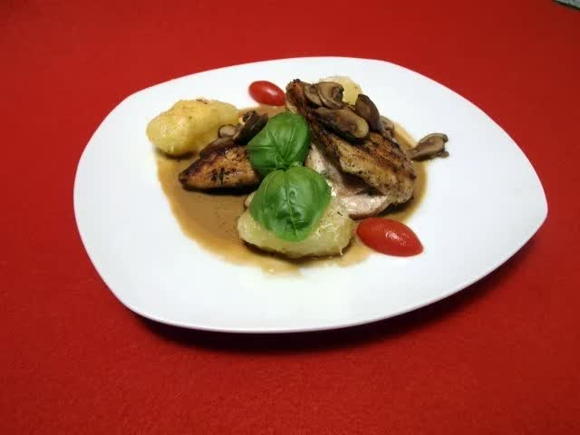

# Hähnchenbrust Saltimbocca mit Champignon-Sherry-Soße und Parmesankartoffeln

- **Rezept:** Hähnchenbrust Saltimbocca mit Champignon-Sherry-Soße und Parmesankartoffeln
- **Quelle:** [kochbar.de](https://www.kochbar.de/rezept/468101/Haehnchenbrust-Saltimbocca-mit-Champignon-Sherry-Sosse-und-Parmesankartoffeln.html)
- **Rezeptor:** *Das perfekte Dinner* (von)
- **Bewertung:** 5/5 (2 Bewertungen)
- **Zeit:** 45 Min. Gesamtzeit · **Schwierigkeit:** einfach (2)
- **Für:** 4 Portionen · **Erstellt:** 23.05.2013
- **Nährwerte (pro 100 g):** 407 kJ / 97 kcal · 13,2 g Eiweiß · 0,9 g KH · 4,3 g Fett

## Zutaten (für 4 Personen)

- Hähnchenbrustfilet — 300 g
- Salz und Pfeffer — 1 Prise
- Parmaschinken — 2 Scheiben
- Salbei-Blätter — 4 Stück
- Butter — 1 EL
- Öl — 1 EL
- Champignons — 250 g
- Brühwürfel — 1 Stück
- Sherry trocken — 1 EL
- Petersilie — 1 Bund
- Sahne — 50 ml

## Zubereitung

1. **Füllen:** Die Hähnchenbrusthälften salzen, pfeffern und in jede eine lange Tasche schneiden. Parmaschinken und Salbei-Blätter in die Taschen schieben und Taschen gut zudrücken (feststecken nicht nötig).
2. **Braten:** Öl mit Butter in einer Pfanne erhitzen und Hähnchenbrusthälften bei mittlerer bis niedriger Temperatur von beiden Seiten langsam braten (etwa 10 Minuten). Hähnchen aus der Pfanne nehmen und warm stellen.
3. **Soße:** Champignons putzen, vierteln und etwa 5 Minuten im Bratensatz anbraten, dann ebenfalls herausnehmen. Den Bratensatz mit etwa 250 ml Wasser und dem Brühwürfel aufkochen. Sherry, gehackte Petersilie und Sahne unterrühren, die Champignons hineingeben und kurz erhitzen. Hähnchen darauf setzen und in der Pfanne servieren.
4. **Beilage:** Dazu passt Kartoffelpüree oder Pasta.

## Kommentare

- 5 von 5 Sternen bei 2 Bewertungen.

---
*Einfaches Pfannenrezept — schnelle Hauptgerichte für 4 Personen.*
