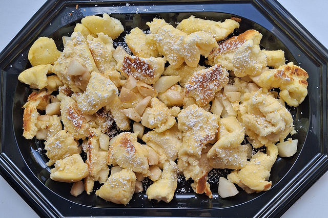
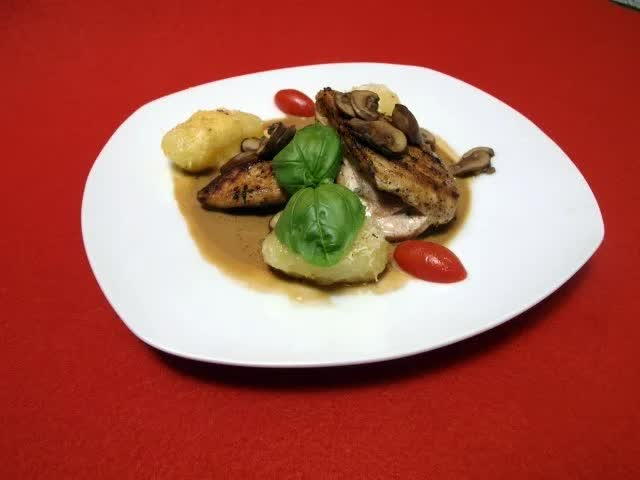

# Rezeptesammlung

Übersicht der gesammelten Rezepte (alphabetisch sortiert).

| Titel                                                                                                        | Vorschau                                                                                                          | Autor               | Quelle                                                                                                                                |
| ------------------------------------------------------------------------------------------------------------ | ----------------------------------------------------------------------------------------------------------------- | ------------------- | ------------------------------------------------------------------------------------------------------------------------------------- |
| [Birnenschmarrn (Ofenvariante)](birnenschmarrn.md)                                                           |                         | Betzedackel         | [Chefkoch](https://www.chefkoch.de/rezepte/3196561475769275/Birnenschmarrn.html)                                                      |
| [Hähnchenbrust Saltimbocca mit Champignon-Sherry-Soße und Parmesankartoffeln](haehnchenbrust-saltimbocca.md) |  | Das perfekte Dinner | [kochbar.de](https://www.kochbar.de/rezept/468101/Haehnchenbrust-Saltimbocca-mit-Champignon-Sherry-Sosse-und-Parmesankartoffeln.html) |
|                                                                                                              |                                                                                                                   |                     |                                                                                                                                       |
