| Icon | Bild                                                                                                                                                                                           | Titel                                                                                                                                    | Autor               | Quelle                                                                                                                                |
| ---- | ---------------------------------------------------------------------------------------------------------------------------------------------------------------------------------------------- | ---------------------------------------------------------------------------------------------------------------------------------------- | ------------------- | ------------------------------------------------------------------------------------------------------------------------------------- |
| ❓    | 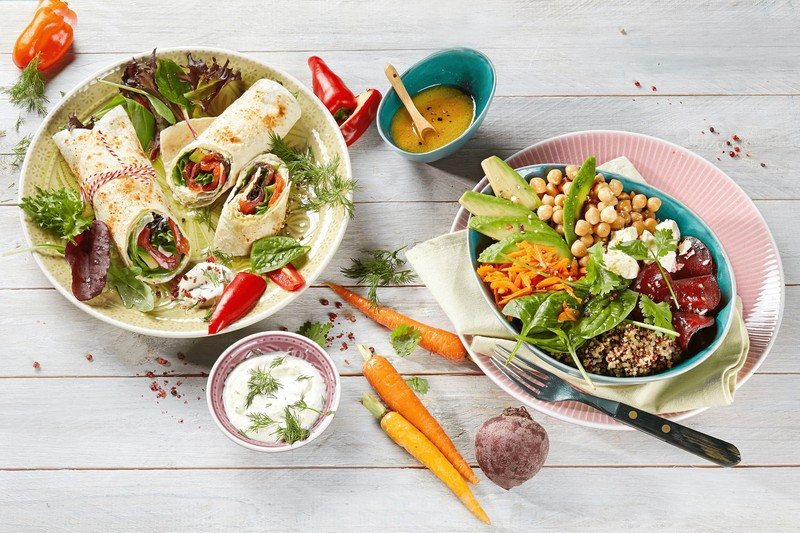                                                                            | [Avocado Wrap mit Dill-Dip](rezepte/avocado-wrap-dill-dip.md)                                                                            | REWE                | [REWE](https://www.rewe.de/rezepte/avocado-wrap-dill-dip/)                                                                            |
| ✅    |                                                                                               | [Birnenschmarrn (Ofenvariante)](rezepte/birnenschmarrn.md)                                                                               | Betzedackel         | [Chefkoch](https://www.chefkoch.de/rezepte/3196561475769275/Birnenschmarrn.html)                                                      |
| ✅    | 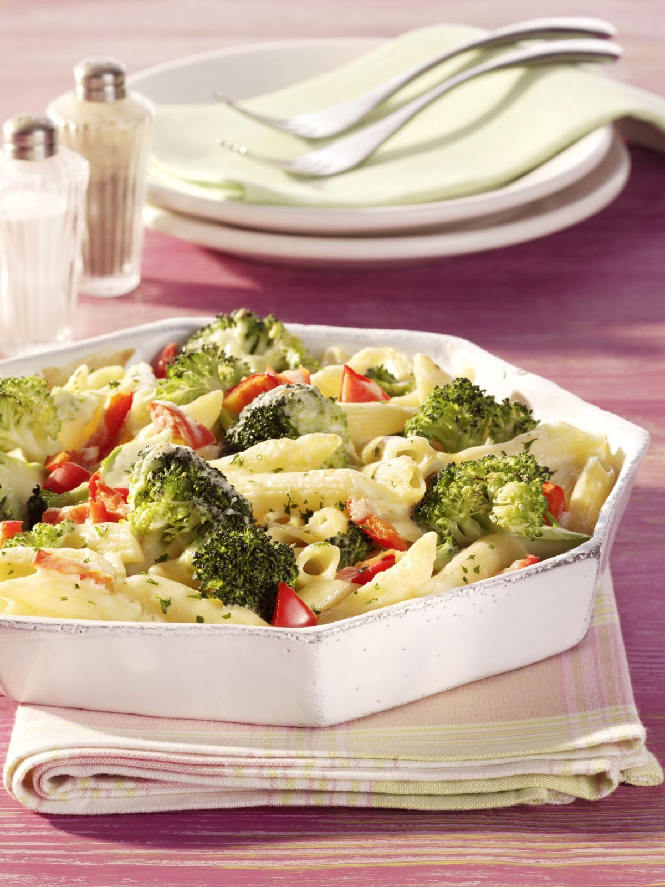                                                                              | [Brokkoli-Nudel-Auflauf](rezepte/brokkoli-nudel-auflauf.md)                                                                              | —                   | [EAT SMARTER](https://eatsmarter.de/rezepte/brokkoli-nudel-auflauf)                                                                   |
| ✅    | 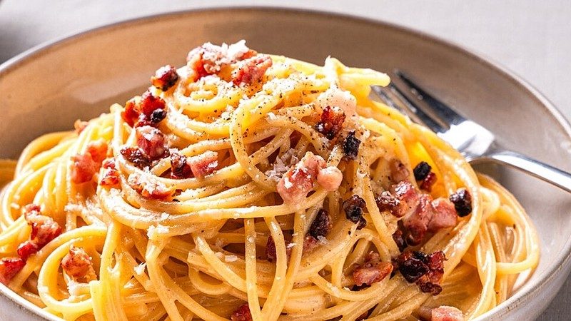                                                      | [Carbonara wie bei der Mamma in Rom](rezepte/carbonara-wie-bei-der-mamma-in-rom.md)                                                      | —                   | [Chefkoch](https://www.chefkoch.de/rezepte/1298241234947062/Carbonara-wie-bei-der-Mamma-in-Rom.html)                                  |
| ✅    | 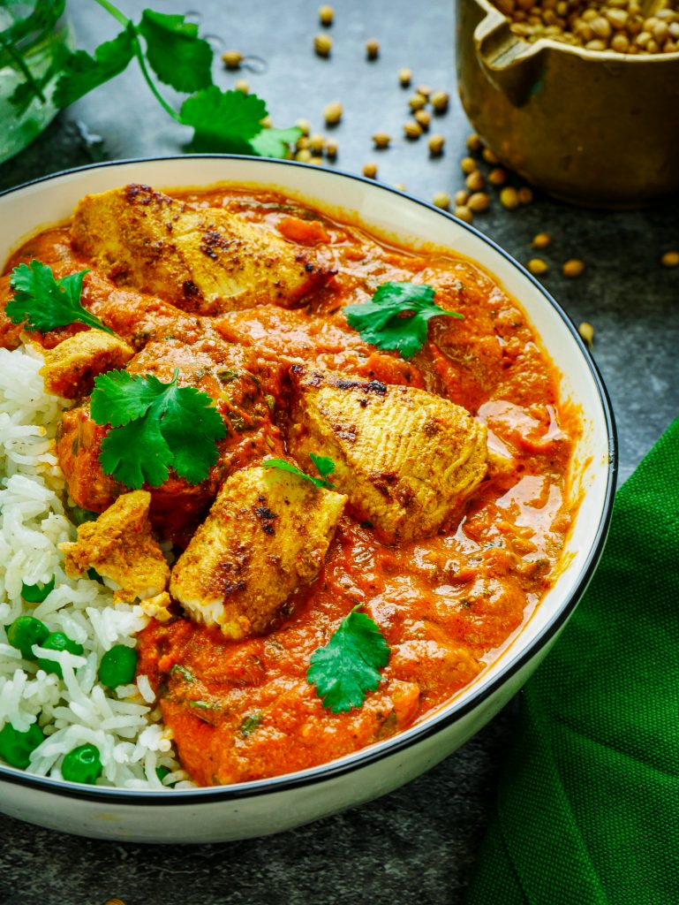                                                                                  | [Chicken Tikka Masala](rezepte/chicken-tikka-masala.md)                                                                                  | Shiba               | [Shibas Kitchen](https://shibaskitchen.de/chicken-tikka-masala/)                                                                      |
| ❓    | 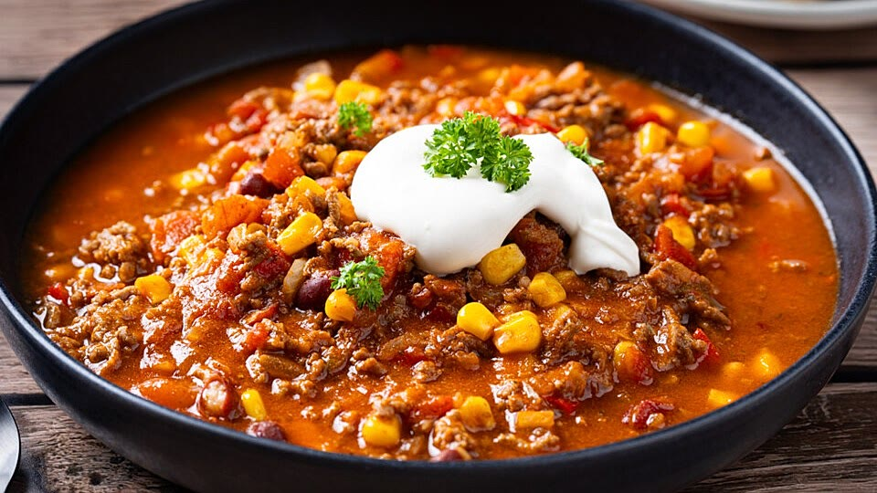                                                                                            | [Chili con Carne](rezepte/chili-con-carne.md)                                                                                            | —                   | [Chefkoch](https://www.chefkoch.de/rezepte/1578671265353584/Chili-con-Carne.html)                                                     |
| ✅    | 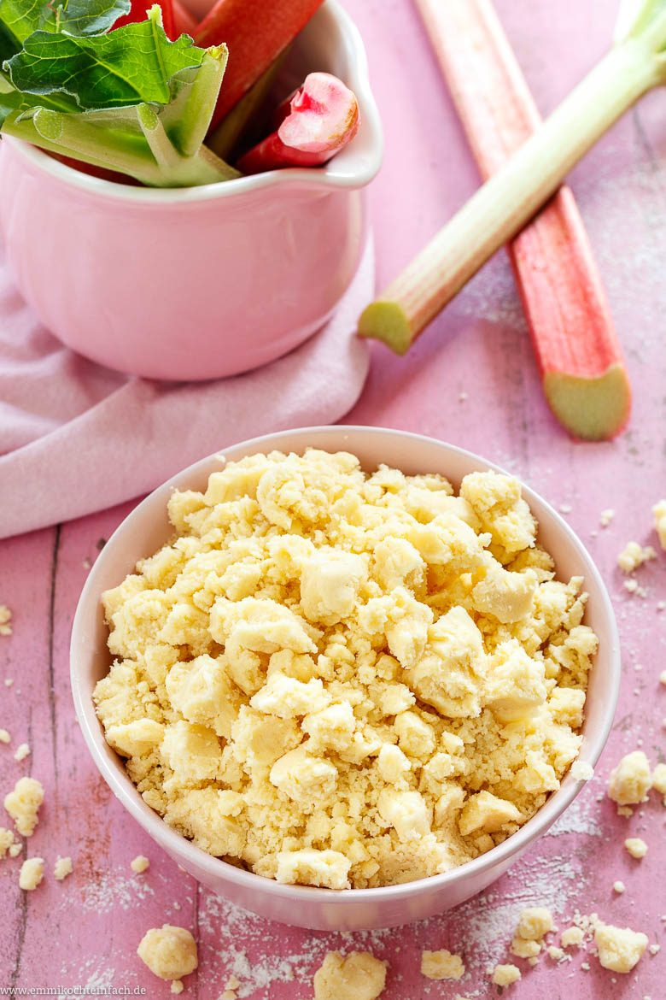                                                                          | [Einfacher Rhabarber Streuselkuchen](rezepte/rhabarber-streuselkuchen.md)                                                                | Emmi                | [Emmikochteinfach](https://emmikochteinfach.de/einfacher-rhabarber-streuselkuchen/)                                                   |
| ✅    | 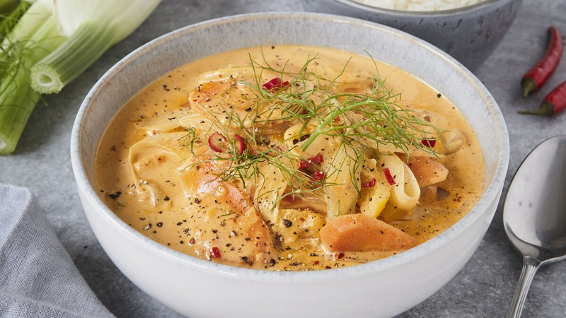                                                              | [Fenchel-Curry – einfach & lecker](rezepte/fenchel-curry-einfach-lecker.md)                                                              | —                   | [Eatbetter](https://www.eatbetter.de/rezepte/fenchel-curry-einfach-lecker)                                                            |
| ❓    | 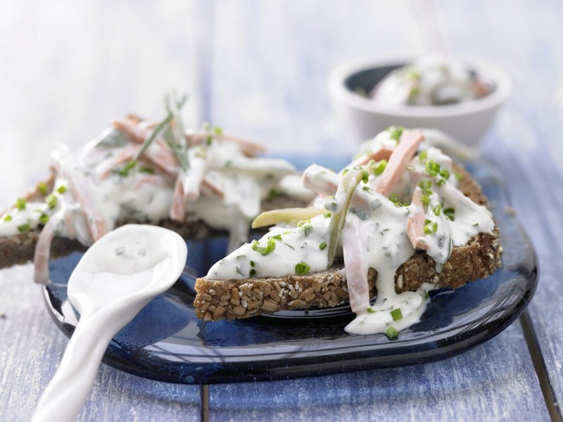                                                                           | [Fleischsalat mit Kräutern](rezepte/fleischsalat-kraeutern.md)                                                                           | —                   | [EAT SMARTER](https://eatsmarter.de/rezepte/fleischsalat-kraeutern)                                                                   |
| ❓    | 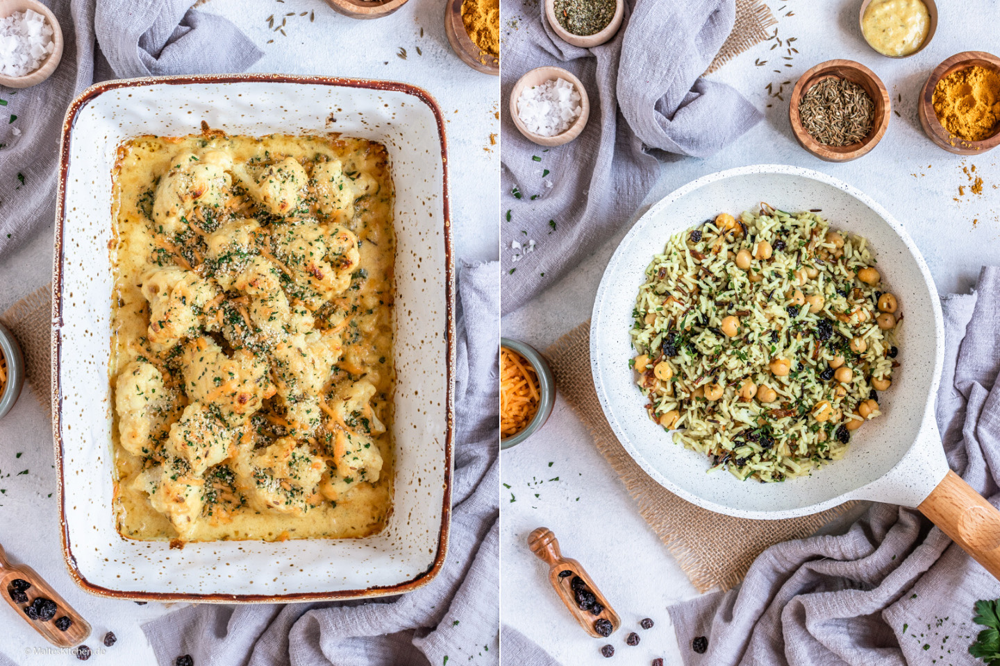 | [Gebackener Blumenkohl mit Käse-Sahne-Soße, Reis und Kichererbsen](rezepte/gebackener-blumenkohl-kaese-sahne-sauce-reis-kichererbsen.md) | —                   | [Maltes Kitchen](https://www.malteskitchen.de/gebackener-blumenkohl-kaese-sahne-sauce-reis-kichererbsen/)                             |
| ✅    | 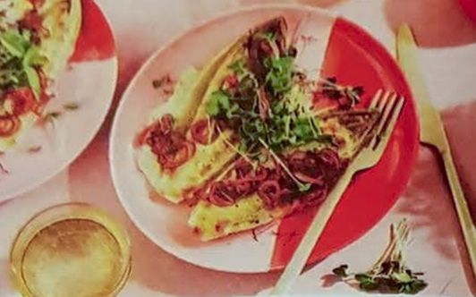                                                         | [Gebackener Chicoree mit Bergkäse](rezepte/gebackener-chicoree-mit-bergkaese.md)                                                         |                     | Schrot u. Korn                                                                                                                        |
| ❓    | 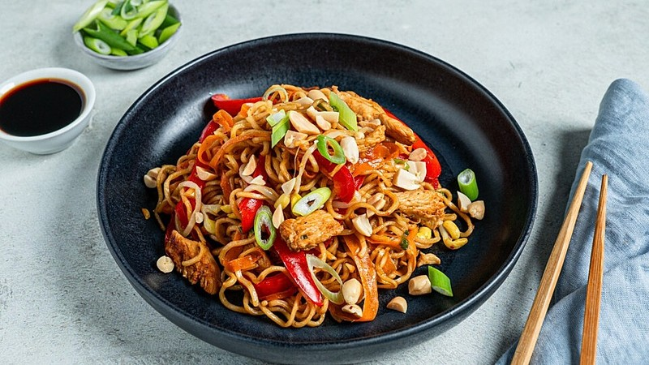                                                               | [Gebratene Asia-Nudeln mit Hähnchen (High Protein)](rezepte/asia-nudeln-mit-haehnchen.md)                                                | Chefkoch_ChristinaS | [Chefkoch](https://www.chefkoch.de/rezepte/4413171770025296/Gebratene-Asia-Nudeln-mit-Haehnchen-High-Protein.html)                    |
| ✅    | 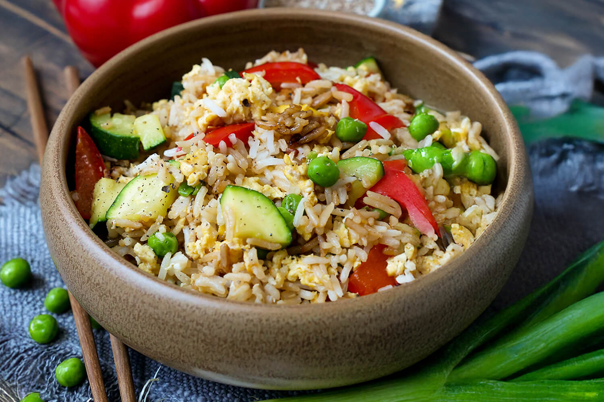                                                       | [Gebratener Reis mit Gemüse und Ei](rezepte/gebratener-reis-mit-gemuese-und-ei.md)                                                       | —                   | [Gaumenfreundin](https://www.gaumenfreundin.de/gebratener-reis-mit-gemuese-und-ei/)                                                   |
| ❓    | 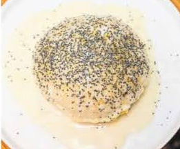                                                                                                     | [Germknödel](rezepte/germknoedel.md)                                                                                                     |                     | ?                                                                                                                                     |
| ❓    | 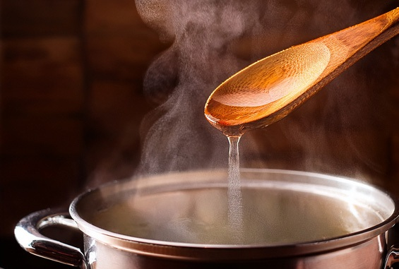                                                                                   | [Gesines Gemüsetarte](rezepte/gesines-gemuesetarte.md)                                                                                   |                     |                                                                                                                                       |
| ✅    | 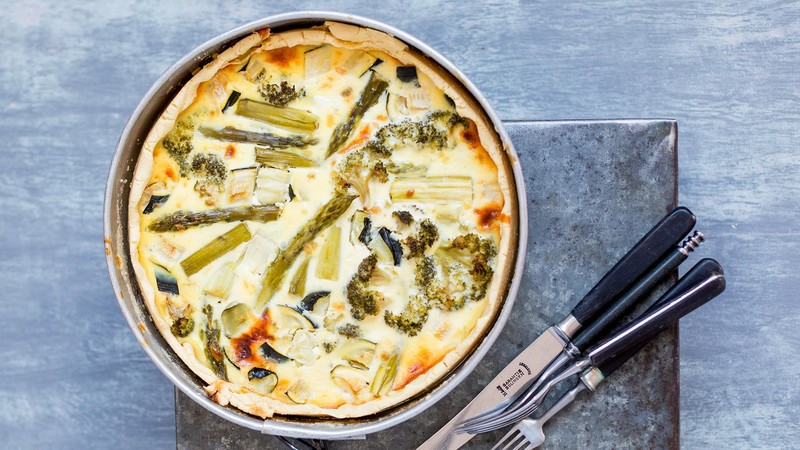                                                                                    | [Grüne Gemüse-Tarte](rezepte/gruene-gemuese-tarte.md)                                                                                    | —                   | [NDR — Die Ernährungs-Docs](https://www.ndr.de/ratgeber/kochen/rezepte/Gruene-Gemuese-Tarte,rezept3992.html)                          |
| ✅    | 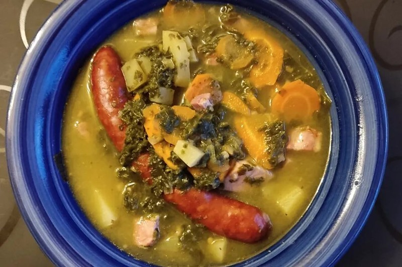                                                               | [Grünkohleintopf mit Kassler](rezepte/gruenkohleintopf-mit-kasseler.md)                                                                  | —                   | [Chefkoch](https://www.chefkoch.de/rezepte/674671169743414/Gruenkohleintopf-mit-Kasseler.html)                                        |
| ✅    |                                                                        | [Hähnchenbrust Saltimbocca mit Champignon-Sherry-Soße und Parmesankartoffeln](rezepte/haehnchenbrust-saltimbocca.md)                     | Das perfekte Dinner | [kochbar.de](https://www.kochbar.de/rezept/468101/Haehnchenbrust-Saltimbocca-mit-Champignon-Sherry-Sosse-und-Parmesankartoffeln.html) |
| ❓    | 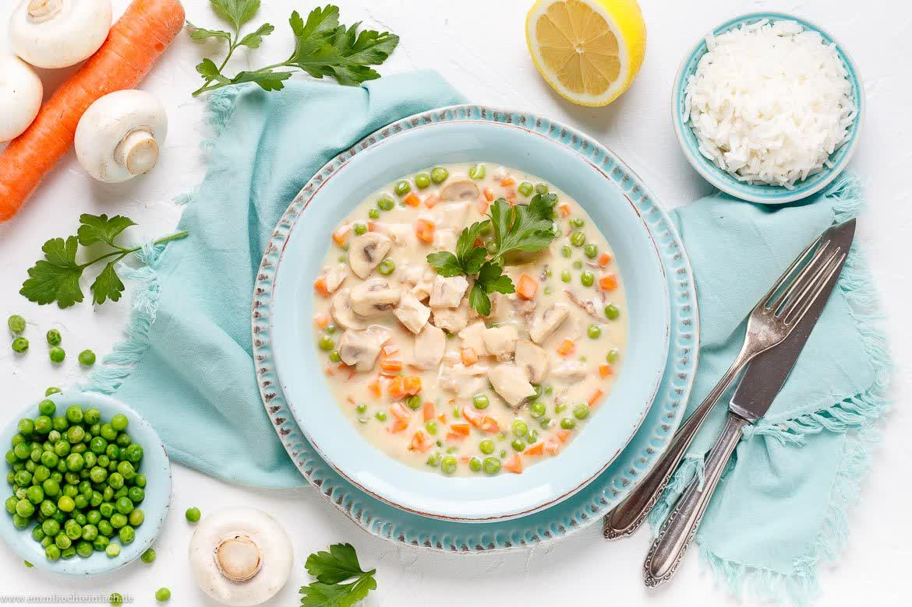                                 | [Hühnerfrikassee – schnell und einfach gemacht](rezepte/huehnerfrikassee-schnell-und-einfach-gemacht.md)                                 | Emmi                | [Emmikochteinfach](https://emmikochteinfach.de/huehnerfrikassee-schnell-und-einfach-gemacht/)                                         |
| ❓    | 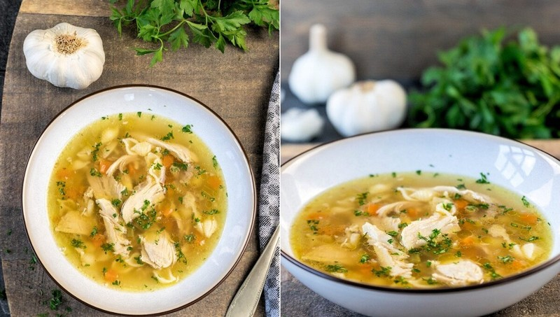                                                       | [Hühnersuppe mit Nudeln & Knoblauch](rezepte/huehnersuppe-mit-nudeln-knoblauch.md)                                                       | —                   | [Maltes Kitchen](https://www.malteskitchen.de/huehnersuppe-nudeln-knoblauch/)                                                         |
| ❓    | 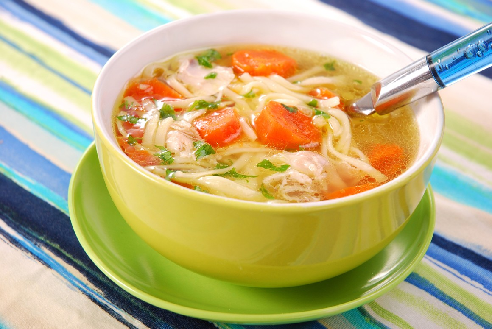                                                                               | [Hühnertopf mit Nudeln](rezepte/huehnertopf-mit-nudeln.md)                                                                               | —                   | [Gutekueche.de](https://www.gutekueche.de/huehnertopf-mit-nudeln-rezept-458)                                                          |
| ❓    | 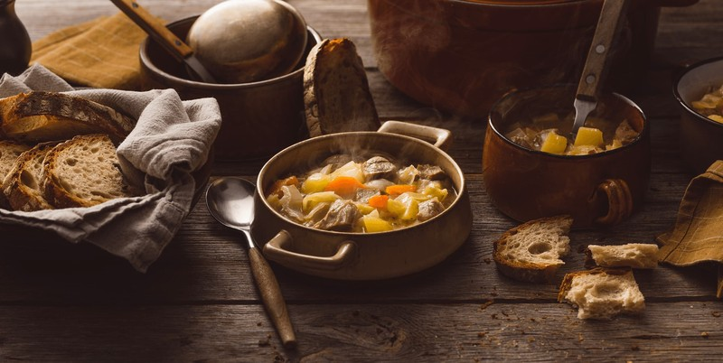                                                                                                      | [Irish Stew](rezepte/irish-stew.md)                                                                                                      | REWE                | [REWE](https://www.rewe.de/rezepte/irish-stew/)                                                                                       |
| ❓    | 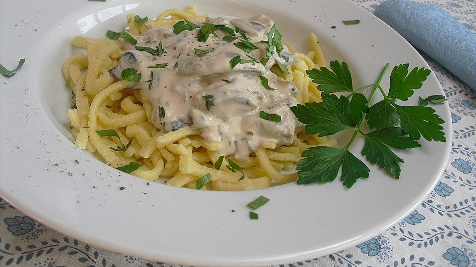                                              | [Italienische Parmesan-Champignon-Sauce](rezepte/italienische-parmesan-champignon-sauce.md)                                              | bennael             | [Chefkoch](https://www.chefkoch.de/rezepte/2821241434191973/Italienische-Parmesan-Champignon-Sauce.html)                              |
| ❓    | 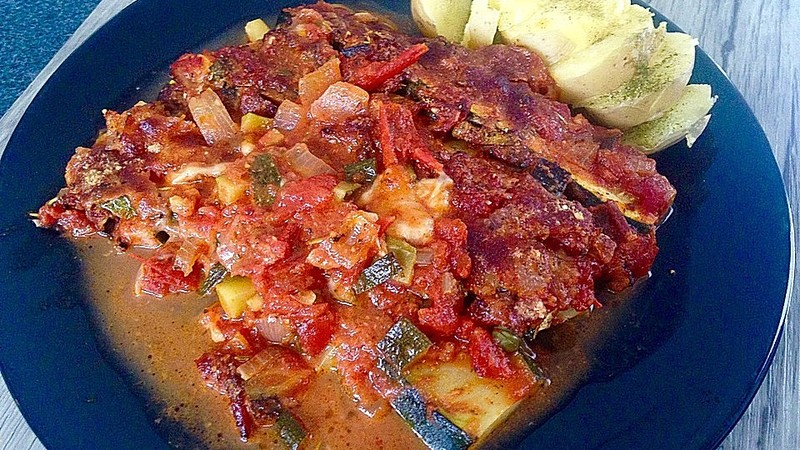                                                          | [Italienische Zucchini-Parmigiana](rezepte/italienische-zucchini-parmigiana.md)                                                          | —                   | [Chefkoch](https://www.chefkoch.de/rezepte/246841098487503/Italienische-Zucchini-Parmigiana.html)                                     |
| ❓    | 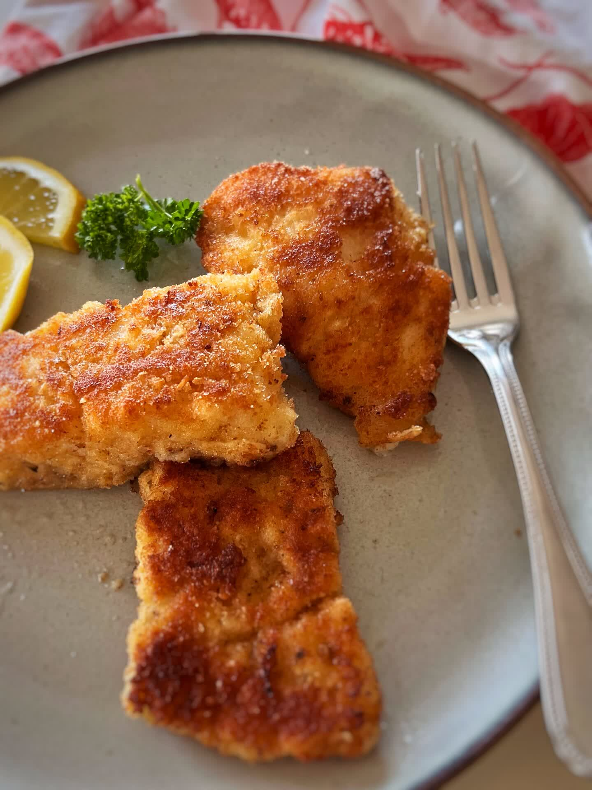                                                                                         | [Kabeljau, paniert](rezepte/kabeljau-paniert.md)                                                                                         | —                   | [Sabrina's Table](https://sabrinastable.com/de/kabeljau-paniert-schmeckt-er-noch-besser/)                                             |
| ✅    | 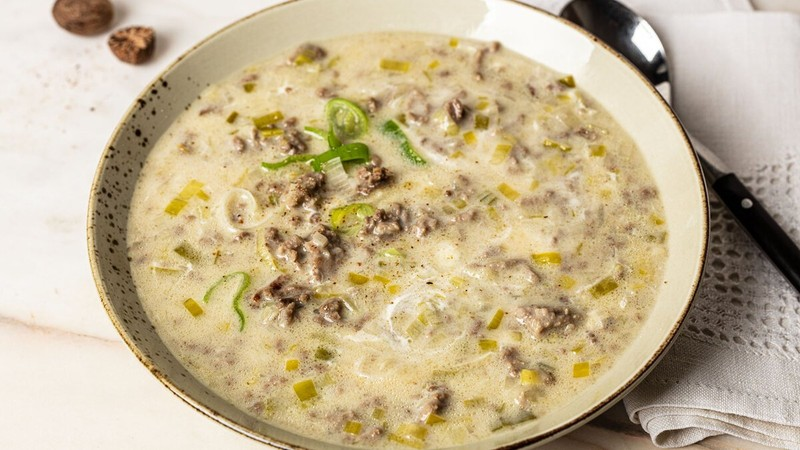                                                         | [Käse-Lauch-Suppe mit Hackfleisch – nach Omas Rezept](rezepte/kaese-lauch-suppe-mit-hackfleisch.md)                                      | Einfach Kochen      | [Einfach Kochen](https://www.einfachkochen.de/rezepte/kaese-lauch-suppe-mit-hackfleisch?portions=4)                                   |
| ✅    | 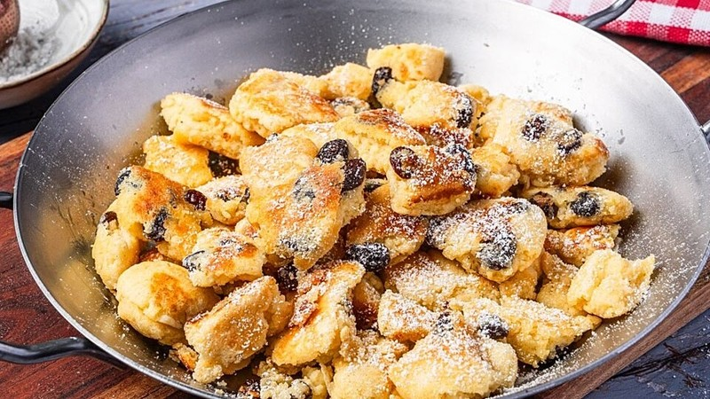                                              | [Kaiserschmarrn (Tiroler Landgasthof)](rezepte/kaiserschmarrn-tiroler-landgasthofrezept.md)                                              | —                   | [Chefkoch](https://www.chefkoch.de/rezepte/1031841208350942/Kaiserschmarrn-Tiroler-Landgasthofrezept.html)                            |
| ✅    | 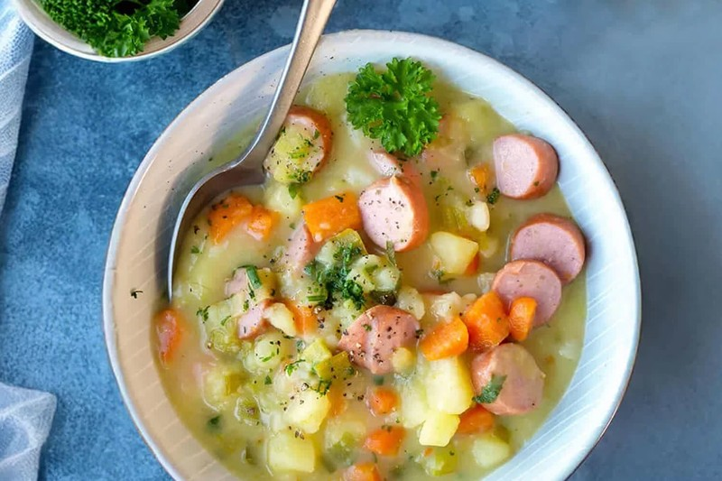                                                                 | [Kartoffelsuppe mit Würstchen](rezepte/kartoffelsuppe-mit-wuerstchen.md)                                                                 | —                   | [Gaumenfreundin](https://www.gaumenfreundin.de/ganz-einfache-kartoffelsuppe-mit-wuerstchen-und-suppengemuese/)                        |
| ❓    |                                                             | [Knabberzeug aus Hülsenfrüchten](rezepte/knabberzeug-aus-huelsenfruechten.md)                                                            |                     | -                                                                                                                                     |
| ✅    | 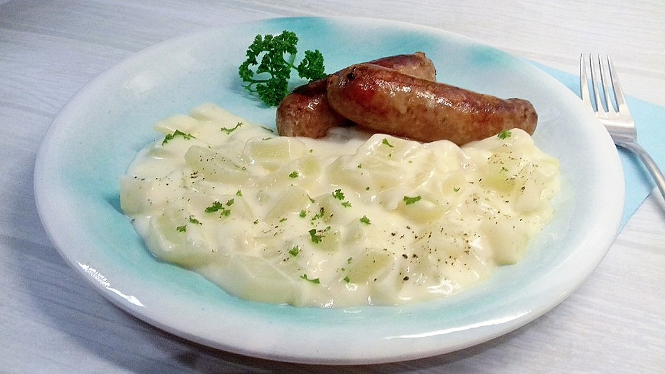                                                                        | [Kohlrabigemüse, klassisch](rezepte/kohlrabigemuese-klassisch.md)                                                                        | —                   | [Chefkoch](https://www.chefkoch.de/rezepte/513871147148871/Kohlrabigemuese-klassisch.html)                                            |
| ✅    | 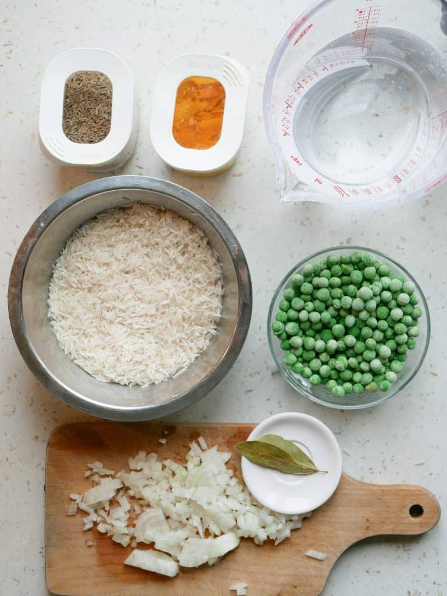                                                                                       | [Kurkuma Reis mit Erbsen (Mamas Rezept)](rezepte/kurkuma-reis.md)                                                                        | Shiba               | [Shibas Kitchen](https://shibaskitchen.de/kurkuma-reis/)                                                                              |
| ❓    | 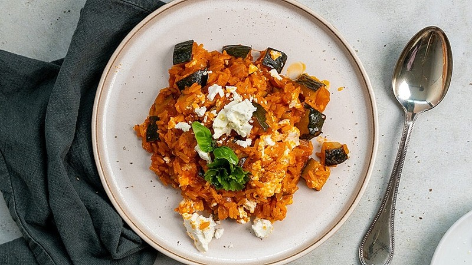                                                                    | [Mediterrane Zucchini-Pfanne](rezepte/mediterrane-zucchini-pfanne.md)                                                                    | Chefkoch            | [Chefkoch](https://www.chefkoch.de/rezepte/1131861219575913/Mediterrane-Zucchini-Pfanne.html)                                         |
| ✅    | 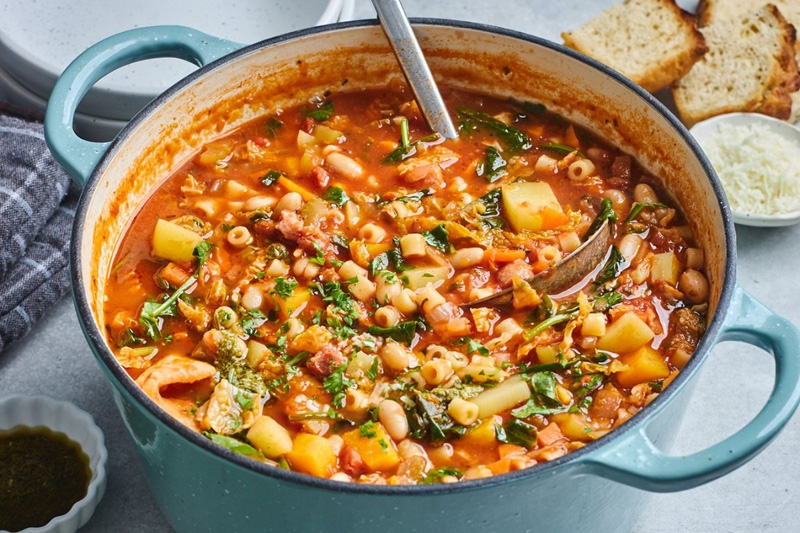                                                                                                      | [Minestrone](rezepte/minestrone.md)                                                                                                      | —                   |                                                                                                                                       |
| ❓    | 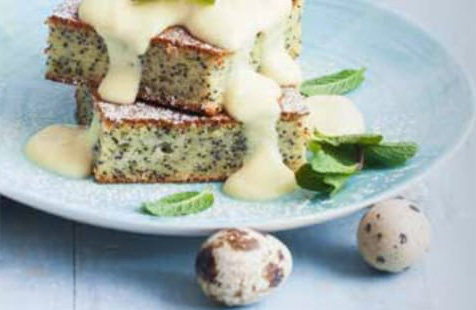                                                                                  | [Mohn Griess Soufflee](rezepte/mohn-griess-soufflee.md)                                                                                  |                     | -                                                                                                                                     |
| ✅    | 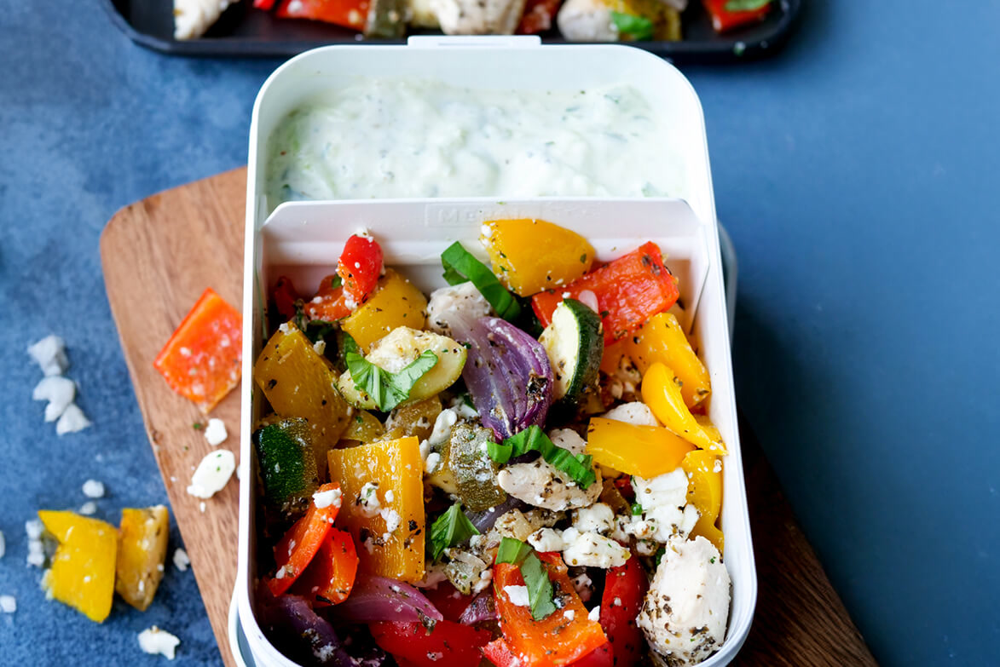                                                                          | [Ofengemüse mit Hähnchen](rezepte/ofengemuese-mit-haehnchen.md)                                                                          | —                   | [Gaumenfreundin](https://www.gaumenfreundin.de/ofengemuese-mit-haehnchen/)                                                            |
| ✅    | 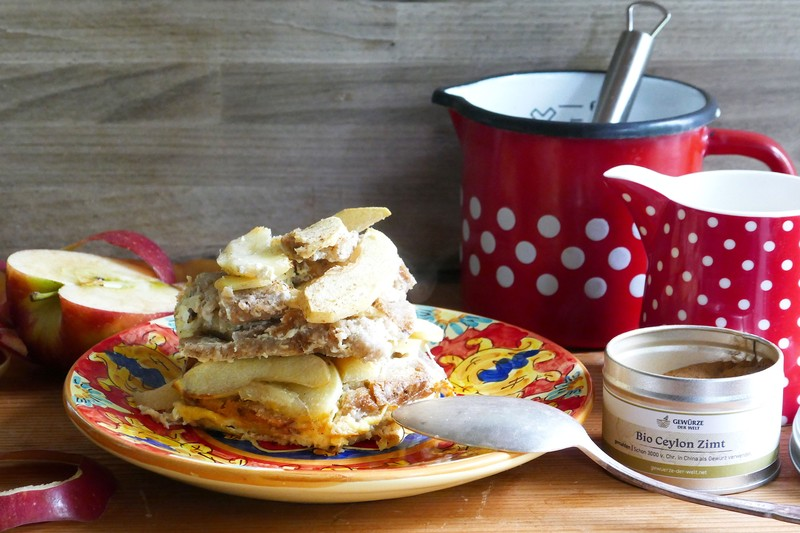                                                                                                | [Ofenschlupfer](rezepte/ofenschlupfer.md)                                                                                                | Gewürze der Welt    | [Gewürze der Welt](https://www.gewuerze-der-welt.net/rezepte/hauptgang/ofenschlupfer)                                                 |
| ✅    | 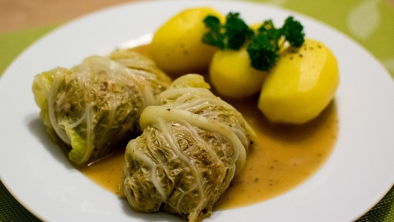                                                                                        | [Omas Kohlrouladen](rezepte/kohlrouladen-omas.md)                                                                                        | —                   | [Chefkoch](https://www.chefkoch.de/rezepte/426431133556910/Omas-Kohlrouladen.html)                                                    |
| ❓    | 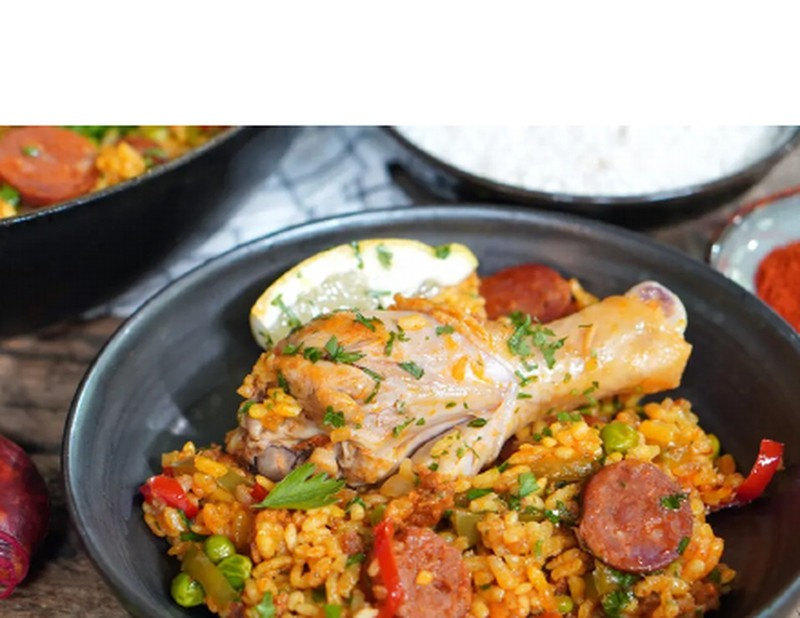                                                                    | [Paella mit Huhn und Chorizo](rezepte/paella-mit-huhn-und-chorizo.md)                                                                    | Emmi                | [NDR — Die Ernährungs-Docs](https://www.ndr.de/ratgeber/kochen/rezepte/Paella-mit-Huhn-und-Chorizo)                                   |
| ✅    |                                                                     | [Pasta in cremiger Pilzsauce](rezepte/pasta-in-cremiger-pilzsauce.md)                                                                    | Untrennbar          | [Chefkoch](https://www.chefkoch.de/rezepte/2647841416081307/Pasta-in-cremiger-Pilzsauce.html)                                         |
| ❓    | 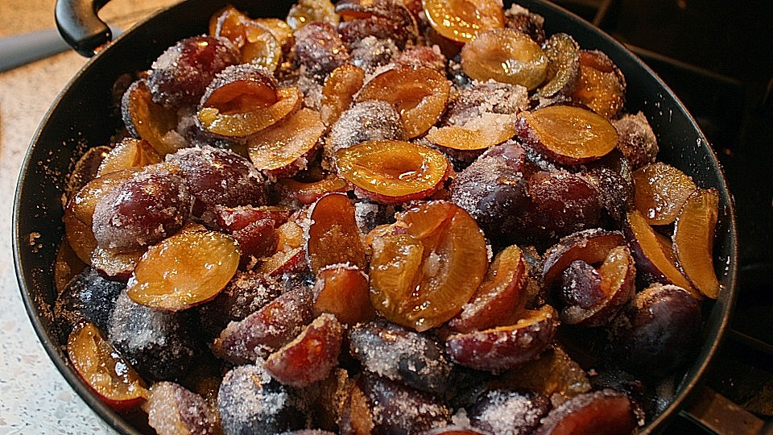                                                                            | [Pflaumenmus im Backofen](rezepte/pflaumenmus-im-backofen.md)                                                                            | Backliesel80        | [Chefkoch](https://www.chefkoch.de/rezepte/1529851258462100/Pflaumenmus-im-Backofen.html)                                             |
| ❓    | 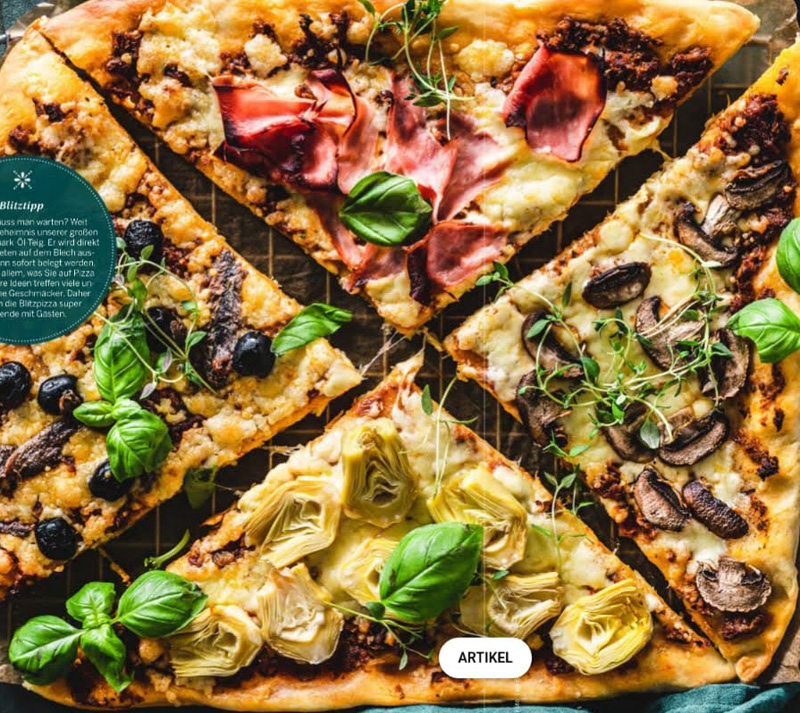                                                                                    | [Pizza mit Quarkteig](rezepte/pizza-mit-quarkteig.md)                                                                                    |                     | -                                                                                                                                     |
| ✅    | 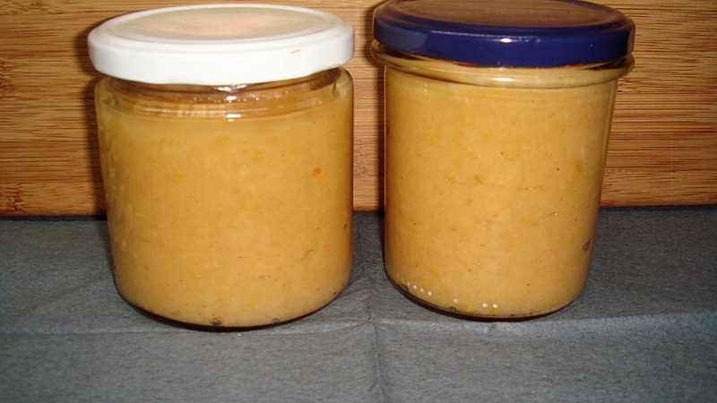                                                                                                      | [Quittenmus](rezepte/quittenmus.md)                                                                                                      | —                   | ???                                                                                                                                   |
| ❓    | 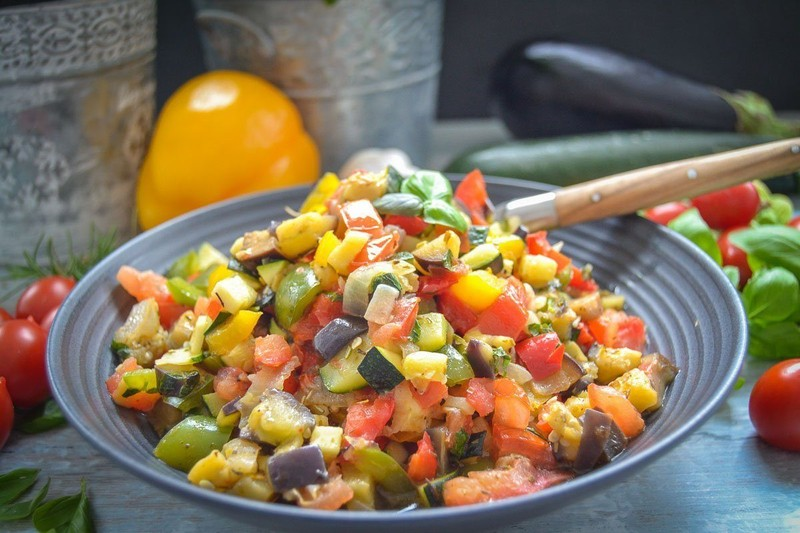                                              | [Ratatouille Rezept](rezepte/ratatouille-rezept-einfach-original-franzoesisches-gemuese.md)                                              | —                   | [Kochen aus Liebe](https://kochenausliebe.com/ratatouille-rezept-einfach-original-franzoesisches-gemuese/)                            |
| ✅    | 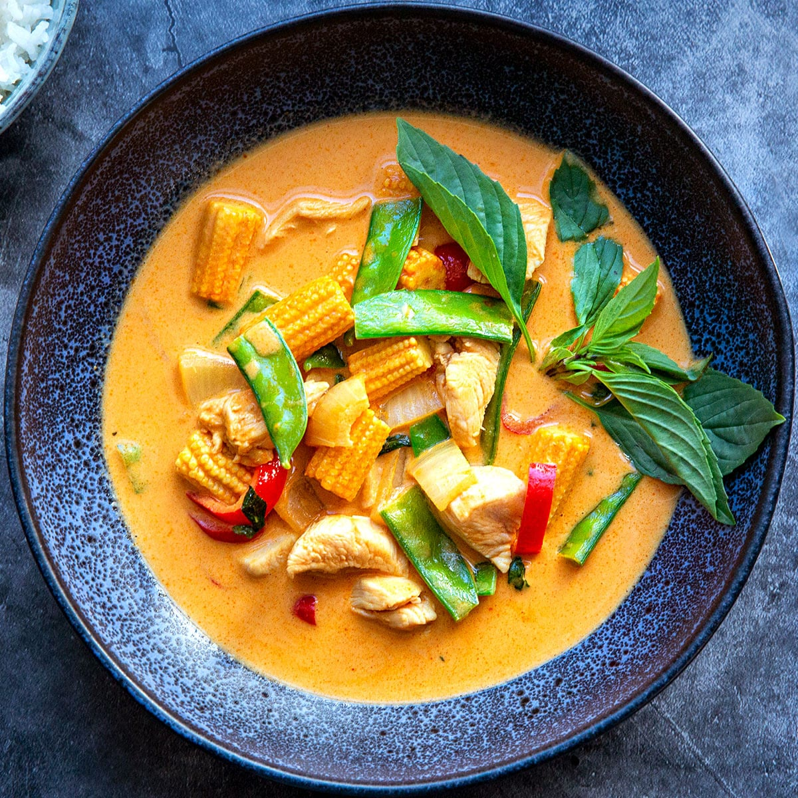                                                                        | [Rotes Thai-Curry mit Huhn](rezepte/rotes-thai-curry-mit-huhn.md)                                                                        | —                   | [Madame Cuisine](https://www.madamecuisine.de/rotes-thai-curry-mit-huhn/)                                                             |
| ✅    | 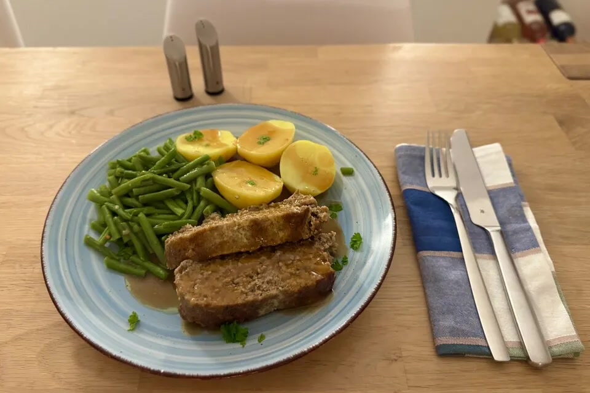                                                                 | [Saftiger Hackbraten mit Soße](rezepte/saftiger-hackbraten-mit-sosse.md)                                                                 | —                   | [Chefkoch](https://www.chefkoch.de/rezepte/2562321401087811/Saftiger-Hackbraten-mit-Sosse.html?portionen=4)                           |
| ✅    | 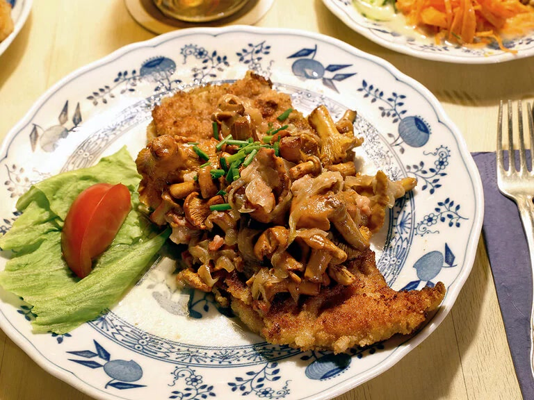                                                                    | [Schnitzel mit Pfifferlingen](rezepte/schnitzel-mit-pfifferlingen.md)                                                                    | —                   | [DasKochrezept.de](https://www.daskochrezept.de/rezepte/schnitzel-mit-pfifferlingen)                                                  |
| ✅    | 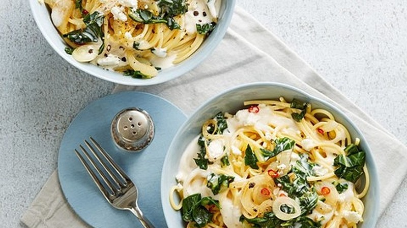                                                            | [Spaghetti mit Mangold-Fetacreme](rezepte/spaghetti-mit-mangold-fetacreme.md)                                                            | —                   | [Chefkoch](https://www.chefkoch.de/rezepte/1279611233327827/Spaghetti-mit-Mangold-Fetacreme.html)                                     |
| ✅    | 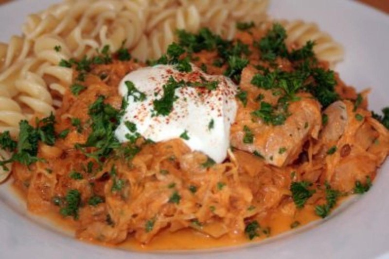                                                                                      | [Szegediner Gulasch](rezepte/szegediner-gulasch.md)                                                                                      | —                   | [Kochbar](https://www.kochbar.de/rezept/295405/Szegediner-Gulasch.html?personen=4)                                                    |
| ✅    | 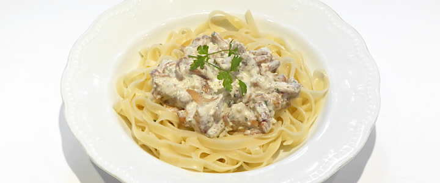                                                                        | [Tagliatelle ai Cantarelli (Bandnudeln mit Pfifferlingen)](rezepte/tagliatelle-ai-cantarelli.md)                                         | —                   | [A-I-K.de](https://authentisch-italienisch-kochen.de/tagliatelle-ai-cantarelli/)                                                      |
| ✅    |                                                             | [Tagliatelle mit Sahne-Pilzsauce](rezepte/tagliatelle-mit-sahne-pilzsauce.md)                                                            | —                   | [Chefkoch](https://www.chefkoch.de/rezepte/451841137638782/Tagliatelle-mit-Sahne-Pilzsauce.html)                                      |
| ✅    | 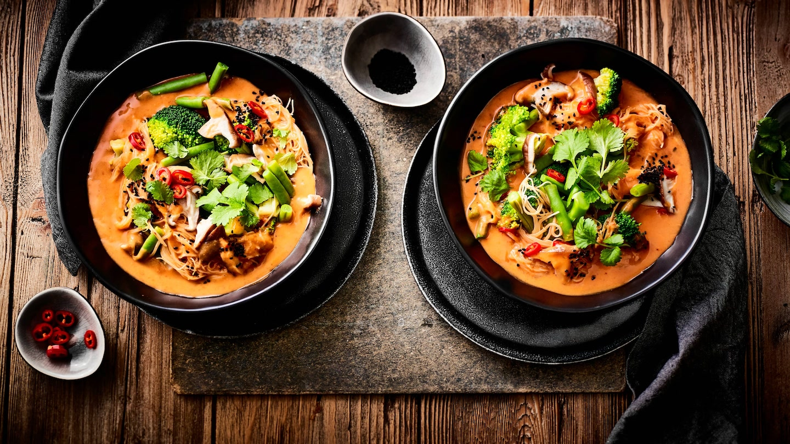                                                                                | [Thai-Curry mit Nudeln](rezepte/thai-curry-mit-nudeln.md)                                                                                | —                   | [EDEKA](https://www.edeka.de/rezeptwelt/rezepte/thai-curry-mit-nudeln/)                                                               |
| ❓    | 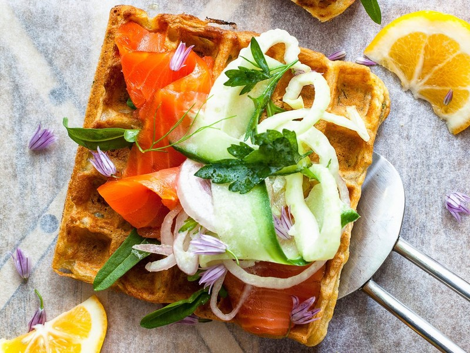                                                                                        | [Waffeln mit Lachs](rezepte/waffeln-mit-lachs.md)                                                                                        | —                   | [EAT SMARTER](https://eatsmarter.de/rezepte/waffeln-mit-lachs)                                                                        |
| ✅    | 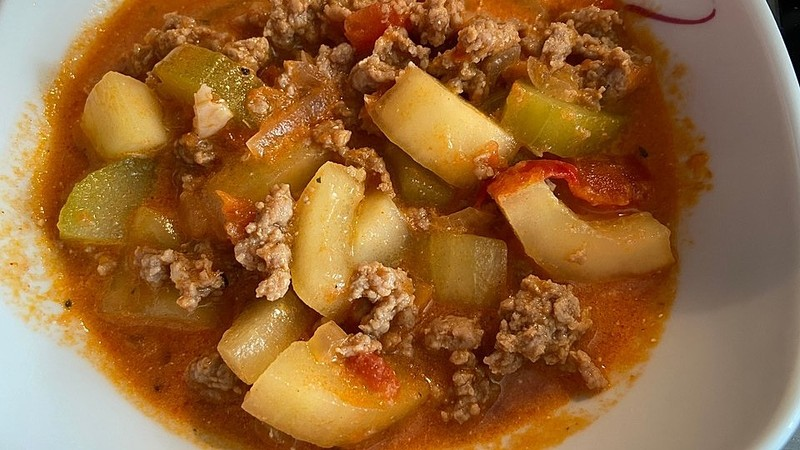                                                          | [Würzige Schmorgurken mit Hackfleisch](rezepte/schmorgurken-mit-hackfleisch.md)                                                          | Manuela-Kyra        | [Chefkoch](https://www.chefkoch.de/rezepte/3919151598352228/Wuerzige-Schmorgurken-mit-Hackfleisch.html?portionen=4)                   |
| ✅    | 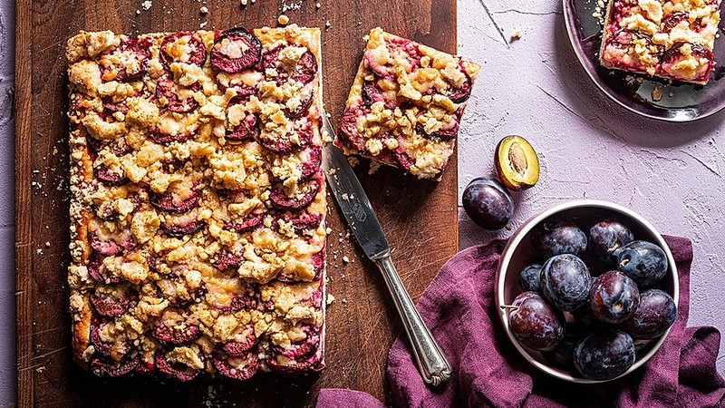                                                | [Zwetschgendatschi mit Butterstreuseln](rezepte/zwetschgendatschi-mit-butterstreuseln.md)                                                | —                   | [Chefkoch](https://www.chefkoch.de/rezepte/1476331252838756/Zwetschgendatschi-mit-Butterstreuseln.html)                               |
| ❓     | 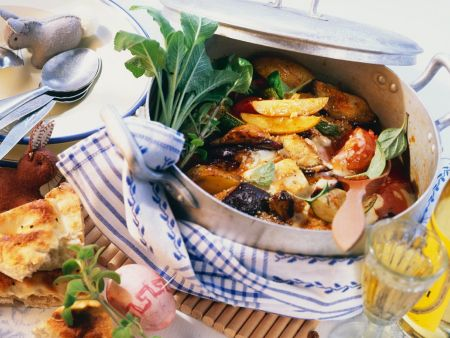 | [Mediterranes Schmorgemüse](rezepte/mediterranes-schmorgemuese.md) | EAT SMARTER | [EAT SMARTER](https://eatsmarter.de/rezepte/mediterranes-schmorgemuese)
