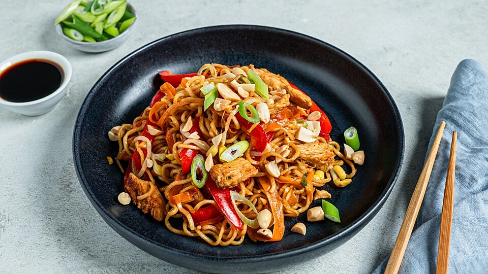

# Gebratene Asia-Nudeln mit Hähnchen (High Protein)

- **Rezept:** Gebratene Asia-Nudeln mit Hähnchen (High Protein)
- **Rezeptor:** *Chefkoch_ChristinaS*
- **Quelle:** [Chefkoch](https://www.chefkoch.de/rezepte/4413171770025296/Gebratene-Asia-Nudeln-mit-Haehnchen-High-Protein.html)
- **Bewertung:** 4,6/5 (26 Bewertungen)
- **Arbeitszeit:** 10 Min. · **Gesamtzeit:** 20 Min. · **Schwierigkeit:** Simpel
- **Für:** 4 Portionen · **Erstellt:** 02.02.2026
- **Allergene:** Gluten · Erdnüsse · Soja · Sesam
- **Nährwerte:** 784 kcal / Portion

## Zutaten (für 4 Portionen)

- 600 g Hähnchenbrustfilet(s)
- 2 EL Pflanzenöl
- 360 g Mie-Nudeln
- 2 Paprikaschote(n), rote
- 4 Lauchzwiebel(n)
- 2 Karotte(n)
- 200 g Mungobohnenkeimlinge
- 30 g Erdnüsse, gehackt
- 8 EL Sojasauce
- 4 EL Sesamöl
- 2 Prise(n) Zucker n. B.
- Salz und Pfeffer n. B.

## Zubereitung

1. **Vorbereiten:** Das Gemüse und das Fleisch waschen und trocken tupfen. Die Karotte fein raspeln und die Paprika sowie die Lauchzwiebeln in längliche Streifen bzw. Ringe schneiden.
2. **Anbraten:** Das Hähnchenfleisch in dünne Scheiben schneiden und in einer Pfanne mit 1 EL Pflanzenöl und der Paprika ca. 3–4 Minuten scharf anbraten.
3. **Nudeln:** Währenddessen die Mie-Nudeln in ca. 5 Minuten bissfest kochen und anschließend in einem Sieb gut abtropfen lassen.
4. **Durchbraten:** Nun die Nudeln sowie alle übrigen Zutaten mit in die Pfanne geben und alles bei mittlerer Hitze ca. 5 Minuten weiter braten. Mit Salz, Pfeffer und ggf. mehr Sojasauce abschmecken.
5. **Garnieren:** Nach Bedarf mit gehackten Erdnüssen und Lauchzwiebeln garnieren.

## Kommentare

- **hdevijldervor 2 Wochen:** „Habe es genau nach Rezept nach gekocht. Es hat mir sehr gut geschmeckt und wird somit in meinem Wochenplaner eingesetzt."
- **FrauDunkelbuntvor 7 Monaten:** „Das Rezept diente mir gestern als Inspiration. Habe es in abgewandelter Form (mehr Gemüse, habe noch Zuckerschoten, Brokkoli, Bambus) mit rein und mit selbstgemachter „Asia-Gewürzmischung" zubereitet. Uns hat es sehr gut geschmeckt."
- **nathy_heusvor 4 Wochen:** „Ich habe das gerade nach gekocht und muss sagen sehr lecker, etwas mehr Sojasauce und es war perfekt. Danke fürs Rezept."

## Eigene Bemerkungen
(noch keine)

---
*Schnelles High-Protein-Pfannengericht mit Mie-Nudeln und Hähnchen.*
