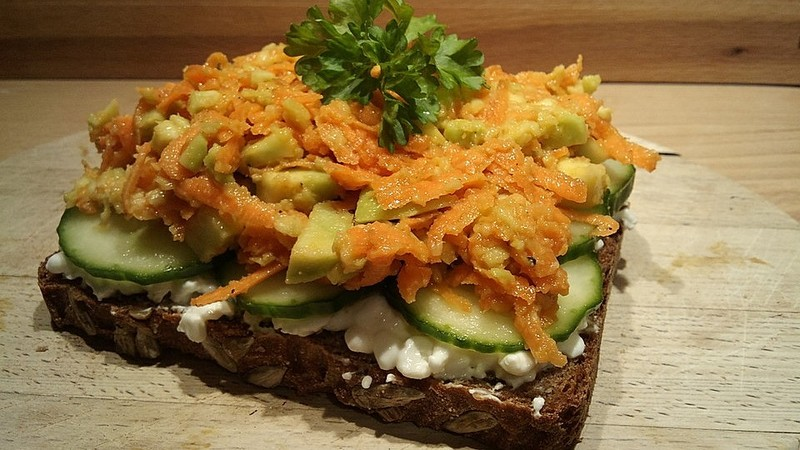

# Avocado-Möhren-Frischkäse-Aufstrich auf Vollkornbrot

- **Rezept:** Avocado-Möhren-Frischkäse-Aufstrich auf Vollkornbrot von Stolperfee30
- **Quelle:** [Chefkoch](https://www.chefkoch.de)
- **Bewertung:** —
- **Arbeitszeit:** 6 Min. · **Gesamtzeit:** 6 Min. · **Schwierigkeit:** Leicht
- **Für:** 2 Portionen · **Erstellt:** 01.11.2014
- **Allergene:** Vegetarisch

## Zutaten

- 4 Scheibe Vollkornbrot
- 2 kleine Möhre
- 1 Avocado
- 1 TL Zitronensaft
- 0.5 Gurke
- 3 EL Hüttenkäse
- Salz und Pfeffer

## Zubereitung

1. Die Möhren schälen und grob reiben. Die Avocado halbieren, den Kern entfernen und das Fruchtfleisch herauslösen. Mit einer Gabel zerkleinern. Die Avocado in einer Schüssel mit den Möhrenraspeln, Zitronensaft, Salz und Pfeffer vermengen.
2. Die Gurke in dünne Scheiben schneiden.
3. Die Brotscheiben mit dem Hütten- oder dem Frischkäse bestreichen und mit Gurkenscheiben belegen. Die Avocado-Möhren-Mischung darauf verteilen.

## Kommentare

(noch keine)

## Eigene Bemerkungen
(noch keine)

---

*Nährwerte (pro Portion): 170 kcal · 5.1 g · 12.5 g · 9.3 g.*
