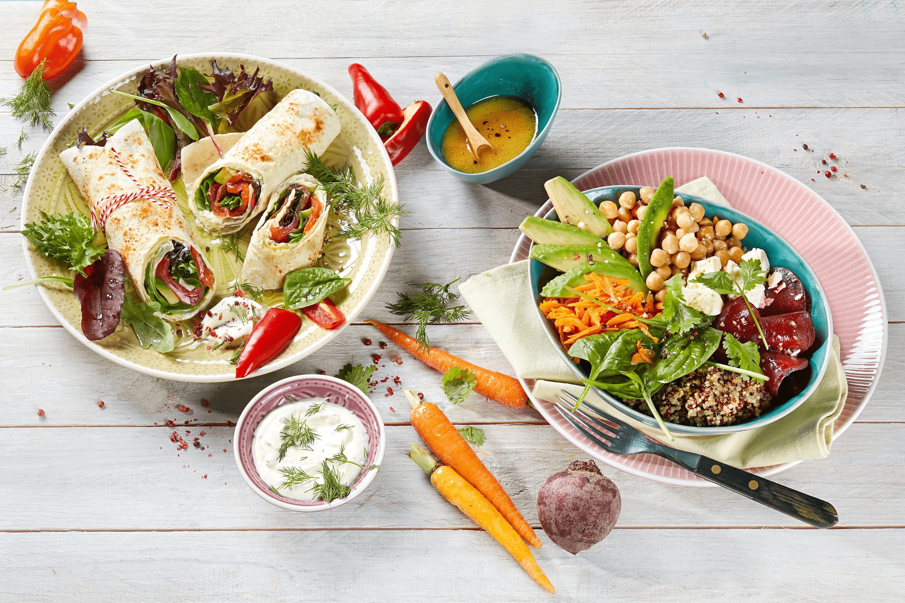

# Avocado Wrap mit Dill-Dip

- **Rezept:** Avocado Wrap mit Dill-Dip
- **Quelle:** [REWE](https://www.rewe.de/rezepte/avocado-wrap-dill-dip/)
- **Bewertung:** —
- **Arbeitszeit:** — · **Gesamtzeit:** — · **Schwierigkeit:** Leicht
- **Für:** 4 Portionen · **Erstellt:** 11.11.2025
- **Allergene:** Gluten · Milch · Fisch

## Zutaten

- 1 Bd. Dill
- 175 g Frischkäse, Doppelrahmstufe
- 125 g griechischer Joghurt
- 2 TL Currypulver
- Salz
- Pfeffer
- 1 Avocado
- 6 Tortilla Wraps, Weizen
- 100 g Salat, gemischt
- 100 g Räucherlachs

## Zubereitung

1. **Dill-Dip:** Dill waschen, zupfen und grob hacken. Frischkäse und griechischen Joghurt in einer Schüssel cremig rühren. Dill, Currypulver, Salz und Pfeffer dazugeben.
2. **Avocado:** Avocado halbieren, den Stein entfernen, mit einem Messer längs in 0,5 cm dünne Streifen schneiden und mit einem Löffel aus der Schale lösen.
3. **Wrap zusammensetzen:** Die Wraps ausbreiten und dünn mit der Hälfte des Dips bestreichen. Salat, Avocado und Räucherlachs in Bahnen darauf verteilen. Die Wraps bis zur Hälfte zusammenrollen. Dann die äußeren, offenen Enden einfalten und den Wrap fertig zuwickeln. Den Wrap auf beiden Seiten mit einer Kordel fixieren. Zum Servieren den Wrap schräg aufschneiden.

## Kommentare

(noch keine)

## Eigene Bemerkungen

(noch keine)

---

*Hinweis: Nährwerte ca. 552 kcal pro Portion (50,3 g KH · 31,2 g Fett · 19,5 g Eiweiß).*
