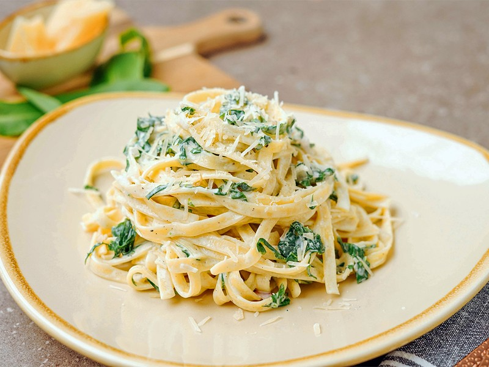

# Bärlauch-Nudeln

- **Rezept:** Bärlauch-Nudeln
- **Autor:** GuteKueche.at
- **Quelle:** [GuteKueche.at](https://www.gutekueche.at/baerlauch-nudeln-rezept-17486)
- **Bewertung:** —
- **Arbeitszeit:** 30 Min. · **Gesamtzeit:** 30 Min. · **Schwierigkeit:** —
- **Für:** 2 Portionen · **Erstellt:** 23.11.2026
- **Allergene:** —

## Zutaten

- 250 g Nudeln (z.B. Spaghetti oder Bandnudeln)
- 1 EL Salz
- 2 l Wasser
- 150 g Bärlauch (frisch)
- 3 Stk Knoblauchzehen
- 2 EL Olivenöl (nativ)
- 1 EL Parmesan (gerieben oder gehobelt)
- 1 Prise Pfeffer (schwarz, gemahlen)
- 1 Prise Salz
- 4 Stk Schalotten
- 200 ml Schlagobers
- 100 ml Weißwein (trocken)

## Zubereitung

1. Zuerst die Nudeln in einem Topf mit kochendem Salzwasser für rund 8 Minuten bissfest (al dente) kochen, dann durch ein Sieb abgießen.
2. In der Zwischenzeit Knoblauch und Schalotten schälen und fein hacken. Bärlauch waschen, trocken schütteln und ebenfalls fein schneiden.
3. Danach Knoblauch und Schalotten in einer Pfanne mit etwas Olivenöl für 3-4 Minuten andünsten, mit Wein und Obers ablöschen.
4. Danach Knoblauch und Schalotten in einer Pfanne mit etwas Olivenöl für 3-4 Minuten andünsten, mit Wein ablöschen, kurz verkochen lassen und mit Schlagobers aufgießen.
5. Nun den fein gehackten Bärlauch zugeben, für 1-2 Minuten köcheln und mit Salz und Pfeffer abschmecken.
6. Zum Schluss die Sauce mit den fertig gekochten Nudeln gut vermengen, mit geriebenen Parmesan garnieren und heiß servieren.

## Kommentare

(noch keine)

## Eigene Bemerkungen

(noch keine)
