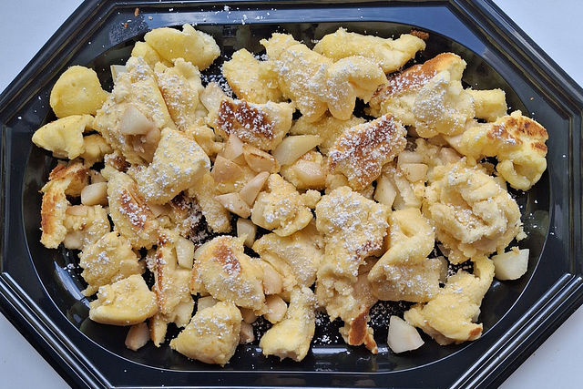

# Birnenschmarrn (Ofenvariante)
 #gut 

- **Rezept:** Birnenschmarrn von *Betzedackel*
- **Quelle:** [Chefkoch](https://www.chefkoch.de/rezepte/3196561475769275/Birnenschmarrn.html)
- **Bewertung:** 4,3/5 (3 Bewertungen)
- **Arbeitszeit:** 15 Min. · **Gesamtzeit:** 35 Min. · **Schwierigkeit:** Normal
- **Für:** 4 Portionen · **Erstellt:** 10.10.2016
- **Allergene:** Gluten · Eier · Milch

## Zutaten

- 4 kleine Birnen (nicht zu reif)
- 6 Eier (Größe L) **getrennt**
- 200 g Mehl
- 8 EL Zucker
- 2 Pck. Vanillezucker
- 200 ml Milch
- 8 EL Butter
- 2 Prisen Salz

## Zubereitung

1. **Teig:** Das Mehl sieben und mit Milch, Vanillezucker, den Eigelben und Salz mit dem Schneebesen gut verrühren. Dann die Eiweiße mit 4 EL Kristallzucker so steif wie möglich schlagen und vorsichtig unter den Teig heben.
2. **Ansetzen:** Die Butter in einer **ofenfesten** (wenn möglich beschichteten) Pfanne erhitzen. 2 EL Zucker in der Pfanne verteilen, kurz in der Butter schmelzen lassen und die Eiermasse eingießen. Die geschälten und in kleine Würfelchen geschnittenen Birnen darüber streuen.
3. **Backen:** Im vorgeheizten Ofen bei 150 °C (Umluft) auf der mittleren Schiene ca. 15 Minuten backen. Aus dem Ofen holen, halbieren und die Hälften wenden.
4. **Zerreißen & servieren:** Auf dem Herd mit zwei Löffeln vorsichtig in kleine Stücke reißen und dabei bei kleiner Hitze weiter braten. Auf zwei Platten geben und mit Puderzucker bestreuen, mit Preiselbeeren servieren.

## Kommentare

- **nudelmary:** „Erstaunt, dass die Variante in der Röhre so gut gelungen ist." Da Birnenkompott gekocht wurde, gab es dieses dazu statt Preiselbeeren. Sehr gut gelungen.
- **Estrella1:** „Schmeckt sehr gut!" Backt solche Sachen aber nur am Herd wie Kaiserschmarrn — hat trotzdem gut funktioniert.

## Eigene Bemerkungen
(noch keine)

---
*Hinweis: Es ist ein Ofen-Birnenschmarrn (im Backofen gebacken, dann zerrissen), nicht der klassische Pfannenschmarrn.*
