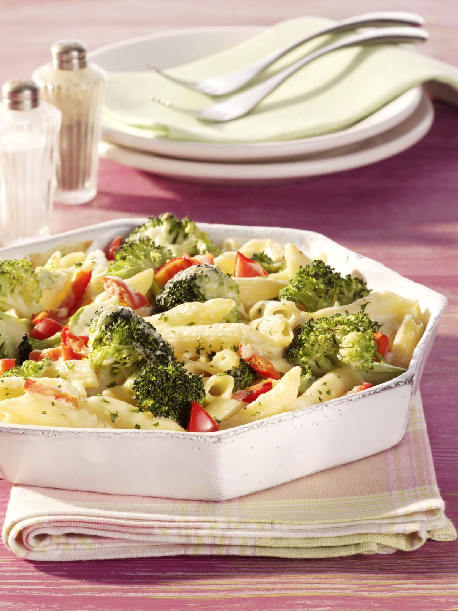

# Brokkoli-Nudel-Auflauf

- **Rezept:** Brokkoli-Nudel-Auflauf von *EAT SMARTER*
- **Quelle:** [EAT SMARTER](https://eatsmarter.de/rezepte/brokkoli-nudel-auflauf)
- **Bewertung:** (siehe Kommentarbereich)
- **Arbeitszeit:** ~30 Min. · **Gesamtzeit:** ~55 Min. · **Schwierigkeit:** Einfach
- **Für:** 4 Portionen · **Erstellt:** 2017
- **Allergene:** Gluten · Milch · Eier · Milchprodukte
#gut 

## Zutaten (für 4 Portionen)

- 250 g Penne
- Salz
- 400 g Brokkoli
- 2 rote Paprikaschoten
- 2 Zwiebeln
- 1 Knoblauchzehe
- 2 EL Butter
- 1 gestr. EL Mehl
- 200 ml Gemüsebrühe (Instant)
- 200 ml Milch
- 100 g Crème fraîche
- 100 g frisch geriebener Parmesan
- Pfeffer
- 1 Prise frisch geriebene Muskatnuss
- 1 EL gehackte Petersilie
- Fett (für die Form)

## Zubereitung

1. **Penne kochen:** Penne in reichlich Salzwasser nach Packungsanweisung al dente kochen.
2. **Brokkoli & Paprika:** Brokkoli putzen und in Röschen teilen. Die Stiele schälen und klein würfeln. Alles abspülen. Brokkoli und die Stiele in Salzwasser 2–3 Minuten blanchieren, mit einer Schaumkelle aus dem Wasser heben und in Eiswasser abschrecken. Brokkoli abgießen und gut abtropfen lassen. Paprika vierteln, putzen, abspülen und in Stücke schneiden. Penne abgießen, kalt abschrecken und gut abtropfen lassen.
3. **Sauce:** Zwiebeln und Knoblauch pellen und die Zwiebeln würfeln. Butter in einem Topf schmelzen. Zwiebeln darin glasig dünsten, Knoblauch dazupressen. Mehl darüber stäuben und anschwitzen. Gemüsebrühe und Milch unter Rühren angießen. Alles einmal aufkochen. Crème fraîche und 70 g Parmesan einrühren. Mit Salz, Pfeffer und Muskat abschmecken.
4. **Backen:** Nudeln, Brokkoli und Paprika in eine gefettete Auflaufform geben. Die Sauce darüber gießen und mit dem restlichen Parmesan bestreuen. Im vorgeheizten Backofen bei 200 Grad (Gas: Stufe 3–4, Umluft: 180 Grad) 20–25 Minuten backen. Mit Petersilie bestreut servieren.

## Kommentare

(noch keine)

## Eigene Bemerkungen

(noch keine)

---

*Vegetarischer Auflauf aus Penne, Brokkoli und einer cremigen Parmesan-Sauce.*
