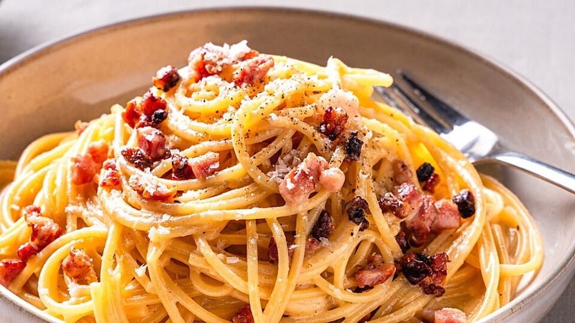

# Carbonara wie bei der Mamma in Rom

- **Rezept:** Carbonara wie bei der Mamma in Rom
- **Quelle:** [Chefkoch](https://www.chefkoch.de/rezepte/1298241234947062/Carbonara-wie-bei-der-Mamma-in-Rom.html)
- **Bewertung:** 4.71 (655 Bewertungen)
- **Arbeitszeit:** 15 Min. · **Gesamtzeit:** 25 Min. · **Schwierigkeit:** Mittel
- **Für:** 4 Portionen · **Erstellt:** 18.02.2009 · **Original:** 4 Portionen
- **Allergene:** Gluten · Milch · Eier
#gut 

## Zutaten

- 100 g Pancetta (oder Guanciale am Stück, alternativ Bauchspeck, Bacon oder Räucherspeck)
- 240 g Spaghetti (oder dünne lange Pasta)
- Salz
- 2 Eier, Größe M
- 40 g Parmesan (oder Grana Padano, frisch gerieben)
- 40 g Pecorino (Romano, frisch gerieben)
- Pfeffer, schwarzer, aus der Mühle

## Zubereitung

1. **Speck braten:** Speck ca. 0,5–1 cm groß würfeln. In einer Pfanne ohne zusätzliches Fett sanft ausbraten und beiseitestellen.
2. **Pasta kochen:** Pasta in reichlich Salzwasser nach Packungsangabe kochen.
3. **Soße vorbereiten:** Währenddessen die Eier mit den beiden Käsesorten in einer Schüssel verquirlen. Eventuell leicht salzen und mit schwarzem Pfeffer abschmecken.
4. **Speck erhitzen:** Den Speck erneut erhitzen. Ca. 60 ml Nudelwasser abschöpfen und etwas davon zum Speck in die Pfanne geben.
5. **Servieren:** Kurz vor Ablauf der angegebenen Kochzeit die Nudeln abgießen und zum Speck in die Pfanne geben. Herd ausstellen, nun auf der noch warmen Herdplatte weiterarbeiten. Die Eier-Käse-Mischung, etwas Kochwasser dazugeben und in der Pfanne stetig schwenken bzw. rühren, bis sich alles gleichmäßig vermischt und miteinander verbunden hat. Bei Bedarf mehr Kochwasser hinzufügen, bis die Käse-Ei-Mischung die Pasta cremig umhüllt.

## Kommentare

(noch keine)

## Eigene Bemerkungen

(noch keine)

---

*Eine authentische römische Carbonara nach dem Prinzip „fuori dal fuoco": Die eigentliche Emulgierung der Eier-Käse-Sauce passiert auf der noch warmen Herdplatte, damit die Eier nie stocken. Mit Pancetta, Parmesan und Pecorino.*
