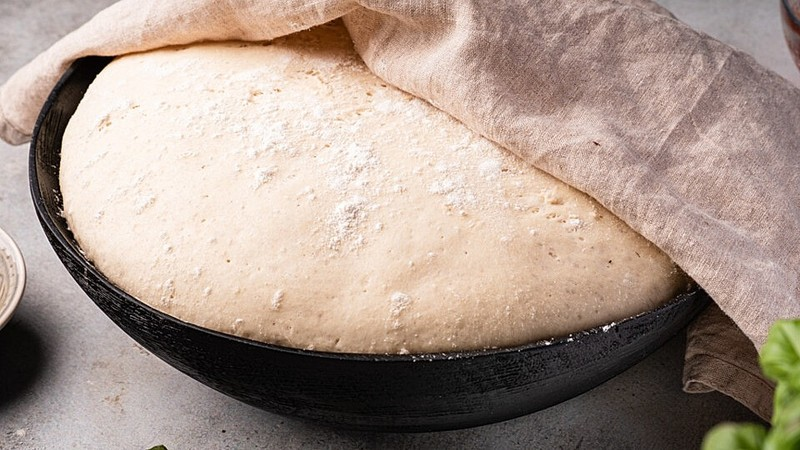

# Der beste Pizzateig - wie beim Italiener!

- **Rezept:** Der beste Pizzateig - wie beim Italiener!
- **Quelle:** [Chefkoch](https://www.chefkoch.de)
- **Bewertung:** —
- **Arbeitszeit:** 30 Min. · **Gesamtzeit:** 34 Min. · **Schwierigkeit:** Leicht
- **Für:** 1 Portionen · **Erstellt:** 14.09.2008
- **Allergene:** Vegan
#gut 

## Zutaten

- 500 g Weizenmehl Type 405
- 300 ml Wasser
- 2 TL Salz
- 5 g Frischhefe
- 1 Dose Pizzatomaten )
- 2 Knoblauchzehe
- Salz und Pfeffer
- 1 Prise Zucker
- 6 Blätter Basilikum
- 1 EL Oregano

## Zubereitung

1. Zunächst das Mehl mit dem Salz sieben und in eine Küchenmaschine oder einen Brotbackautomaten mit Teigfunktion geben. Nun die Hefe in lauwarmem Wasser auflösen und zum Mehl-Salz-Gemisch geben. Trockenhefe kann direkt unter das Mehl gemischt werden.  Anmerkung: Die angegebene Menge mit 5 g frischer Hefe stimmt tatsächlich.
2. Anschließend die Zutaten 20 Minuten zu einem elastischen Teig verkneten.  Anmerkung: Es wird dringend eine elektrische Hilfe beim Kneten empfohlen, denn so erreicht der Teig die gewünschte Konsistenz. Funktioniert auch mit einem Handrührgerät mit Knethaken.
3. Nach dem Kneten den Teig mit einem feuchten Tuch abdecken und zwei Stunden ruhen lassen. Anschließend in vier Stücke zu je 200 g teilen, diese zu Kugeln formen und wieder abgedeckt weitere sechs Stunden gehen lassen.
4. Für die Tomatensauce eine Dose geschälte Tomaten mit den restlichen Zutaten kalt pürieren.
5. Backofen auf Höchststufe vorheizen, ca. 250–270 °C. Teig ca. 4 mm dünn ausrollen oder ziehen. Anschließend Tomatensauce dünn auftragen und in kreisrunden Bewegungen mit der Kelle über die komplette Pizza verteilen. Nach Wunsch belegen. Pizza 7–12 Minuten im vorgeheizten Ofen backen.

## Kommentare

(noch keine)

## Eigene Bemerkungen

Vorsicht mit dem Wasser!!!
1/2 Würfel frische Hefe
Mal mit Weizenmehl probieren

Ist schon ziemlich aufwendig.

---

*Nährwerte (pro Portion): 1813 kcal · 56.4 g · 6 g · 376.6 g.*
