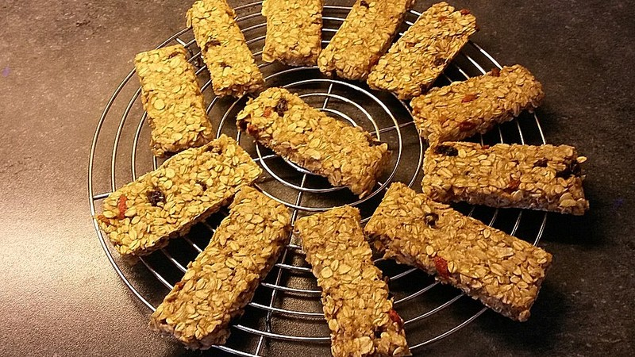

# Einfache Müsli-Riegel

- **Rezept:** Einfache Müsli-Riegel von Laabertasche
- **Quelle:** [Chefkoch](https://www.chefkoch.de)
- **Bewertung:** —
- **Arbeitszeit:** 5 Min. · **Gesamtzeit:** 12 Min. · **Schwierigkeit:** Leicht
- **Für:** 1 Portionen · **Erstellt:** 12.01.2016
- **Allergene:** —

## Zutaten

- 250 g Haferflocken
- 2 Banane
- 2 EL Nüsse
- 2 EL Rosinen
- 1 EL Honig
- n. B. Zimt

## Zubereitung

1. Den Ofen auf 150 °C vorheizen.
2. Die Bananen mit einer Gabel zerdrücken. Alle Zutaten in einer Schüssel miteinander mischen und mit den Händen fest kneten. Am besten zuerst den Honig unter die Bananen mischen.
3. Die Masse zu ca. 8 Riegeln formen. (Auch hier: Die Masse zuerst fest zu einer Kugel zusammendrücken, bevor Riegel geformt werden.)
4. Ca. 7 Minuten im vorgeheizten Ofen bei Ober-/Unterhitze backen. Danach abkühlen lassen.

## Kommentare

(noch keine)

## Eigene Bemerkungen
(noch keine)

---

*Nährwerte (pro Portion): 182 kcal · 5.7 g · 4 g · 30.2 g.*
