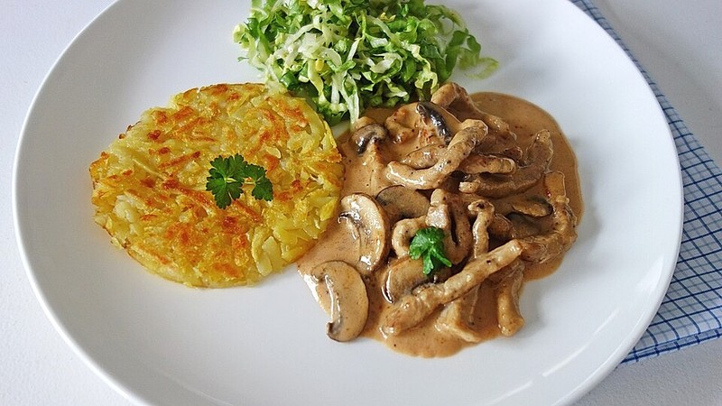

# Geschnetzeltes in Pilz - Sahnesoße

- **Rezept:** Geschnetzeltes in Pilz - Sahnesoße von demelzea
- **Quelle:** [Chefkoch](https://www.chefkoch.de)
- **Bewertung:** —
- **Arbeitszeit:** 35 Min. · **Gesamtzeit:** 35 Min. · **Schwierigkeit:** Normal
- **Für:** 4 Portionen · **Erstellt:** 24.07.2005
- **Allergene:** —
#gut 

## Zutaten

- 600 g Schnitzelfleisch
- 500 g Champignons
- 20 g Steinpilze
- 2 m.-große Zwiebel
- 300 g süße Sahne
- 1 EL Mehl
- 300 ml Wasser
- Salz und Pfeffer
- 1 TL Paprikapulver
- 2 EL Sherry
- Saucenbinder

## Zubereitung

1. Die Steinpilze mit 300 ml heißem Wasser übergießen und gut 30 Minuten einweichen. Danach das Wasser abgießen, aber auffangen und die Pilze klein schneiden.
2. Die Schnitzel in feine Streifen schneiden, salzen, pfeffern und mit Mehl bestäuben. Etwas Öl in einer Pfanne erhitzen und das Fleisch portionsweise darin anbraten, beiseite stellen.
3. Champignons blättrig schneiden und die Zwiebeln würfeln. Wieder etwas Öl in der Pfanne erhitzen und die Champignons, die Steinpilze und die Zwiebeln anbraten. Mit Salz, Pfeffer und Paprika würzen. Das Pilzwasser durch einen Kaffeefilter gießen und die Pilze damit ablöschen, Sherry (ich nehme so 2-3 EL) dazugeben und etwas einkochen lassen. Die Sahne angießen und wieder einkochen lassen. Das Schnitzelfleisch in der Soße erwärmen. Mit Pfeffer und Salz noch mal abschmecken. Sollte die Soße zu dünn sein, mit ein wenig Saucenbinder nachhelfen.  Dazu schmecken Bandnudeln oder Reis und ein grüner Salat.

## Kommentare

(noch keine)

## Eigene Bemerkungen
(noch keine)

---

*Nährwerte (pro Portion): 455 kcal · 42.6 g · 27.3 g · 7.9 g.*
