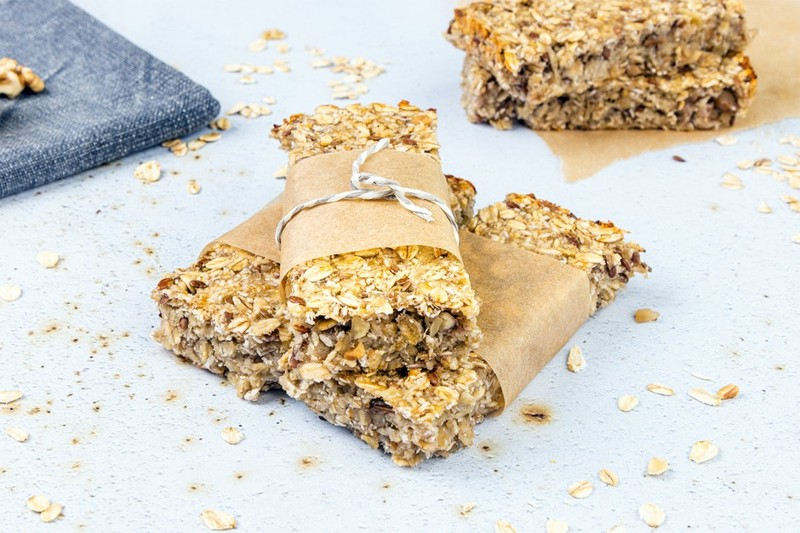

# Gesunder Müsliriegel

- **Rezept:** Gesunder Müsliriegel
- **Autor:** Tammy3108
- **Quelle:** [GuteKueche.at](https://www.gutekueche.at/gesunder-musliriegel-rezept-34987)
- **Bewertung:** —
- **Arbeitszeit:** 15 Min. · **Gesamtzeit:** 45 Min. · **Schwierigkeit:** —
- **Für:** 5 Portionen · **Erstellt:** 23.11.2026
- **Allergene:** —

## Zutaten

- 2 Stk Äpfel (süß-säuerlich, z.B. Elstar)
- 2 Stk Bananen
- 1 Stk Bio-Zitrone
- 200 g Haferflocken (zart oder mittelgrob)
- 5 EL Honig
- 30 g Kokosflocken
- 20 g Leinsamen
- 30 g Nüsse (gerieben oder fein gehackt)

## Zubereitung

1. Für den gesunden Müsliriegel die Bananen schälen und mit einer Gabel zerdrücken. Die Äpfel schälen und mit einer Küchenreibe fein reiben. Die Zitrone auspressen.
2. Die Bananen- und Apfelmasse in einer Schüssel gründlich miteinander vermischen und den Zitronensaft hinzufügen.
3. Als nächstes die Nüsse, Haferflocken, Kokosflocken, Leinsamen und Honig in die Obstmasse einrühren und ca. 10 Minuten ruhen lassen.
4. Die Masse auf ein mit Backpapier ausgelegtes Backblech ca. 0,5 - 0,8 cm dick aufstreichen und für 15-20 Minuten im Backofen bei 160 °C (Ober-/Unterhitze) backen.
5. Zum Schluss die fertig gebackene Müslimasse in rechteckige Riegeln schneiden und auskühlen lassen.

## Kommentare

(noch keine)

## Eigene Bemerkungen

(noch keine)
