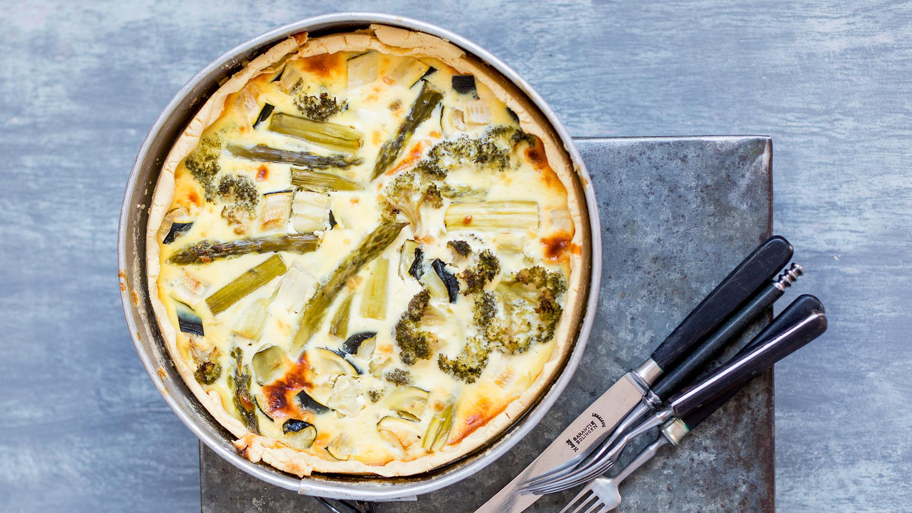

# Grüne Gemüse-Tarte

- **Rezept:** Grüne Gemüse-Tarte
- **Quelle:** [NDR — Die Ernährungs-Docs](https://www.ndr.de/ratgeber/kochen/rezepte/Gruene-Gemuese-Tarte,rezept3992.html)
- **Bewertung:** —
- **Arbeitszeit:** 20 Min. · **Gesamtzeit:** 45 Min. · **Schwierigkeit:** Einfach
- **Für:** 4 Portionen · **Erstellt:** 20.11.2026
- **Allergene:** Milch · Eier · Getreide/Gluten
#gut 

## Zutaten
- 250 g Vollkorn-Dinkelmehl
- 1 Ei *(für den Teig)*
- 2 Prisen Salz
- 125 g Butter *(kalt, in Flöckchen)*
- etwas Fett *(zum Einfetten der Form)*
- 250 g grüner Spargel
- 250 g Brokkoli *(in Röschen)*
- 200 g Zucchini *(in 1 cm Würfel)*
- 200 ml Gemüsebrühe
- 50 g Gouda *(fein gerieben)*
- 3 Eier *(für den Eier-Mix)*
- 200 g Sahne *(saure Sahne)*
- Pfeffer
- Muskatnuss

## Zubereitung
1. **Teig:** Mehl auf die Arbeitsfläche häufen und in die Mitte eine Mulde drücken. Ei und Salz dazugeben, die kalte Butter in Flöckchen auf dem Mehlrand verteilen und alles rasch zu einem glatten Teig verarbeiten, eventuell etwas kaltes Wasser hinzufügen. Eine Springform (28–30 cm) einfetten und mit dem Teig auskleiden, dabei einen Rand hochziehen. Die Form mit Frischhaltefolie zugedeckt etwa 30 Minuten kühl stellen.
2. **Gemüse garen:** Spargel waschen, die holzigen Enden abschneiden, Stangen im unteren Drittel schälen und in etwa 3 cm lange Stücke schneiden. Brokkoli putzen und in Röschen teilen. Zucchini putzen und in Würfel schneiden. Die Brühe aufkochen und Spargel und Brokkoli darin bei mittlerer Hitze mit geschlossenem Deckel etwa 2 Minuten garen. Zucchini dazugeben und etwa 1 Minute mitgaren. Alles abgießen und abtropfen lassen, dabei 100 ml Brühe auffangen. Abkühlen lassen.
3. **Füllung:** Backofen auf 200 Grad vorheizen. Käse fein reiben und mit Eiern, saurer Sahne und aufgefangener Brühe verquirlen. Mit Salz, Pfeffer und Muskat würzen.
4. **Backen:** Den Teigboden mit einer Gabel mehrmals einstechen. Gemüse darauf verteilen und mit dem Eier-Mix übergießen. Die Tarte im Ofen auf der mittleren Schiene 35–40 Minuten backen. Herausnehmen und vor dem Servieren kurz abkühlen lassen.

## Kommentare
(noch keine)

## Eigene Bemerkungen
(noch keine)

---
