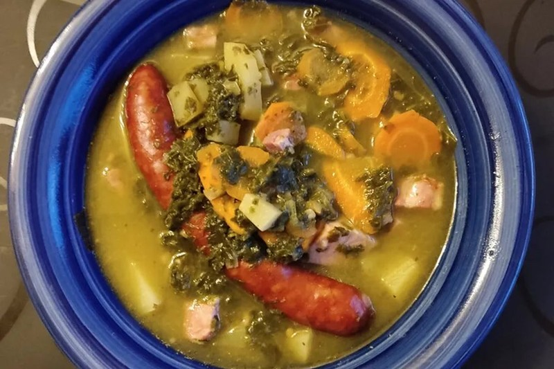

# Grünkohleintopf mit Kassler

- **Rezept:** Grüne Kohleintopf mit Kasseler
- **Quelle:** [Chefkoch](https://www.chefkoch.de/rezepte/674671169743414/Gruenkohleintopf-mit-Kasseler.html)
- **Bewertung:** —
- **Arbeitszeit:** 45 Min. · **Gesamtzeit:** 45 Min. · **Schwierigkeit:** Mittel
- **Für:** 4 Portionen · **Erstellt:** 19.11.2025
- **Allergene:** Gluten · Milch · Schweinefleisch · Eier
#gut

## Zutaten

- 1 kg Grünkohl
- 2 Zwiebeln
- 2 EL Butterschmalz
- 2 EL Gemüsebrühe (instant)
- 400 g Kasseler (Kasseler Bauch)
- 2 Lorbeerblätter
- 750 g Kartoffeln
- 500 g Möhren
- 4 Würstchen (Mettenden, ca. 350 g)
- 1 EL Senf (mittelscharfer)
- 0.5 TL Zucker
- 1,5 l Wasser
- Salz und Pfeffer

## Zubereitung

1. **Grünkohl:** Grünkohl von den dicken Rippen zupfen und in reichlich kochendem Salzwasser portionsweise ca. 3 Minuten kochen. Abtropfen lassen und grob hacken. Zwiebeln schälen und in Spalten schneiden.
2. **Basis:** Butterschmalz in einem Topf erhitzen, Zwiebelspalten darin glasig dünsten. Grünkohl zugeben und kurz mitdünsten. Etwa 1,5 l Wasser zugießen und aufkochen. Brühe einrühren. Kasseler (in Scheiben) und Lorbeerblätter dazugeben.
3. **Gemüse:** Kartoffeln und Möhren schälen. Möhren in Scheiben, Kartoffeln in Stücke schneiden. Mettenden und vorbereitetes Gemüse nach etwa 1 Stunde zum Kohl geben und mitgaren.
4. **Abschmecken:** Abschließend Grünkohl mit Senf, Salz und Zucker abschmecken. Heiß servieren.

## Kommentare

(noch keine)

## Eigene Bemerkungen

(noch keine)

