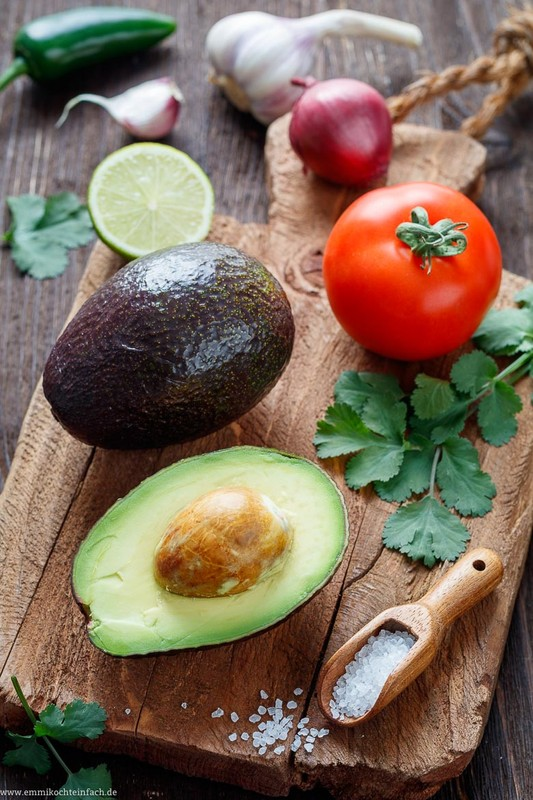

# Guacamole selber machen – Original-Rezept

- **Rezept:** Guacamole selber machen – Original-Rezept von *Emmi*
- **Quelle:** [Emmi kocht einfach](https://emmikochteinfach.de/original-guacamole-einfach-selber-machen/)
- **Bewertung:** 5/5 (94 Bewertungen)
- **Arbeitszeit:** 5 Min. · **Gesamtzeit:** 15 Min. · **Schwierigkeit:** Einfach
- **Für:** 4 Portionen · **Erstellt:** 12.06.2024
- **Allergene:** (kein Allergen — Avocado, Tomate, Zwiebel, Koriander, Knoblauch, Limette, Jalapeño, Meersalz, Pfeffer)
#gut 

## Zutaten

- 2 reife Avocados
- 1 Tomate
- 1 kleine rote Zwiebel
- 1 EL frische Korianderblätter
- 1 Knoblauchzehe
- 1 Limette (2 Hälften)
- ½ kleine Jalapeño
- Meersalz und schwarzer Pfeffer zum Abschmecken

## Zubereitung

1. **Avocado zerdrücken:** Die Avocados halbieren, die Kerne entfernen und das Fruchtfleisch mit einem Löffel herauslösen. Frischen Limettensaft darüber pressen und alles mit einer Gabel zu einem feinen Mus zerdrücken.
2. **Zutaten vorbereiten:** Die Tomate waschen, trocknen und fein würfeln. Die rote Zwiebel fein würfeln. Die Jalapeño waschen und fein würfeln (nach Geschmack — je nach Schärfe der Sorte die Kerne mitverwenden oder weglassen). Den Koriander waschen, trocknen und fein hacken.
3. **Vermengen:** Alle Zutaten zum Avocado-Mus in die Schüssel geben. Die Knoblauchzehe darüber auspressen oder reiben. Die zweite Limettenhälfte auspressen und alles gut vermengen. Mit Meersalz und schwarzem Pfeffer nach Belieben abschmecken.
4. **Servieren:** Den Avocado-Dip in einem Schüsselchen als Dip oder Beilage servieren. Mit Nachos und Tortilla-Chips perfekt zur Geltung.

## Kommentare

(noch keine)

## Eigene Bemerkungen

Weniger Limette

---

*Hinweis: Limettensaft und rote Zwiebel helfen dabei, dass die Guacamole ihre schöne grüne Farbe länger behält und nicht braun wird.*
