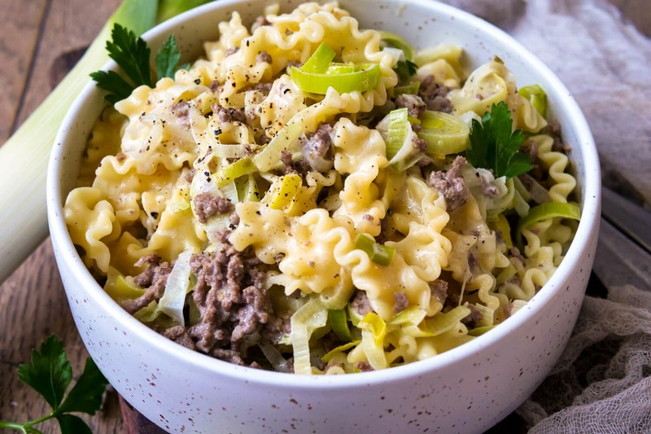

# Hackfleisch-Lauch-Pfanne mit Nudeln

- **Rezept:** Hackfleisch-Lauch-Pfanne mit Nudeln
- **Autor:** Steffi (Gaumenfreundin)
- **Quelle:** [Gaumenfreundin](https://www.gaumenfreundin.de/hackfleisch-lauch-pfanne/)
- **Bewertung:** —
- **Arbeitszeit:** — · **Gesamtzeit:** 25 Min. · **Schwierigkeit:** Leicht
- **Für:** 4 Portionen · **Erstellt:** 02.02.2023
- **Allergene:** —

## Zutaten

- 2 Stangen Lauch 400-500 g
- 300 g Nudeln
- 1 EL Olivenöl
- 500 g Hackfleisch
- 250 ml Gemüsebrühe
- 250 g Sahne zum Kochen
- 200 g Frischkäse mit Kräutern
- Salz und Pfeffer
- Muskat
- 50 g geriebener Käse Emmentaler oder Gouda

## Zubereitung

1. Lauch in Ringe schneiden. Nudeln nach Packungsangabe kochen.
2. Öl in einer großen Pfanne erhitzen und das Hackfleisch kräftig anbraten. Lauch zugeben und 10 Minuten mitbraten, bis er weich ist und zusammenfällt. Alles mit Salz und Pfeffer würzen.
3. Gemüsebrühe und Sahne zugeben und die Sauce bei kleiner Hitze für 10 Minuten köcheln lassen. Frischkäse unterheben und alles mit Salz, Pfeffer und Muskat würzen.
4. Geriebenen Käse und Nudeln unterheben und servieren.

## Kommentare

(noch keine)

## Eigene Bemerkungen
(noch keine)

---

*Nährwerte (pro Portion): 845 kcal · 36 g · 49 g · 63 g.*
