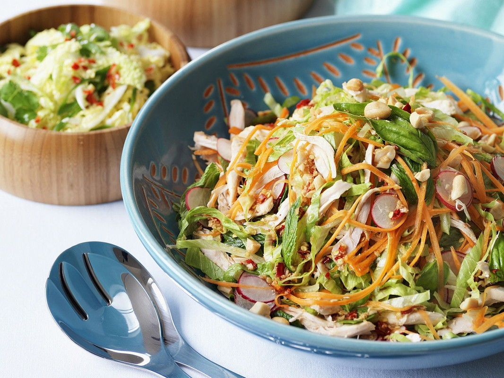

# Hähnchensalat auf vietnamesische Art

- **Rezept:** Hähnchensalat auf vietnamesische Art von *EAT SMARTER*
- **Quelle:** [EAT SMARTER](https://eatsmarter.de/rezepte/haehnchensalat-auf-vietnamesische-art-0)
- **Arbeits-/Gesamtzeit:** ca. 40 Min. / ca. 40 Min.
- **Für:** 4 Portionen · **Erstellt:** 02.01.2013
- **Allergene:** Nüsse

#gut 

## Zutaten

- 700 ml Geflügelbrühe
- 600 g Hähnchenbrustfilet
- 300 g Möhren (3 Möhren)
- 200 g Radieschen (1 Bund)
- 1 rote Chilischote
- 1 Kopfsalat
- 1 Bund gemischte Kräuter (z. B. Minze, Basilikum)
- 1 Limette
- 45 g gehackte Erdnusskerne (3 EL)
- 2 EL Pflanzenöl
- Pfeffer

## Zubereitung

1. Brühe in einem Topf zum Kochen bringen. Hähnchenbrustfilet hineinlegen und in ca. 20 Minuten bei kleiner Hitze garziehen lassen.
2. Inzwischen Möhren schälen und in dünne, lange Streifen schneiden. Radieschen waschen, putzen und in dünne Scheiben hobeln. Chilischote waschen, putzen und fein hacken.
3. Kopfsalat waschen, trockenschleudern und in feine Streifen schneiden. Kräuter waschen, trockenschütteln und Blättchen abzupfen.
4. Hähnchenbrustfilet aus der Brühe nehmen, abtropfen und auskühlen lassen. Limette auspressen.
5. Fleisch in feine Streifen schneiden, mit den vorbereiteten Salatzutaten, Limettensaft, Nüssen und Öl mischen und mit Salz und Pfeffer abschmecken.

## Kommentare

(noch keine)

## Eigene Bemerkungen

Weniger Fleisch,  ca 400g.

