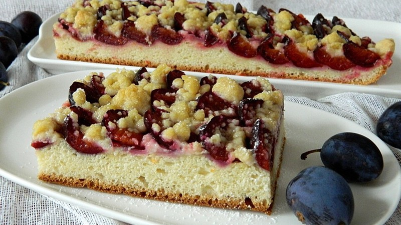

# Hefekuchen vom Blech

- **Rezept:** Hefekuchen vom Blech von dodith
- **Quelle:** [Chefkoch](https://www.chefkoch.de)
- **Bewertung:** —
- **Arbeitszeit:** 40 Min. · **Gesamtzeit:** 1 Std. · 10 Min. · **Schwierigkeit:** Normal
- **Für:** 1 Portionen · **Erstellt:** 21.03.2014
- **Allergene:** —
#gut 

## Zutaten

- 500 g Mehl
- 1 Tüte Trockenhefe
- 250 ml Milch, lauwarme
- 100 g Butter, weiche
- 75 g Zucker
- 1 m.-großes Ei
- 1 TL , gestr. Salz
- 0.5 Zitrone, Schale davon
- n. B. Äpfel
- n. B. Sauerkirschen
- n. B. Rhabarber
- n. B. Zwetschge
- etwas Zitronensaft
- n. B. Zucker
- n. B. Zimtpulver
- 200 g Mehl
- 150 g Zucker
- 150 g Butter, flüssige
- 100 g Mandeln, gehackte
- 2 Prisen Zimtpulver
- 1 Prise Salz

## Zubereitung

1. Mehl, Trockenhefe, Zucker, Salz und Zitronenabrieb oder Citroback mischen (wer mit Aromafläschchen arbeitet, gibt das Aroma mit der Milch dazu). Ei, lauwarme Milch und weiches Fett darauf geben (Tipp: Milch und Fett zusammen in der Mikrowelle erwärmen, bis es ca. handwarm ist) und alles gut verkneten, bis der Teig geschmeidig ist. Beim Kneten mit den Knethaken der Küchenmaschine soll er sich vom Schüsselrand lösen und zu einem glatten Kloß werden. Den Teig in einer mit Küchentuch abgedeckten Schüssel an einem warmen, zugfreien Ort gehen lassen, bis er sich deutlich vergrößert hat. Kurz durchkneten und auf einem vorbereiteten Backblech verteilen, kurz gehen lassen.
2. Den Kuchen kann man jetzt entweder nur mit Obst oder Streuseln belegt backen oder auch mit Obst und Streuseln darauf. 
Für die Streusel Mehl und Zucker mischen, nach Belieben noch Mandeln zufügen, mit einer Gabel gut verrühren und die zerlassene Butter unter Rühren mit der Gabel einfließen lassen. Dabei bilden sich Streusel, die nach Bedarf mit den Fingern noch etwas nachgeformt werden können. 
Rhabarber kann man je nach Geschmack etwas zuckern vor dem Backen, Zwetschgen nach 15 Minuten Backzeit mit etwas Zimt-Zucker bestreuen. Die Apfelspalten mit Zitronensaft beträufeln.
3. Den Kuchen im vorgeheizten Ofen bei ca. 200 °C Ober-/Unterhitze (je nach Ofen auch 220°C) ca. 25 - 35 Minuten backen, bei feuchtem Obstbelag ggfs. auch etwas länger. Die Ränder sollen goldgelb sein und bei der Stäbchenprobe soll kein Teig kleben bleiben. Die Backzeit richtet sich nach dem Belag und wie immer auch nach dem jeweiligen Backofen.

## Kommentare

(noch keine)

## Eigene Bemerkungen

- Backblech unten
- Temperatur 190°

15 Min. vorbacken bei 50°
15 Min. offen
10 Min. abgedeckt

### Streusel
- weniger Butter
- nur 60g Zucker

---

*Nährwerte (pro Portion): 6098 kcal · 113.5 g · 281.9 g · 773.7 g.*
