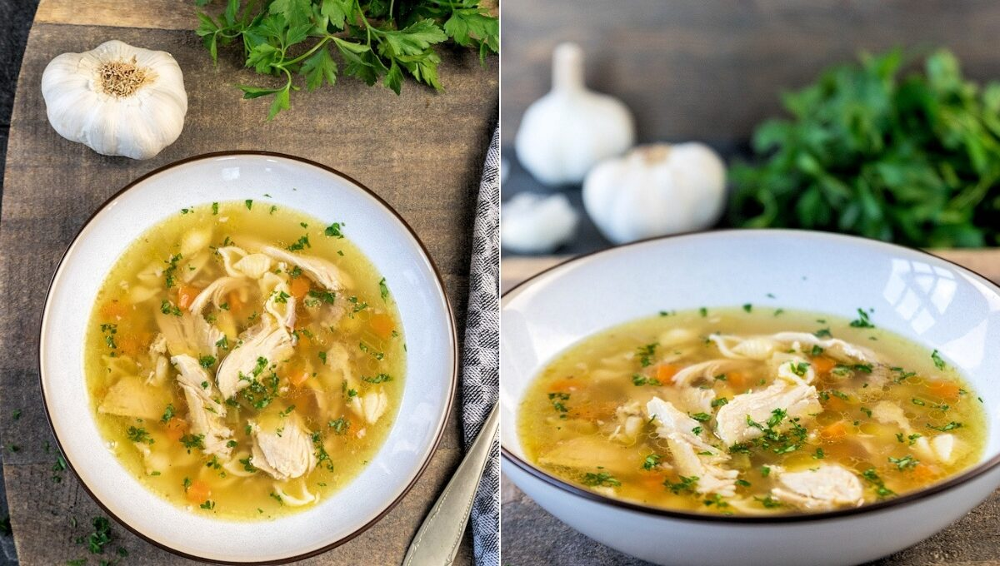

# Hühnersuppe mit Nudeln & Knoblauch

- **Rezept:** Hühnersuppe mit Nudeln & Knoblauch
- **Quelle:** [Maltes Kitchen](https://www.malteskitchen.de/huehnersuppe-nudeln-knoblauch/)
- **Bewertung:** —
- **Arbeitszeit:** 25 Min. · **Gesamtzeit:** 1 Std. 55 Min. · **Schwierigkeit:** Einfach
- **Für:** 4 Portionen · **Erstellt:** 20.11.2026
- **Allergene:** Milch *(Parmesanrinde)*

## Zutaten
- 2 Hähnchenschenkel *(Original: 4)*
- 1 Zwiebel, fein gewürfelt
- 1 Möhre, fein gewürfelt
- 1 Stange Staudensellerie, fein gewürfelt
- 7 Knoblauchzehen, in feine Scheiben geschnitten
- 1 Lorbeerblatt
- ½ Stück Parmesanrinde
- 1,25 Liter Hühnerbrühe *(Original: 2,5 L)*
- Olivenöl
- Salz
- Schwarzer Pfeffer
- 150 g kleine Muschelnudeln *(Optional)*

## Zubereitung
1. **Vorbereiten:** Die Hähnchenschenkel salzen und 1 Stunde vor der Zubereitung aus dem Kühlschrank holen.
2. **Anbraten:** Den Topf bei mittlerer Hitze heiß werden lassen, mit Olivenöl bedecken und die Hähnchenschenkel von beiden Seiten anbraten, bis sie braun sind. Herausnehmen und beiseite stellen.
3. **Dünsten:** Das meiste Fett abgießen (2–3 EL bleiben). Zwiebel, Staudensellerie, Möhre und Lorbeerblatt hineingeben und weich und leicht goldbraun andünsten.
4. **Köcheln:** Die Hähnchenschenkel zurück in den Topf geben, die Brühe angießen und die Parmesanrinde zufügen. Mit Salz und Pfeffer würzen, aufkochen und bei geringer Hitze ca. 45 Minuten zugedeckt köcheln lassen.
5. **Knoblauch anbraten:** Während die Brühe köchelt, in einer Pfanne Olivenöl erhitzen, den Knoblauch ca. 30–45 Sekunden anbraten — er darf keine Farbe annehmen! Durch ein Sieb abgießen und in die Brühe geben.
6. **Fleisch zupfen:** Nach 45 Minuten die Keulen herausnehmen und abkühlen lassen, die Haut entfernen und das Fleisch zupfen. Das Fleisch zurück in die Suppe geben und 5 Minuten warm werden lassen.
7. **Nudeln (optional):** Wer Muschelnudeln servieren möchte, kocht sie al dente vor und rührt sie kurz vor dem Servieren unter.
8. **Servieren:** Die Suppe abschmecken und bei Bedarf mit Petersilie bestreuen.

## Kommentare
(noch keine)

## Eigene Bemerkungen
(noch keine)

---
