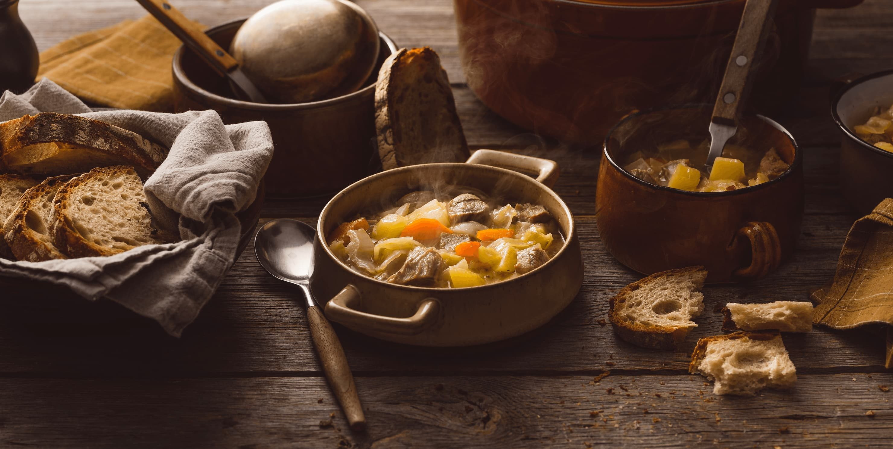

# Irish Stew

- **Rezept:** Irish Stew von *REWE*
- **Quelle:** [REWE](https://www.rewe.de/rezepte/irish-stew/)
- **Bewertung:** (siehe Kommentarbereich)
- **Arbeitszeit:** ~40 Min. · **Gesamtzeit:** ~1h · **Schwierigkeit:** Mittel
- **Für:** 4 Portionen · **Erstellt:** 11.07.2022
- **Allergene:** Milch

## Zutaten (für 4 Portionen)

- 1 kg Lammschulter
- 4 Zwiebeln
- 600 g Weißkohl
- 500 g Kartoffeln
- 2 Möhren
- 1 Petersilienwurzel
- 100 g durchwachsener Speck
- 1 Bund Petersilie
- 1 l Rinderbrühe
- 1 EL Kümmel
- 1 Lorbeerblatt
- 1 TL getrockneter Majoran
- Salz, Pfeffer

## Zubereitung

1. **Fleisch vorbereiten:** Die Sehnen vom Lammfleisch abschneiden und das Fleisch in mundgerechte Würfel schneiden.
2. **Gemüse vorbereiten:** Die Zwiebeln schälen und in Ringe schneiden. Den Weißkohl halbieren, Strunk entfernen und in Streifen schneiden. Kartoffeln, Möhren und Petersilienwurzel schälen, ggf. putzen und grob würfeln. Den Speck ebenfalls würfeln. Die Petersilie waschen, trocken schütteln, die Blättchen von den Stielen zupfen und hacken. Die Hälfte der Petersilienstängel, getrennt von den Blättern, ebenfalls hacken.
3. **Anbraten:** Den Speck in einem großen Topf auslassen. Das Fleisch dazugeben und rundherum scharf anbraten. Die Zwiebeln sowie Petersilienstängel zufügen und einige Minuten mitbraten.
4. **Brühe köcheln:** Die Brühe angießen und aufkochen. Mit geschlossenem Deckel etwa 30 Minuten köcheln lassen.
5. **Garen:** Das Gemüse und die Gewürze dazugeben und weitere 30 Minuten abgedeckt garen.
6. **Servieren:** Das Lorbeerblatt entfernen, den Eintopf mit Salz und Pfeffer abschmecken und mit Petersilie bestreut servieren.

## Kommentare

(noch keine)

## Eigene Bemerkungen

(noch keine)

---

*Herzhaft deftiger irischer Eintopf mit zartem Lammfleisch. Kann auch sehr gut im Schnellkochtopf zubereitet werden — dafür das Gemüse direkt nach dem Anbraten von Fleisch und Zwiebeln mit der Brühe dazugeben und den Eintopf etwa 25 Minuten garen.*
