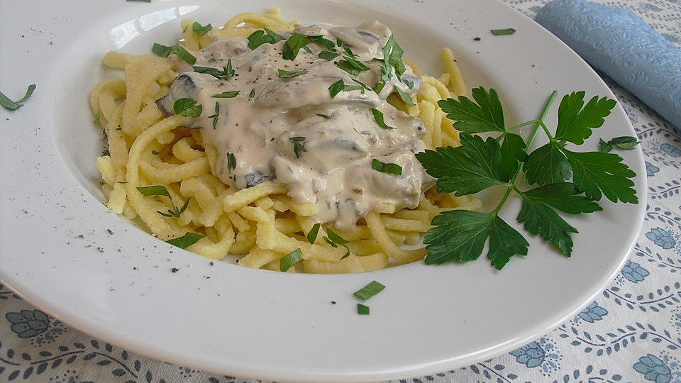

# Italienische Parmesan-Champignon-Sauce

- **Rezept:** Italienische Parmesan-Champignon-Sauce
- **Quelle:** [Chefkoch](https://www.chefkoch.de/rezepte/2821241434191973/Italienische-Parmesan-Champignon-Sauce.html)
- **Bewertung:** —
- **Arbeitszeit:** 10 Min. · **Gesamtzeit:** 20 Min. · **Schwierigkeit:** Leicht
- **Für:** 4 Portionen · **Erstellt:** 19.11.2025
- **Allergene:** Milch · Gluten

## Zutaten

- 500 g Champignons
- 3 große Zwiebeln
- 2 Becher Sahne
- 2 Handvoll Parmesan (gerieben)
- 1 Zehe Knoblauch
- Olivenöl
- Salz und Pfeffer

## Zubereitung

1. **Anschwitzen:** Das Olivenöl in einer Pfanne bzw. einem Wok auf höchster Stufe erhitzen und die fein gehackten Zwiebeln und Knoblauch anschwitzen.
2. **Champignons:** Die Champignons waschen oder häuten und in 0,5 cm dicke Scheiben schneiden. Wenn die Zwiebeln glasig sind, die Champignons in die Pfanne geben. Nach 2–3 Min. die Sahne dazugeben und die Hitze auf mittlere Stufe regulieren.
3. **Sauce:** Den Parmesan reiben und ebenfalls dazugeben. Alles noch etwas köcheln lassen und mit Salz und ordentlich Pfeffer abschmecken.

## Kommentare

- **badgirl888:** „Schmeckte ganz gut"

## Eigene Bemerkungen

(noch keine)

---

*Gut als Soße zu Pasta.*

