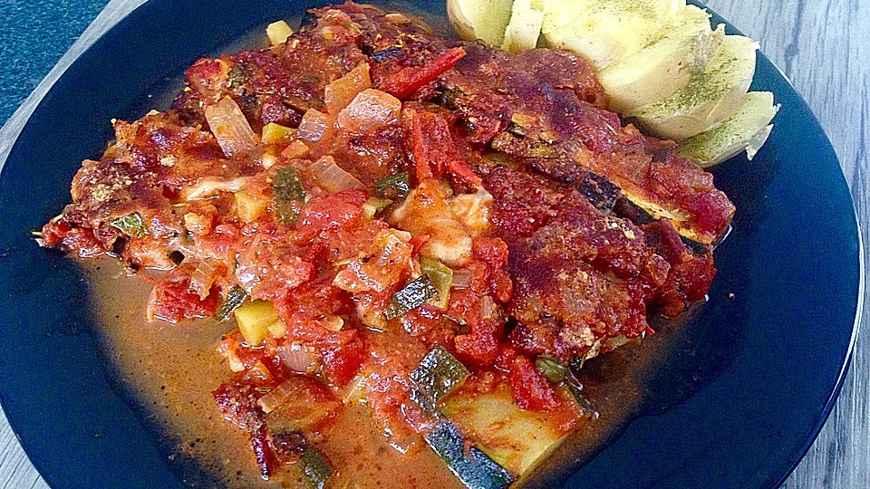

# Italienische Zucchini-Parmigiana

- **Rezept:** Italienische Zucchini-Parmigiana
- **Quelle:** [Chefkoch](https://www.chefkoch.de/rezepte/246841098487503/Italienische-Zucchini-Parmigiana.html)
- **Bewertung:** 4.17 (6 Bewertungen)
- **Arbeitszeit:** 35 Min. · **Gesamtzeit:** 35 Min. · **Schwierigkeit:** Leicht
- **Für:** 4 Portionen · **Erstellt:** 23.10.2004 · **Original:** 4 Portionen
- **Allergene:** Gluten · Milch · Eier

## Zutaten

- 1 kleine Zwiebel(n), gehackt
- 1 Zehe/n Knoblauch, gehackt
- 2 EL Olivenöl
- 1 Dose Tomaten (500 g)
- 750 g Zucchini
- Salz und Pfeffer
- Öl (zum Braten)
- 1 Bund Basilikum, gehackt
- 200 g Mozzarella
- 2 Eier
- viel Parmesan, frisch geriebener

## Zubereitung

1. **Soße ansetzen:** Gehackte Zwiebel und Knoblauchzehe in Olivenöl leicht anbraten, aber nicht braun werden lassen. Dann die Tomaten mit dem Saft dazugeben, mit Salz und Pfeffer würzen und etwas zerdrücken. Zugedeckt schmoren lassen.
2. **Zucchini braten:** Die Zucchini der Länge nach in knapp 1 cm dicke Scheiben schneiden. Diese portionsweise in Öl goldbraun braten, auf Küchenkrepp abtropfen lassen.
3. **Formieren:** Backofen vorheizen, die Eier mit Salz und Pfeffer verquirlen und den Mozzarella in Scheiben schneiden. In einer feuerfesten Form 3–4 EL Tomatensoße verteilen, Zucchinischeiben darauf geben, mit Mozzarellascheiben belegen, salzen und pfeffern.
4. **Belag:** Parmesankäse und gehacktes Basilikum darüber streuen, wieder löffelweise Tomatensoße darüber gießen. Lagenweise wiederholen, bis alle Zutaten aufgebraucht sind. Die verquirlten Eier gleichmäßig darüber geben und ca. 20 Minuten bei Mittelhitze überbacken.
5. **Servieren:** Heiß oder lauwarm mit Weißbrot als Hauptspeise oder auch als Beilage zu Kurzgebratenem servieren.

## Kommentare

(noch keine)

## Eigene Bemerkungen

(noch keine)

---

*Eine vegetarische italienische Klassiker-Variante aus Zucchinilagen mit Mozzarella, Parmesan und einer würzigen Tomatensoße, die im Backofen goldbraun überbacken wird — perfekt als Hauptspeise mit Weißbrot.*
