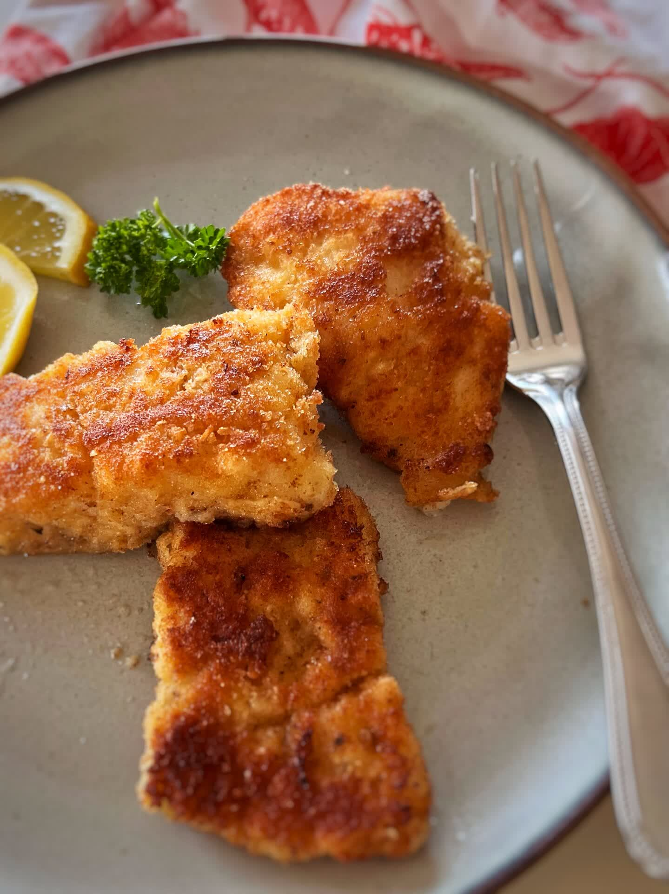

# Kabeljau, paniert

- **Rezept:** Kabeljau, paniert
- **Quelle:** [Sabrina's Table](https://sabrinastable.com/de/kabeljau-paniert-schmeckt-er-noch-besser/)
- **Bewertung:** —
- **Arbeitszeit:** 30 Min. · **Gesamtzeit:** 50 Min. · **Schwierigkeit:** Einfach
- **Für:** 4 Portionen · **Erstellt:** 20.11.2026
- **Allergene:** Eier · Milch · Getreide/Gluten

## Zutaten
- 1 kg Kabeljau
- 2 Eier
- 1 Schuss Milch
- 50 g Mehl
- 200 g Semmelbrösel
- Salz und Pfeffer
- 3 EL Butterschmalz *(gerne auch mehr)*
- Salzwasser
- 1 Zitrone *(zum Garnieren)*

## Zubereitung
1. **Vorbereitung:** Kabeljau unter kaltem Wasser abspülen, gut trocken tupfen, Haut und Gräten entfernen und in gleichmäßige Stücke schneiden.
2. **Salzwasser:** Kaltes Wasser mit 1 EL Salz vermengen und den Kabeljau etwa 15 Minuten einlegen, damit er fester wird und sich besser verarbeiten lässt. Danach gut trocken tupfen.
3. **Panieren:** Drei tiefe Teller mit Mehl, verquirlten Eiern (+ Milch) und Semmelbröseln vorbereiten. Die Stücke im Mehl wenden, überschüssiges Mehl abklopfen, dann durch die Eier ziehen und in den Bröseln wälzen; die Panade leicht andrücken.
4. **Braten:** Butterschmalz in einer großen Pfanne erhitzen, Hitze leicht reduzieren. Die panierten Stücke ruhig garen, nach 2–3 Minuten wenden und weitere 2–3 Minuten braten, bis außen goldbraun.
5. **Finalisieren:** Den Fisch auf Küchenpapier abtropfen lassen und mit frischer Zitrone beträufeln.

## Kommentare
(noch keine)

## Eigene Bemerkungen
(noch keine)

---
