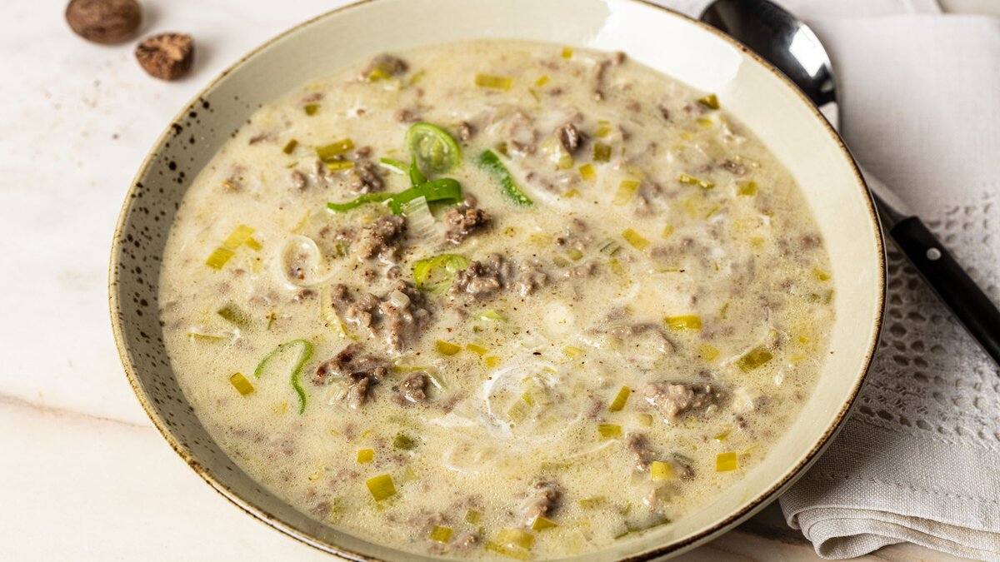

# Käse-Lauch-Suppe mit Hackfleisch

- **Rezept:** Käse-Lauch-Suppe mit Hackfleisch – nach Omas Rezept von *Einfach Kochen*
- **Quelle:** [Einfach Kochen](https://www.einfachkochen.de/rezepte/kaese-lauch-suppe-mit-hackfleisch?portions=4)
- **Bewertung:** (siehe Kommentarbereich)
- **Arbeitszeit:** ~10 Min. · **Gesamtzeit:** ~30 Min. · **Schwierigkeit:** Einfach
- **Für:** 4 Portionen · **Erstellt:** 2022
- **Allergene:** Milch
#gut 

## Zutaten (für 4 Portionen)

- 1 Zwiebel
- 1 Knoblauchzehe
- 250 g Porree
- 500 g gemischtes Hackfleisch
- 2 EL Sonnenblumenöl
- Salz
- 800 ml Gemüsebrühe
- 200 g Schmelzkäse (Rahmstufe)
- 150 g Crème fraîche (30 % Fett)
- 1 Prise Cayennepfeffer
- 1 Prise geriebene Muskatnuss

## Zubereitung

1. **Vorbereiten:** Zwiebel und Knoblauch abziehen und fein würfeln. Porree halbieren, waschen, abtropfen lassen, putzen und in Scheiben schneiden.
2. **Anbraten:** Hackfleisch in einem großen Topf mit dem Öl anbraten. Zwiebel und Knoblauch zugeben und mitbraten.
3. **Siedend kochen:** Gemüsebrühe angießen und aufkochen lassen. Die Scheiben Porree sowie Salz und Cayennepfeffer zugeben und etwa 15 Minuten köcheln lassen.
4. **Zubereiten:** Schmelzkäse und Crème fraîche zugeben und gut verrühren. Mit Muskatnuss abschmecken und warm servieren.

## Kommentare

(noch keine)

## Eigene Bemerkungen

- Mehr Porree (ca. 800-1000g) hatten wir schon.
- Creme fraiche lassen wir weg.

---

*Nehme ich an, da ich das Rezept nicht selbst ausprobiert habe.*
