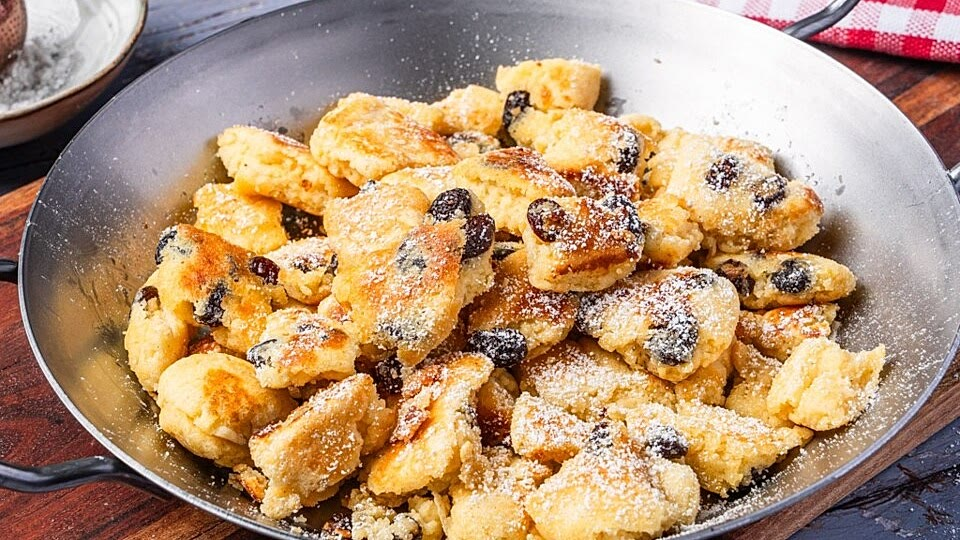

# Kaiserschmarrn (Tiroler Landgasthof)

- **Rezept:** Kaiserschmarrn – klassisch, schnell und einfach
- **Quelle:** [Chefkoch](https://www.chefkoch.de/rezepte/1031841208350942/Kaiserschmarrn-Tiroler-Landgasthofrezept.html)
- **Bewertung:** —
- **Arbeitszeit:** 15 Min. · **Gesamtzeit:** 30 Min. · **Schwierigkeit:** Mittel
- **Für:** 4 Portionen · **Erstellt:** 19.11.2025
- **Allergene:** Gluten · Eier · Milch
#gut 

## Zutaten

- 100 g Rosinen
- 5 EL Rum (Cognac oder Wasser)
- 6 Eigelb (Größe M)
- 1 Pck. Bourbon-Vanillezucker
- 1 EL, gehäuft, Zucker
- 1 Prise Salz
- 250 g Mehl
- 500 ml Milch
- 50 g Butter, flüssige
- 6 Eiweiß (Größe M)
- 75 g Butter zum Braten (ca. 15–25 g je Portion)
- 6 TL Zucker
- 4 TL Puderzucker

## Zubereitung

1. **Rosinen:** Die Rosinen in 5 EL Rum mindestens eine halbe Stunde einlegen. Wer keinen Rum mag, nimmt Cognac. Für eine alkoholfreie Variante Wasser nehmen. Anschließend die Rosinen in einem Sieb abtropfen lassen.
2. **Teig:** Das Eigelb mit dem Vanillezucker, einer Prise Salz und 1 gehäuften EL Zucker mit dem Handrührgerät 2–3 Minuten schaumig aufschlagen, bis eine hellgelbe Masse entstanden ist. Das Mehl und die Rosinen unterrühren.
3. **Eischnee:** Anschließend die zerlassene Butter einrühren. Dann das Eiweiß zu einem festen Eischnee aufschlagen und mit einem Löffel oder Teigschaber langsam, aber gründlich, unter die Teigmasse heben. Es sollten keine Eiweißflocken mehr zu sehen sein.
4. **Braten:** In einer breiten Pfanne (ca. 24–28 cm Durchmesser) 15–25 g Butter zerlassen und 1/3 des Teiges ca. 1 cm hoch eingießen. Hitze etwas reduzieren und den Teig 3–5 Minuten goldgelb anbraten. Dann umdrehen und die andere Hälfte braten.
5. **Servieren:** Den Kaiserschmarrn mit 2 TL Zucker bestreuen und bei etwas höherer Hitze in der Pfanne karamellisieren lassen. Kaiserschmarrn sofort auf Tellern anrichten und mit Puderzucker bestäuben. Mit dem restlichen Teig genau so verfahren. Dabei vor jedem Eingießen in die Pfanne alles nochmals gut verrühren, da die Rosinen schnell zu Boden sinken.

## Kommentare

(noch keine)

## Eigene Bemerkungen

(noch keine)

---

*Traditionelles Rezept aus einem Tiroler Landgasthof.*

