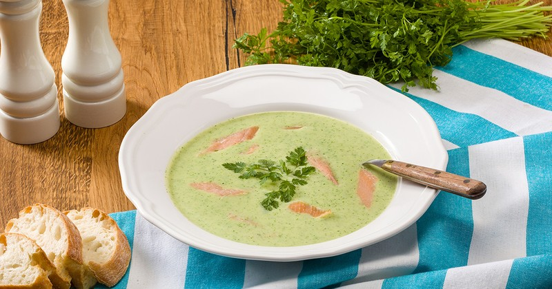

# Kerbelsuppe

- **Rezept:** Kerbelsuppe
- **Autor:** EatMe
- **Quelle:** [EatMe](https://www.eatme.eu/de/rezepte/kerbelsuppe)
- **Bewertung:** —
- **Arbeitszeit:** 25 Min. · **Gesamtzeit:** 50 Min. · **Schwierigkeit:** Leicht
- **Für:** 4 Portionen · **Erstellt:** 22.04.2021
- **Allergene:** Milch, Gluten, Fisch

## Zutaten

- 1 Schalotte
- 75 g Butter
- 75 g Mehl
- 25 g frischer Kerbel
- 200 ml Kochsahne
- 1 Würfel Gemüsebrühwürfel
- 100 g geräucherte Forelle
- Salz und Pfeffer

## Zubereitung

1. Die Schalotte fein hacken. Die Butter in einem Suppentopf erhitzen und die Schalotte drei Minuten bei mittlerer Hitze anschwitzen. Das Mehl hinzugeben und unter Rühren drei Minuten garen lassen. 250 ml Wasser dazugeben, zum Kochen bringen und mit dem Schneebesen weiterrühren, bis die Suppe leicht gebunden ist und keine Klümpchen mehr enthält.
2. Weitere 750 ml Wasser hinzufügen und zum Kochen bringen. Ein paar schöne Kerbelzweige für die Garnierung aufheben, den Rest hacken und zusammen mit der Sahne und dem Gemüsebrühwürfel in die Suppe geben. Erneut zum Kochen bringen und zwei Minuten bei schwacher Hitze köcheln lassen. Mit einem Stabmixer pürieren, bis eine glatte Suppe entsteht, anschließend mit Salz und Pfeffer abschmecken.
3. Die geräucherte Forelle in Streifen schneiden und auf vier warme Teller verteilen. Die Suppe darüber gießen und mit dem restlichen Kerbel garnieren.

## Kommentare

(noch keine)

## Eigene Bemerkungen

(noch keine)

---

*Nährwerte (pro Portion): 345 kcal · 9 g · 17 g · 16 g.*
