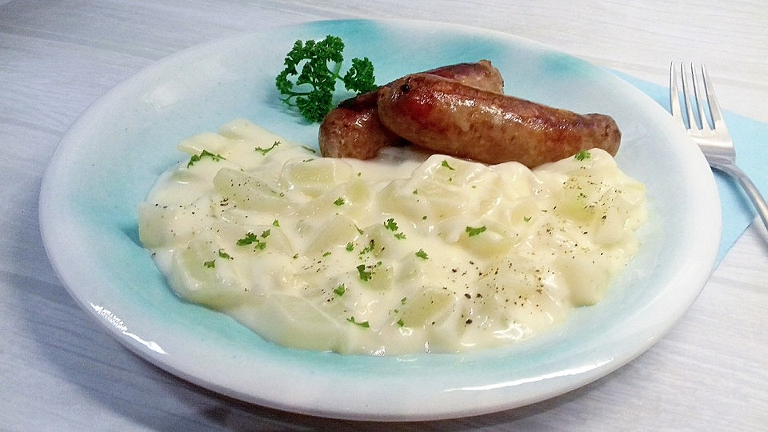

# Kohlrabigemüse, klassisch (von kindermama)

- **Rezept:** Kohlrabigemüse, klassisch
- **Quelle:** [Chefkoch](https://www.chefkoch.de/rezepte/513871147148871/Kohlrabigemuese-klassisch.html)
- **Bewertung:** 4.67 (301 Bewertungen)
- **Arbeitszeit:** 40 Min. · **Gesamtzeit:** 40 Min. · **Schwierigkeit:** Leicht
- **Für:** — · **Erstellt:** 09.05.2006 · **Original:** 4 Portionen
- **Allergene:** Milch
#gut 

## Zutaten

- 1 Zwiebel(n) (oder 2 Schalotten)
- 2 Kohlrabi (mit Stiel und Blättern, circa 800 g)
- 1 EL Butter
- Salz
- Pfeffer
- Muskat (frisch gerieben)
- 100 ml Wasser
- 100 ml Sahne
- evtl. Brühe (gekörnte)
- evtl. Mehl (zum Binden)

## Zubereitung

1. **Vorbereiten:** Zwiebel oder Schalotte schälen und fein würfeln. Kohlrabis schälen, waschen und in Würfel oder Stifte schneiden. Zwei bis drei der ganz kleinen feinen Kohlrabiblättchen waschen, klein hacken und zur Seite stellen.
2. **Garen:** Die Zwiebel in 1 EL Butter glasig anschwitzen, ganz leicht Farbe annehmen lassen. Von der Platte nehmen und die Kohlrabiwürfel zugeben. Etwas Salz, Pfeffer, Muskat, etwa 100 ml Wasser und 100 ml Sahne zugeben (wer unbedingt möchte, kann etwas gekörnte Brühe zugeben oder statt Wasser Gemüsebrühe nehmen). Wieder auf die Herdplatte stellen und aufkochen lassen. Dann bei kleiner bis mittlerer Hitze im geschlossenen Topf ca. 15 bis 20 Min. kochen. Ab und zu etwas umrühren. Anmerkung: Die Sahne flockt beim Kochen etwas aus, das gibt sich jedoch beim Umrühren wieder.
3. **Blätter:** Kurz vor Ende der Garzeit die zarten Kohlrabiblättchen zugeben.
4. **Binden:** Evtl. die Soße etwas abbinden, entweder einfach mit 1 TL Mehl in wenig Wasser aufgelöst oder, etwas feiner, mit Mehlbutter. Tipp: Eine herzhaftere Variante ergibt sich, wenn man zu Beginn die Zwiebel in gewürfeltem Speck anbrät.

## Kommentare

(noch keine)

## Eigene Bemerkungen

(noch keine)

---

*Ein herzhaftes, leichtes Kohlrabigemüse in einer cremigen Butter-Sahne-Soße — der Klassiker, der mit zarten Kohlrabi-Blättern als Beilage perfekt wird.*
