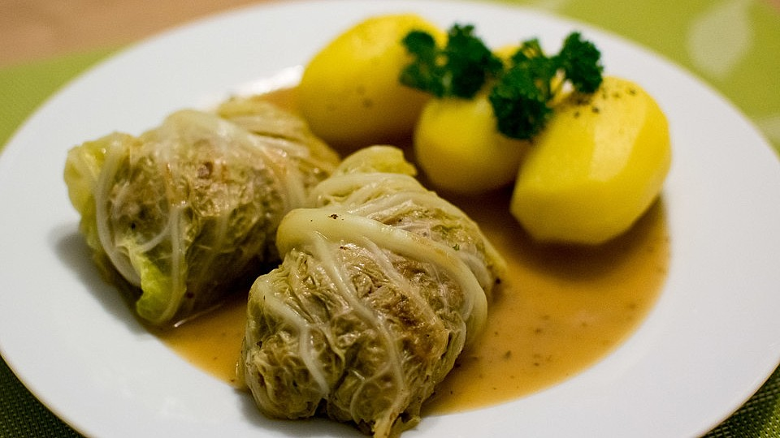

# Omas Kohlrouladen

- **Rezept:** Omas Kohlrouladen von *äüöp*
- **Quelle:** [Chefkoch](https://www.chefkoch.de/rezepte/426431133556910/Omas-Kohlrouladen.html)
- **Bewertung:** (siehe Kommentarbereich)
- **Arbeitszeit:** ~50 Min. · **Gesamtzeit:** ~1h30 · **Schwierigkeit:** Mittel
- **Für:** 4 Portionen · **Erstellt:** 03.12.2005
- **Allergene:** Gluten · Eier · Milch
#gut 

## Zutaten (für 4 Portionen)

- 1 Wirsing (oder Weißkohl)
- 2 Brötchen (altbacken)
- 2 Zwiebel(n)
- 1 kg Hackfleisch, gemischtes
- 2 Eier (Kl. M)
- n. B. Senf (ca. 2–4 EL)
- n. B. Salz und Pfeffer
- n. B. Paprikapulver, rosenscharfes
- n. B. Majoran
- 200 g Speckwürfel
- 1 l Brühe
- 400 ml Sahne

## Zubereitung

1. **Blätter vorbereiten:** Acht schöne Blätter vom Wirsing oder Weißkohl ablösen und in kochendem Salzwasser blanchieren. In Eiswasser abschrecken und mit einem Küchentuch etwas trocknen.
2. **Teig ansetzen:** Für den Hackfleischteig das Brötchen in reichlich kaltem Wasser einweichen. Danach sehr gut ausdrücken. Die Zwiebel schälen und fein würfeln. Danach das Hackfleisch, das Ei, das ausgedrückte Brötchen, 1–2 EL Senf, die Zwiebelwürfel, ordentlich Salz und Pfeffer sowie scharfes Paprikapulver in eine Schüssel geben. Zum Schluss nach Belieben noch getrockneten Majoran hineinstreuen. Alles gut vermengen.
3. **Rollen:** Kleine Häufchen vom Hackfleischteig auf die ausgelegten Kohlblätter verteilen, zusammenrollen und mit Küchengarn zusammenbinden.
4. **Schmoren & Soße:** Die Kohlrouladen in einer hohen Pfanne anbraten, sodass sie Farbe bekommen. Dabei auch die Speckwürfel mit auslassen. Haben die Kohlrouladen etwas Farbe angenommen, mit Brühe aufgießen. Zugedeckt eine halbe Stunde schmoren lassen. Zum Schluss die Rouladen herausnehmen. Sahne zur Soße geben, etwas einkochen lassen oder evtl. leicht abbinden. Mit wenig Salz und Pfeffer abschmecken und die Soße zu den Kohlrouladen servieren.

## Kommentare

(noch keine)

## Eigene Bemerkungen

(noch keine)

---

*Klassisches Gericht mit Hackfleischteig in blanchierten Kohlblättern, geschmort in Brühe und Sahne.*
