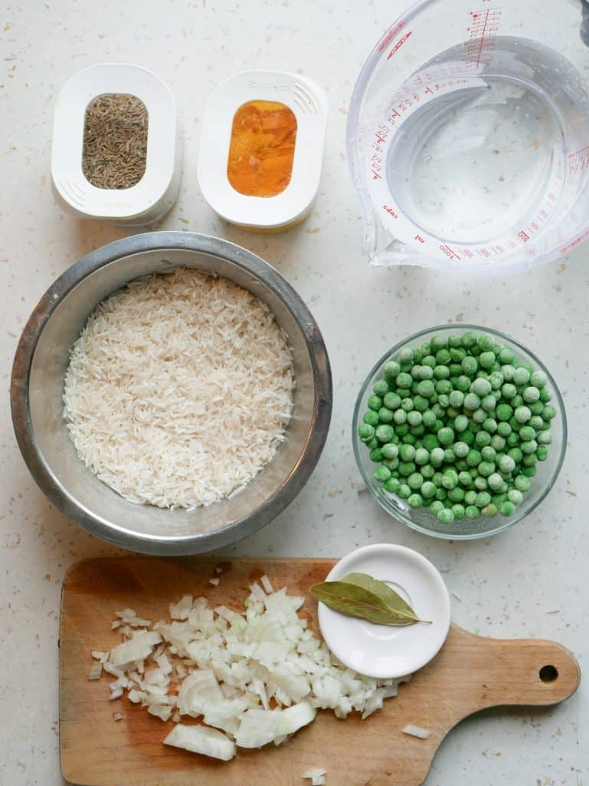

# Kurkuma Reis mit Erbsen (Mamas Rezept)

- **Rezept:** Kurkuma Reis mit Erbsen
- **Rezeptor:** *Shiba* (Shibas Kitchen)
- **Quelle:** [Shibas Kitchen](https://shibaskitchen.de/kurkuma-reis/)
- **Bewertung:** (siehe Kommentarbereich)
- **Arbeitszeit:** 15 Min. · **Gesamtzeit:** 25 Min. · **Schwierigkeit:** Einfach
- **Für:** 4 Portionen · **Erstellt:** Oktober 2022
- **Allergene:** (keine)

## Zutaten (für 4 Portionen)

- 300 g Reis (weiß, z. B. Basmati)
- 1 TL Kurkuma
- 200 g Erbsen (grün, frisch oder eingefroren)
- 1 Zwiebel
- 2 EL Öl
- Salz
- Pfeffer

## Zubereitung

1. **Reis waschen:** Den Reis vorher gründlich waschen und im Wasser für kurze Zeit (ca. 5–10 Min.) einweichen lassen.
2. **Reis kochen:** Den gewaschenen Reis mit 1,5-facher Menge Wasser und dem Kurkuma aufkochen. Danach die Hitze runterschalten (auf die niedrigste Stufe), Deckel zu und den Reis ca. 10–15 Minuten in Ruhe garen, ohne ihn zu rühren.
3. **Erbsen:** Die Erbsen (und die gewürfelte Zwiebel mit etwas Öl) separat kurz anbraten und dann zum Reis geben.
4. **Abschmecken:** Mit Salz und Pfeffer abschmecken. Der Reis ist dann schön gelb gefärbt.

## Kommentare

- **Autorin Shiba:** „Heute stelle ich euch meine Lieblingsreisvariante vor: Kurkuma Reis mit Erbsen. Die wunderschöne gelbe Farbe kommt natürlich von Kurkuma und gemeinsam mit den grünen Erbsen eine wunderschöne Farbkombination. Ein großes Highlight für meine Gäste."

## Eigene Bemerkungen
(noch keine)

---
*Einfacher, bunter Reis mit der goldenen Farbe von Kurkuma — Lieblingsrezept aus der Kindheit der Autorin.*
