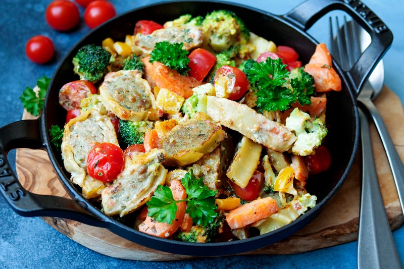

# Maultaschen-Pfanne mit Gemüse

- **Rezept:** Maultaschen-Pfanne mit Gemüse
- **Quelle:** [Gaumenfreundin](https://www.gaumenfreundin.de/maultaschen-pfanne/)
- **Bewertung:** —
- **Arbeitszeit:** — · **Gesamtzeit:** 25 Min. · **Schwierigkeit:** Leicht
- **Für:** 3 Portionen · **Erstellt:** 18.06.2023
- **Allergene:** —
#gut 

## Zutaten

- 1 Pck. Maultaschen 6 Stück
- 1 Zwiebel
- 1 Knoblauchzehe
- 1 Möhre
- 1 Brokkoli
- 1 gelbe Paprikaschote
- 200 g kleine Tomaten
- 2 EL Olivenöl
- 200 ml Gemüsebrühe
- 100 ml Sahne
- Salz und Pfeffer
- 1 TL Paprikapulver edelsüß

## Zubereitung

1. Maultaschen in Streifen schneiden. Zwiebel und Knoblauch klein hacken. Möhre in Scheiben schneiden, Brokkoli in Röschen teilen, Paprika würfeln und Tomaten halbieren.
2. Die Hälfte vom Öl in einer Pfanne erhitzen. Maultaschen knusprig anbraten, dann herausnehmen. Nochmal Öl in die Pfanne geben. Zwiebeln, Knoblauch, Möhren, Brokkoli und Paprika zugeben und 5 Minuten braten.
3. Sahne und Gemüsebrühe einrühren und bei mittlerer Hitze 10 Minuten köcheln lassen. Maultaschen und Tomaten unterheben. Alles mit Salz, Pfeffer und Paprika würzen.

## Kommentare

(noch keine)

## Eigene Bemerkungen
- **Mehr** Maultaschen. Wir nehmen immer 2 Päckchen (2x6 Stück)

---

*Nährwerte (pro Portion): 451 kcal · 19 g · 19 g · 56 g.*
