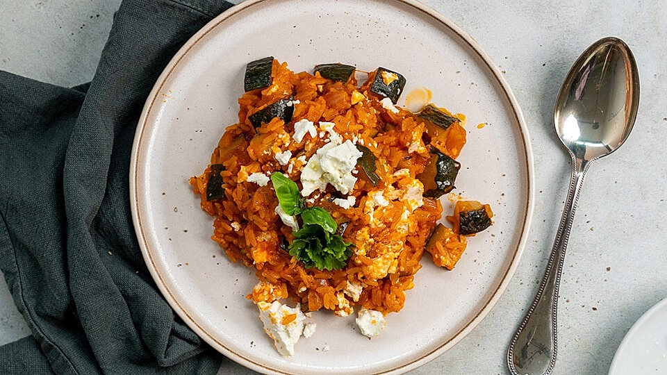

# Mediterrane Zucchini-Pfanne

- **Rezept:** Mediterrane Zucchini-Pfanne
- **Quelle:** [Chefkoch](https://www.chefkoch.de/rezepte/1131861219575913/Mediterrane-Zucchini-Pfanne.html)
- **Bewertung:** 4.56 (711 Bewertungen)
- **Arbeitszeit:** 20 Min. · **Gesamtzeit:** 45 Min. · **Schwierigkeit:** Mittel
- **Für:** 4 Portionen · **Erstellt:** 24.08.2008 · **Original:** 4 Portionen
- **Allergene:** Gluten · Milch · Eier

## Zutaten

- 1 Zwiebel, gewürfelte
- 1 Knoblauchzehe, gepresste
- 4 EL Olivenöl
- 2 Zucchini (ca. 350 g)
- 125 g Reis
- 600 ml Gemüsebrühe
- 100 g Tomatenmark
- Salz und Pfeffer
- Thymian
- 200 g Feta-Käse, gewürfelter

## Zubereitung

1. **Vorbereiten:** Die Zwiebel würfeln, den Knoblauch pressen. Die Zucchini waschen, vierteln und in Scheiben schneiden.
2. **Anbraten & garen:** Das Olivenöl in einer großen Pfanne erhitzen und die Zwiebel darin anschwitzen. Die Zucchini zusammen mit dem Knoblauch dazu geben und einige Zeit mitbraten. Den ungekochten Reis hinzufügen und ebenfalls etwas mitbraten. Das Tomatenmark mit dem Schneebesen in die Gemüsebrühe einrühren und damit den Reis ablöschen. Dann alles aufkochen lassen. Mit Salz, Pfeffer und Thymian abschmecken und ca. 20 Min. auf kleiner Stufe köcheln lassen, bis der Reis die Sauce aufgesogen hat und gar ist. Dabei gelegentlich umrühren. Sollte zu wenig Flüssigkeit vorhanden sein, einfach noch ein wenig Gemüsebrühe unterrühren.
3. **Feta:** Kurz vor dem Servieren den gewürfelten Feta-Käse unter das Gericht mischen und etwas verlaufen lassen.

## Kommentare

(noch keine)

## Eigene Bemerkungen

(noch keine)

---

*Eine mediterrane Pfanne aus Reis, Zucchini und Tomatenmark in einer würzigen Brühe-Soße, mit gewürfeltem Feta als feiner Krönung. Schnelle, gesunde Beilage oder leichtes Hauptgericht.*
