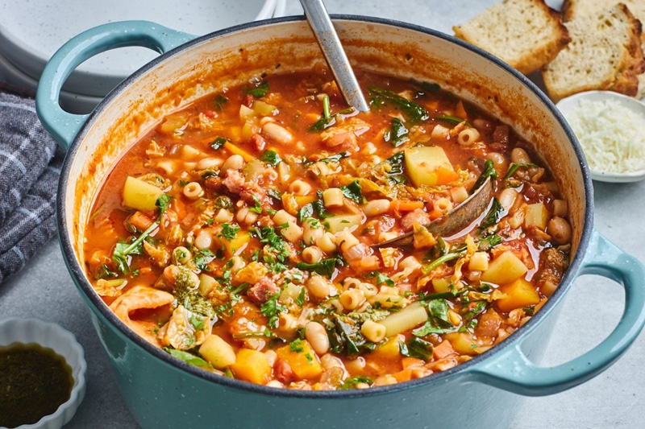

# Minestrone

- **Quelle:** -
- **Für:** 4 Portionen 

#gut 

## Zutaten

- 3 Zwiebeln 
- 2 Staudensellerie 
- 2 Kartoffeln 
- 500g Bohnen 
- 1 Zucchini 
- 2 Möhren 
- 3 Knoblauch 
- Speck
- 2 Tomaten 
- Erbsen (TK optional)
- 100g Parmesan 
- Basilikum 
- Spaghetti 
- Tomatenmark
- Brühe 1,5l mit ca 1 EL Briühe

## Zubereitung

1. 

## Eigene Bemerkungen
(noch keine)

---
