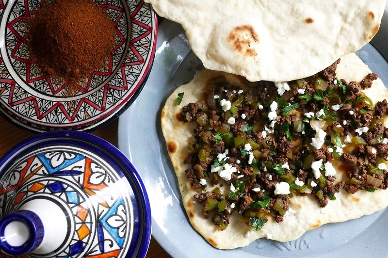

# Orientalische Hackfleisch-Fladen mit Baharat

- **Rezept:** Orientalische Hackfleisch-Fladen mit Baharat – unserem Gewürz des Monats!
- **Autor:** Andrea Rolshausen
- **Quelle:** [Gewürze der Welt](https://www.gewuerze-der-welt.net/rezepte/hauptgang/orientalische-hackfleisch-fladen-mit-baharat)
- **Bewertung:** —
- **Arbeitszeit:** — · **Gesamtzeit:** — · **Schwierigkeit:** —
- **Für:** 4 Portionen · **Erstellt:** 23.11.2026
- **Allergene:** —
#gut 

## Zutaten

- 2 Zwiebeln, gehackt
- 2 grüne Paprikaschoten, gehackt
- 500 g Hackfleisch
- Salz nach Geschmack
- 3 EL Baharat
- schwarzer Pfeffer nach Geschmack
- 150 g Schafskäse, zerbröselt
- 1 Bund Petersilie, die Blätter gehackt
- Für die Fladen:
  - 500 g Mehl
  - Salz nach Geschmack
  - 10 g frische Hefe

## Zubereitung

1. Das Öl in einer Pfanne erhitzen und das Hackfleisch kräftig anbraten. Baharat hinzufügen und unter Rühren 1 Minute mitbraten. Zwiebeln und Paprika hinzufügen und dünsten, bis das Gemüse weich ist. Den Schafskäse und die Petersilie unterziehen und mit Baharat, Salz und Pfeffer abschmecken.
2. Für die Fladen das Mehl und ca. ½ TL Salz vermischen. In die Mitte eine Mulde drücken und die Hefe hineinbröckeln. 170 ml warmes Wasser hinzufügen und von innen nach außen zu einem glatten Teig verarbeiten. Dabei 1 EL Öl einarbeiten.
3. Den Teig in 8 Portionen teilen und die Teigstücke dünn ausrollen.
4. In einer Pfanne etwas Öl erhitzen und die Fladen darin pro Seite 2 Minuten ausbacken. Fertige Fladen im Ofen warmstellen.
5. Die Fladen mit der Hackfleisch-Mischung bestreichen und servieren.
6. Guten Appetit!

## Kommentare

(noch keine)

## Eigene Bemerkungen

- Noch eine Paprika dazu. (oben verbessert)
