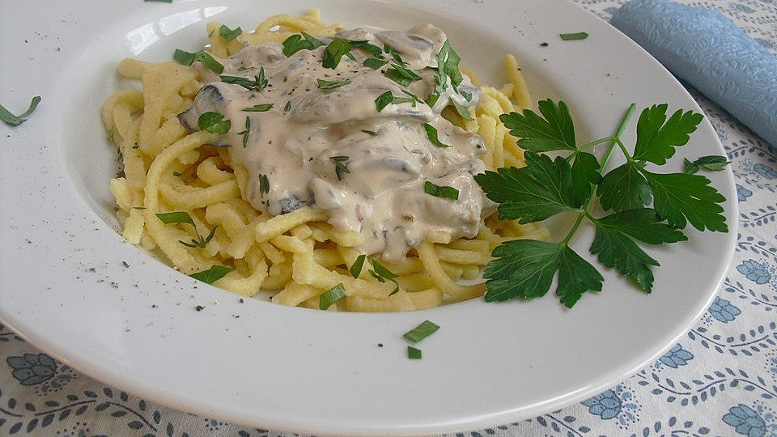

# Pasta in cremiger Pilzsauce

- **Rezept:** Pasta in cremiger Pilzsauce
- **Rezeptor:** *Untrennbar*
- **Quelle:** [Chefkoch](https://www.chefkoch.de/rezepte/2647841416081307/Pasta-in-cremiger-Pilzsauce.html)
- **Bewertung:** 4,8/5 (8 Bewertungen)
- **Arbeitszeit:** 10 Min. · **Gesamtzeit:** 25 Min. · **Schwierigkeit:** Simpel
- **Für:** 1 Portion · **Erstellt:** 15.01.2015
- **Allergene:** Gluten · Milch
- **Nährwerte:** 3187 kcal / Portion

## Zutaten (für 1 Portion)

- 500 g Nudeln, getrocknet
- 500 g Pilze, gemischt (Champignons, Austern, Wildpilze, Steinpilze usw.)
- 1,5 Becher Sahne
- 1 Schalotte
- 100 g Speck
- 1 Knoblauchzehe
- 1 TL, gehäuft Thymian, getrocknet
- 1 Bund Petersilie, frisch
- Salz und Pfeffer
- Olivenöl

## Zubereitung

1. **Nudeln:** Nudelwasser aufsetzen und zum Kochen bringen, salzen und die Nudeln al dente kochen.
2. **Sauce:** Währenddessen die Pilze säubern, klein schneiden und die Schalotte sowie den Speck fein würfeln. Öl in einer Pfanne erhitzen und die Schalotte glasig dünsten. Den Knoblauch in feine Scheiben schneiden und mit dem Speck hinzugeben. Wenn der Speck leicht Farbe bekommen hat, die Pilze mit hinzugeben und leicht anbraten. Mit der Sahne ablöschen und aufkochen lassen. Thymian hinzugeben und mit Salz und Pfeffer abschmecken. Die Petersilie hacken (ein paar Blätter aufheben) und kurz bevor die Nudeln al dente sind, in die Sauce geben.
3. **Veredeln:** Die Nudeln abgießen und tropfnass zurück in den Topf geben. Die Sauce hinzufügen und alles schön verrühren.

## Kommentare

- **Goertivor 6 Jahren:** „Ich habe Pilze gesammelt und deine Sauce davon zubereitet. Die Farbe der Sauce war nicht so ansprechend, aber lecker war sie in jedem Fall. Meine Tochter ernährt sich vegetarisch, daher habe ich dieses Mal den Speck weg gelassen. Vielen Dank für's Einstellen. Grüße von Goerti"
- **_Reini_vor 8 Jahren:** „Hallo Untrennbar, bei uns gab es das Gericht heute als Resteverwertung für Steinpilze. War sehr lecker. Werde es bei Gelegenheit nochmal mit gemischten Pilzen nachkochen. Danke für das Rezept. Viele Grüße"

## Eigene Bemerkungen
(noch keine)

---
*Cremige Vegetarier-/Vegetarierfreundinnen-Sauce — schnelle Hauptgericht für 1 Person.*
