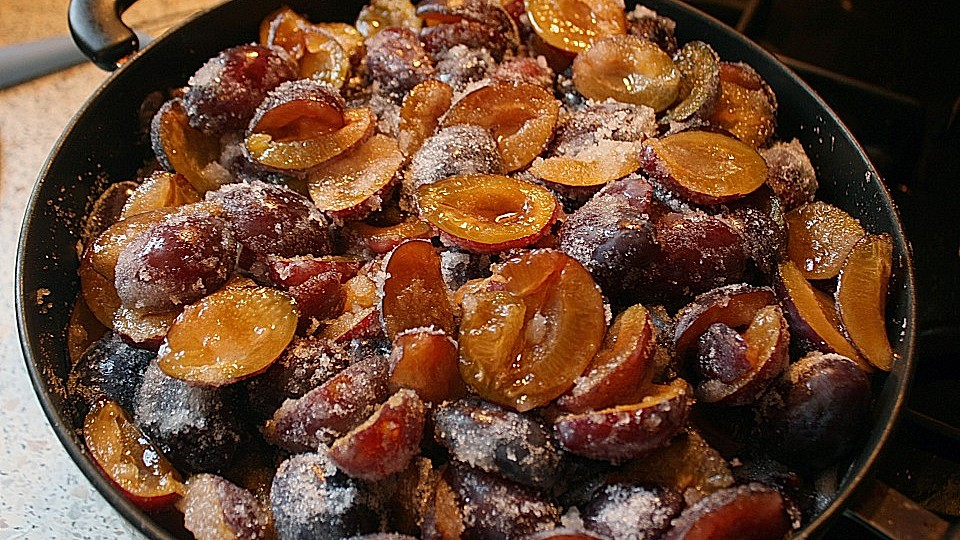

# Pflaumenmus im Backofen (von Backliesel80)

- **Rezept:** Pflaumenmus im Backofen
- **Quelle:** [Chefkoch](https://www.chefkoch.de/rezepte/1529851258462100/Pflaumenmus-im-Backofen.html)
- **Bewertung:** 4.7 (156 Bewertungen)
- **Arbeitszeit:** 50 Min. · **Gesamtzeit:** 50 Min. · **Schwierigkeit:** Leicht
- **Für:** 24 kleine Schraubgläser (150 ml) · **Erstellt:** 17.11.2009 · **Original:** 1 Portion (Partien)
- **Allergene:** —

## Zutaten

**Reicht für ca. 24 kleine Schraubgläser (150 ml):**

- 5 kg Pflaume(n)
- 5 EL Essig (neutral oder Fruchtessig)
- 1,5 kg Zucker
- 5 EL Wasser
- 2 TL Zimt (gemahlen, nach Bedarf)
- 3 EL Rum (nach Bedarf)

## Zubereitung

1. **Vorbereiten:** Die Pflaumen entsteinen und in einen Bräter geben. Essig, Zucker und Wasser dazugeben und etwas durchrütteln.
2. **Ziehen lassen:** Nun am besten abgedeckt über Nacht ziehen lassen. Vollreife Pflaumen brauchen weniger Zeit — sobald sie ein paar Zentimeter im eigenen Saft stehen, können sie in den Ofen.
3. **Backen:** Ca. 4 Stunden ohne Deckel im Backofen bei 150 °C Umluft garen. **Während dem Backen nicht rühren** — wer einmal rührt, muss es immer wieder tun, sonst brennt es an. Falls die oberste Schicht verbrennt, kann man sie vorsichtig mit einem Kochlöffel in die Flüssigkeit drücken und die Backofentür stoßweise öffnen, damit der Dampf entweicht.
4. **Pürieren:** Bräter aus dem Ofen nehmen und die Pflaumen mit dem Pürierstab pürieren. Eventuell noch mit Zimt und Rum abschmecken und in vorbereitete Schraubgläser füllen.

## Kommentare

(noch keine)

## Eigene Bemerkungen

(noch keine)

---

*Ohne Umrühren und ohne Gelierzucker — der Backofen übernimmt die Zubereitung. Nach 4 Stunden wird das Mus schön dick und schmeckt genauso gut wie der gekaufte. Mit Pürierstab fertig.*
