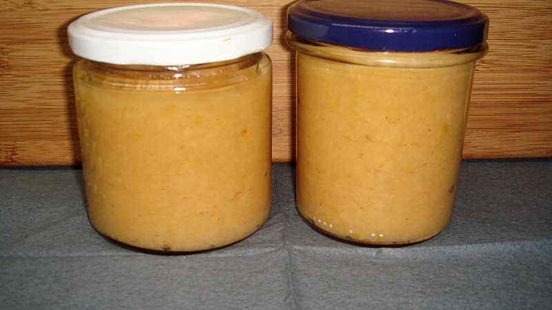

# Quittenmus

- **Quelle:** ???
- Für: 3Gläser a 250ml plus einmal Sofortverbrauch. 

#gut 

## Zutaten

- 12 Quitten , 1900g (entkernt)
- 3 Äpfel, 275g (entkernt)
- Zucker 1:10
- 2X Vanillezucker 

## Zubereitung

1. Quitten und Äpfel nicht schälen - einfach gut abwaschen
2. 45 min köcheln 
3. Mit dem Zauberstab pürieren 

## Eigene Bemerkungen
(noch keine)

---
