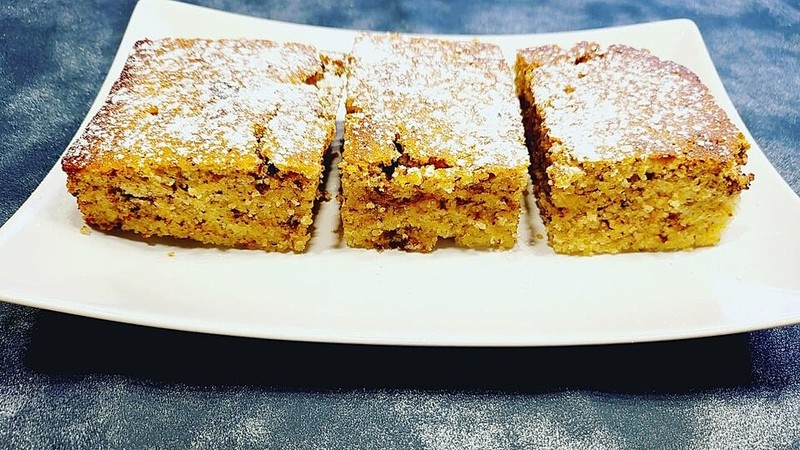

# Quittenschnitten

- **Rezept:** Quittenschnitten von MeiLing
- **Quelle:** [Chefkoch](https://www.chefkoch.de)
- **Bewertung:** —
- **Arbeitszeit:** 20 Min. · **Gesamtzeit:** 50 Min. · **Schwierigkeit:** Leicht
- **Für:** 1 Portionen · **Erstellt:** 26.10.2011
- **Allergene:** —
#gut 

## Zutaten

- 180 g Zucker
- 200 g Margarine
- 4 Ei
- 250 g Mehl
- 0.5 Pck. Backpulver
- 4 Quitte
- 1 EL Schokodekor

## Zubereitung

1. Quitten vierteln, schälen und Kernhaus entfernen. In kleine Würfel schneiden und in ca. 200 ml Wasser und etwas Zitronensaft ca. 15 Minuten köcheln (sollten so weich sein, dass man sie mit den Pürierstab zu Mus verarbeiten kann.)
2. Butter, Zucker und Eier sehr schaumig rühren. Mehl mit Backpulver mischen und unterrühren. Dann das abgekühlte Quittenmus (sollten 150g werden) unterrühren. Die Schokotropfen ebenfalls dazugeben.
3. Auf ein gefettetes Backblech streichen und ca. 25-30 Minuten bei 175 Grad U/O-Hitze backen. Stäbchenprobe ist sinnvoll. Mit Puderzucker bestäuben

## Kommentare

(noch keine)

## Eigene Bemerkungen

- Nach 15 min abdecken 
- Etwas weniger Zitrone
- 160 Grad, länger ... bis zu 20 Min. 
- Mehl 5/3 von Quitte oder 1zu1.

---

*Nährwerte (pro Portion): 3685 kcal · 54.4 g · 189.8 g · 434.1 g.*
