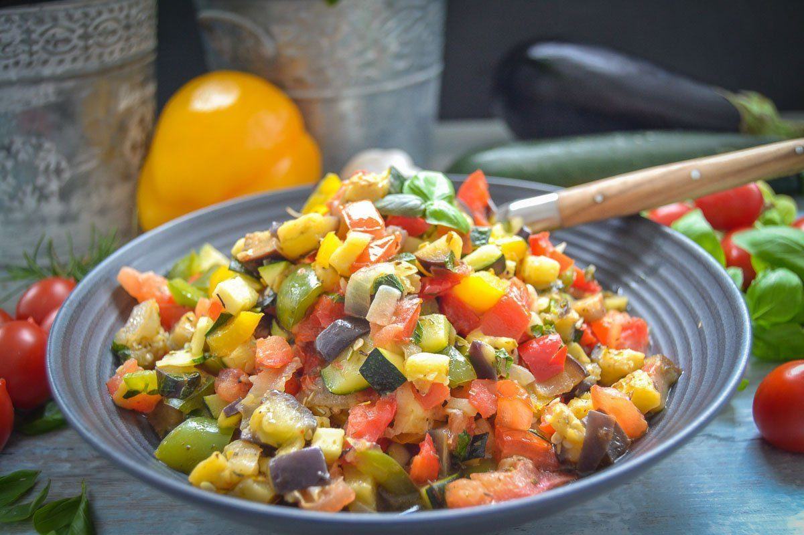

# Ratatouille Rezept

- **Rezept:** Ratatouille Rezept von *Kochen aus Liebe*
- **Quelle:** [Kochen aus Liebe](https://kochenausliebe.com/ratatouille-rezept-einfach-original-franzoesisches-gemuese/)
- **Bewertung:** (siehe Kommentarbereich)
- **Arbeitszeit:** ~10 Min. · **Gesamtzeit:** ~30 Min. · **Schwierigkeit:** Einfach
- **Für:** 4 Portionen · **Erstellt:** 22.07.2024
- **Allergene:** (keine)

## Zutaten (für 4 Portionen)

- 2 rote Paprikaschoten
- 2 gelbe Paprikaschoten
- 2 grüne Paprikaschoten
- 4 kleine Zucchini
- 2 Auberginen
- 2 Lorbeerblätter
- 6 Zehen Knoblauchzehen (frisch, mild)
- 2 Zwiebeln (Gemüsezwiebeln)
- 4 Tomaten (Fleischtomaten, entkernt)
- Salz (nach Geschmack)
- 2 TL Kräuter der Provence
- 2 TL Rosmarin (frisch gehackt)
- 2 TL Thymian (frisch gehackt)
- 2 TL Sarriette (Bohnenkraut)
- 1 TL Piment d'Espelette (oder etwas Chili)
- 2 Lorbeerblätter
- 16–20 EL Olivenöl
- 2 Handvoll Basilikum

## Zubereitung

1. **Vorbereiten:** Alle Zutaten bereitstellen, das Gemüse waschen, Zwiebel und Knoblauch schälen und in kleine Würfel schneiden. Die Kräuter hacken und die Tomaten entkernen.
2. **Paprika:** Die Paprikaschoten von den Kernen befreien und gleichmäßig klein würfeln.
3. **Anbraten:** Das Olivenöl erhitzen und die Zwiebeln andünsten, nach 3 Minuten die Paprikawürfel, Knoblauch und das Lorbeerblatt dazugeben.
4. **Auberginen:** Die klein gewürfelten Auberginenwürfel zugeben und andünsten.
5. **Zucchini:** Nach ein paar Minuten die gewürfelte Zucchini zum Gemüse geben.
6. **Tomaten:** Zum Schluss die Tomatenwürfel und das geschnittene Basilikum zum Rest geben, mit dem Salz nochmal abschmecken.

## Kommentare

(noch keine)

## Eigene Bemerkungen

(noch keine)

---

*Klassisches provenzalische Sommergericht aus Paprika, Zucchini, Aubergine, Tomate und Kräutern — schmeckt warm und kalt.*
