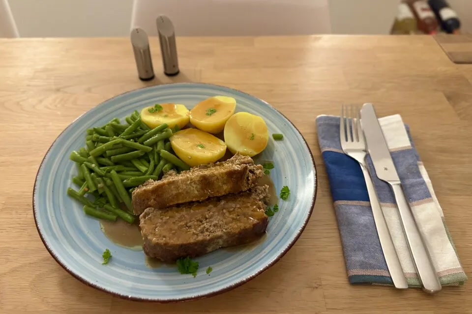

# Saftiger Hackbraten mit Soße

- **Rezept:** Saftiger Hackbraten mit Soße
- **Quelle:** [Chefkoch](https://www.chefkoch.de/rezepte/2562321401087811/Saftiger-Hackbraten-mit-Sosse.html)
- **Bewertung:** —
- **Arbeitszeit:** 25 Min. · **Gesamtzeit:** 105 Min. · **Schwierigkeit:** Normal
- **Für:** 4 Portionen · **Erstellt:** 19.11.2025
- **Allergene:** Gluten · Eier · Milch
#gut 

## Zutaten

- 1 Brötchen (altbacken)
- 1 m.-große Zwiebel
- 1 Ei
- Petersilie (frisch oder getrocknet)
- 500 g Hackfleisch
- 1 TL Senf (mittelscharf)
- 0.5 TL Paprikapulver, edelsüßes
- Salz und Pfeffer
- 400 ml Fleischbrühe (oder Wasser)
- 3 EL Tomatenmark
- 1 Becher süße Sahne
- 3 TL Speisestärke (oder Mehl)
- 2 EL Öl (zum Anbraten)

## Zubereitung

1. **Brotlaib:** Das Brötchen in Wasser einweichen. Zwiebel schälen und in feine Würfel schneiden. Hackfleisch mit Salz, Pfeffer und Paprikapulver würzen, Petersilie dazugeben. Das ausgedrückte Brötchen zusammen mit dem Ei unterrühren und alles zu einer Art Brotlaib formen.
2. **Anbraten:** Öl in einem Topf erhitzen und den Hackbraten von allen Seiten kräftig anbraten. Mit der Fleischbrühe oder Wasser ablöschen und salzen. Tomatenmark und Senf einrühren. Deckel drauf und etwa eine Stunde schmoren lassen.
3. **Soße:** Den Hackbraten aus dem Topf nehmen und warm stellen. Die Sahne mit der Speisestärke oder mit Mehl mischen, in die Soße rühren und für die Bindung nochmals wenige Minuten köcheln lassen. Bei Bedarf nochmals mit Salz und Pfeffer nachwürzen.

## Kommentare

(noch keine)

## Eigene Bemerkungen

(noch keine)

---

*Serviert mit Gemüse und Semmelknödeln.*

