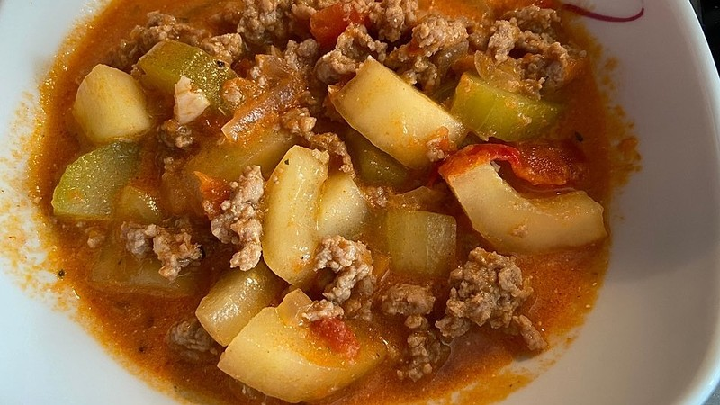

# Würzige Schmorgurken mit Hackfleisch

- **Rezept:** Würzige Schmorgurken mit Hackfleisch
- **Rezeptor:** *Manuela-Kyra* (Wochenplaner Kochbuch)
- **Quelle:** [Chefkoch](https://www.chefkoch.de/rezepte/3919151598352228/Wuerzige-Schmorgurken-mit-Hackfleisch.html?portionen=4)
- **Bewertung:** 4,7/5 (7 Bewertungen)
- **Arbeitszeit:** 20 Min. · **Gesamtzeit:** 55 Min. · **Schwierigkeit:** Normal
- **Für:** 4 Portionen · **Erstellt:** 06.11.2020
- **Allergene:** Milch
- **Nährwerte:** 932 kcal / Portion
 #gut 

## Zutaten (für 4 Portionen)

- 1 kg Schmorgurke(n) oder Salatgurke(n)
- 1 kg Thüringer Mett
- 1 Zwiebel
- 2 Knoblauchzehe(n)
- 1 Dose Tomaten, stückig, ca. 400 g
- 1 EL Tomatenmark
- 500 ml Gemüsebrühe
- etwas Öl n. B.
- Salz und Pfeffer n. B.
- Paprikapulver
- 1 Becher Crème fraîche
- ca. 150 g Kräuterbutter

## Zubereitung

1. **Vorbereiten:** Die Gurken schälen, entkernen und in ca. 1 cm große Stücke schneiden. Zwiebeln und Knoblauch klein schneiden.
2. **Braten:** Das Mett in einer Pfanne im Öl krümelig braten. Sobald das Mett die richtige Farbe hat, Zwiebeln, Kräuterbutter und Knoblauch dazugeben. Noch etwas weiter köcheln lassen. Anschließend Tomatenmark, Salz, Pfeffer und Paprika dazugeben und alles vermischen. Danach die Gurken untermengen. Zum Schluss die stückigen Tomaten und die Gemüsebrühe dazugeben. Alles ca. 15 Minuten köcheln lassen.
3. **Abfertigen:** Wenn die Gurken weich genug sind, nur noch Crème fraîche einrühren und eventuell mit einer Mehlschwitze andicken. Dazu passt Reis.

## Kommentare

- **susi1405:** „Ich habe nach einem Rezept mit Schmorgurken gesucht, das dem meiner verstorbenen Mutter gleich kommt. Und was soll ich sagen? Es schmeckt genau so..."

## Eigene Bemerkungen
(noch keine)

---
*Würzige Gurkensuppe mit Hackfleisch-Mett — schnelle Hauptgerichte für 4 Personen.*
