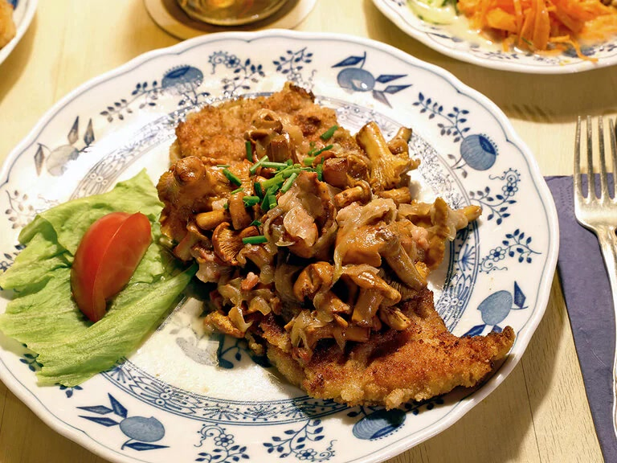

# Schnitzel mit Pfifferlingen

- **Rezept:** Schnitzel mit Pfifferlingen
- **Quelle:** [DasKochrezept.de](https://www.daskochrezept.de/rezepte/schnitzel-mit-pfifferlingen)
- **Bewertung:** —
- **Arbeitszeit:** 30 Min. · **Gesamtzeit:** 30 Min. · **Schwierigkeit:** Mittel
- **Für:** 4 Portionen · **Erstellt:** 19.11.2025
- **Allergene:** Gluten · Eier · Milch · Schweinefleisch
 #gut 

## Zutaten

**Für die Pfifferlinge:**
- 1 Schalotte
- 600 g Pfifferlinge (frisch)
- 2 EL Butterschmalz
- Salz und Pfeffer
- ½ Bd. Schnittlauch

**Für die Schnitzel:**
- 5 EL Mehl
- 150 g Semmelbrösel
- 2 Eier (Größe M)
- 4 Schnitzel (à 140 g)
- Salz und Pfeffer
- 10 EL Butterschmalz

## Zubereitung

1. **Pfifferlinge:** Schalotte abziehen, fein würfeln. Pilze putzen, ggf. halbieren. Fett erhitzen, Pilze ca. 3 Minuten darin braten, bis die Flüssigkeit verdampft ist. Schalotte zugeben, ca. 2 Minuten braten. Salzen, pfeffern.
2. **Schnitzel paniert:** Schnitzel salzen und pfeffern, in Mehl wenden, in verquirlte Eier tauchen und in Semmelbrösel panieren.
3. **Braten:** In heißem Butterschmalz die Schnitzel von beiden Seiten knusprig braten. Auf Küchenpapier abtropfen lassen.
4. **Servieren:** Schnitzel auf Teller legen, Pfifferlinge dazu geben und mit feingehacktem Schnittlauch bestreuen. Heiß servieren.

## Kommentare

(noch keine)

## Eigene Bemerkungen

(noch keine)

---

*Ein absolutes Lieblingsessen: saftige Schnitzel mit knuspriger Panade und dazu herrliche Pfifferlinge!*
