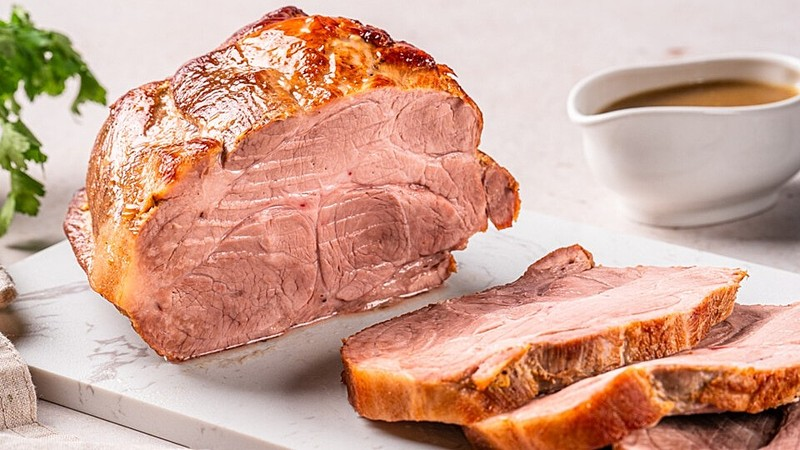

# Schweinebraten, klassisch – einfach und schnell

- **Rezept:** Schweinebraten, klassisch – einfach und schnell
- **Quelle:** [Chefkoch](https://www.chefkoch.de)
- **Bewertung:** —
- **Arbeitszeit:** 15 Min. · **Gesamtzeit:** 1 Std. · 45 Min. · **Schwierigkeit:** Leicht
- **Für:** 3 Portionen · **Erstellt:** 23.08.2010
- **Allergene:** —
#gut 

## Zutaten

- 1 kg Schweinebraten
- Olivenöl
- 3 Zwiebel
- 0.75 EL Senf
- Salz und Pfeffer
- 2 n. B. Knoblauchzehe
- 250 ml Wasser
- etwas Speisestärke

## Zubereitung

1. Den Schweinebraten im Bräter in Olivenöl von allen Seiten scharf anbraten. Dann das Fleisch herausnehmen und die Zwiebeln im Öl anrösten. In der Zeit den Schweinebraten mit Senf einstreichen, salzen und pfeffern.
2. Wenn die Zwiebeln goldgelb sind, das Fleisch zurück in den Bräter legen und die Zwiebeln darauflegen. Nach Belieben Knoblauchzehen halbieren und dazugeben. Das Wasser angießen, den Bräter schließen und für 60–75 Minuten bei 170 °C Umluft in den Backofen stellen.
3. Wenn das Fleisch weich ist, herausnehmen und die Sauce in einen Topf geben. Es wird nicht sehr viel Sauce sein, aber dafür ist sie kräftig. Aufkochen lassen, evtl. den Knoblauch herausfischen und die Sauce pürieren. Nach Belieben etwas binden. Hierzu einen Teelöffel Speisestärke in wenig Wasser glatt rühren und in die Sauce einrühren.

## Kommentare

(noch keine)

## Eigene Bemerkungen
(noch keine)

---

*Nährwerte (pro Portion): 758 kcal · 59.8 g · 55.4 g · 5.7 g.*
