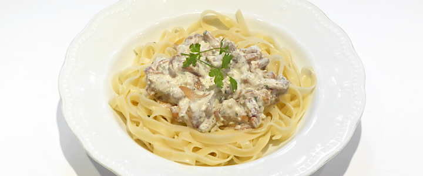

# Tagliatelle ai Cantarelli (Bandnudeln mit Pfifferlingen)

- **Rezept:** Tagliatelle ai Cantarelli
- **Quelle:** [A-I-K.de](https://authentisch-italienisch-kochen.de/tagliatelle-ai-cantarelli/)
- **Bewertung:** —
- **Arbeitszeit:** 20 Min. · **Gesamtzeit:** 20 Min. · **Schwierigkeit:** Leicht
- **Für:** 4 Portionen · **Erstellt:** 19.11.2025 · **Original:** 2 Portionen
- **Allergene:** Gluten · Eier · Milch
 #gut 

## Zutaten

**Original für 2 Portionen, hier für 4 verdoppelt:**

- 340 g Tagliatelle (à 170 g)
- 400 g Pfifferlinge (à 200 g)
- 2 EL Olivenöl extra vergine
- 2 Knoblauchzehen (à 1 Zehe)
- 250 g Ricotta (Kuh) (à 125 g)
- 2 EL Petersilie
- Salz
- Pfeffer

## Zubereitung

1. **Pfifferlinge vorbereiten:** Pfifferlinge waschen, putzen und klein schneiden.
2. **Pilze anbraten:** In einer Pfanne Olivenöl erhitzen und die Knoblauchzehe anbraten, dann herausnehmen und wegschmeißen.
3. **Pilze braten:** Die Pfifferlinge in die Pfanne geben, salzen und pfeffern und braten.
4. **Sauce:** Parallel die Nudeln aufsetzen und al dente kochen. Wenn das Wasser der Pilze verkocht ist und diese angebraten sind, den Ricotta in die Pfanne geben und mit 4–5 EL des Nudelkochwassers glatt streichen. Rühren, bis auch der Ricotta erwärmt ist.
5. **Servieren:** Gehackte Petersilie unterziehen und die Sauce über die gekochten Tagliatelle geben.

## Kommentare

(noch keine)

## Eigene Bemerkungen

(noch keine)

---

*Bandnudeln mit einer leicht cremigen Pilzsauce aus Ricotta und Nudelkochwasser — einfach, schnell und italienisch authentisch.*
