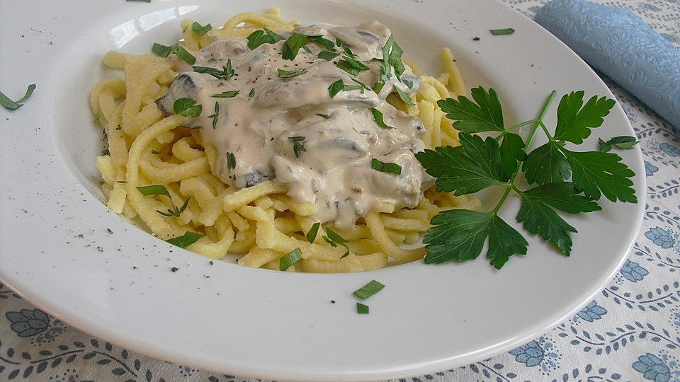

# Tagliatelle mit Sahne-Pilzsauce

- **Rezept:** Tagliatelle mit Sahne-Pilzsauce
- **Quelle:** [Chefkoch](https://www.chefkoch.de/rezepte/451841137638782/Tagliatelle-mit-Sahne-Pilzsauce.html)
- **Bewertung:** —
- **Arbeitszeit:** 30 Min. · **Gesamtzeit:** 50 Min. · **Schwierigkeit:** Mittel
- **Für:** 3 Portionen · **Erstellt:** 19.11.2025
- **Allergene:** Gluten · Milch · Eier
 #gut 

## Zutaten

- 200 g Tagliatelle (grün)
- 200 g Tagliatelle (weiß)
- 100 g Rohschinken (mild, z. B. Parmaschinken)
- 300 g Pilze (Champignons, Austernpilze, Pfifferlinge), frisch
- 0.5 Zitrone
- 0.5 Bund Petersilie (glatt)
- 0.5 Bund Basilikum
- 200 g Sahne
- 150 ml Fleischbrühe (mild)
- 1 Zehe Knoblauch
- 1.5 EL Butter
- Salz und Pfeffer

## Zubereitung

1. **Vorbereiten:** Nudeln kochen. Den rohen Schinken in schmale Streifen schneiden. Pilze putzen, in dünne Scheiben schneiden und mit 1 EL Zitronensaft beträufeln.
2. **Sauce:** In einem breiten Topf 0,5 EL Butter zerlassen. Die Knoblauchzehe hineinpressen und sanft andünsten. 200 g Sahne und 150 ml Fleischbrühe angießen, bei stärkerer Hitze cremig einköcheln. Mit Salz, Pfeffer und Zitronensaft abschmecken. Über die gekochten Nudeln gießen.
3. **Pilze:** In einer Pfanne 1 EL Butter zerlassen. Pilze portionsweise einrühren und anbraten. Petersilie fein hacken, mit den Schinkenstreifen unter die Pilze mischen und bei milder Hitze kurz anbraten.
4. **Servieren:** Die Sahnesauce über die Nudeln gießen und mit der Pilz-Schinken-Mischung bedecken. Mit Basilikumblättchen bestreuen.

## Kommentare

(noch keine)

## Eigene Bemerkungen

(noch keine)

---

*Der Name „Heu und Stroh" kommt von den weißen und grünen Bandnudeln, die das Gericht hübsch aussehen lassen.*

