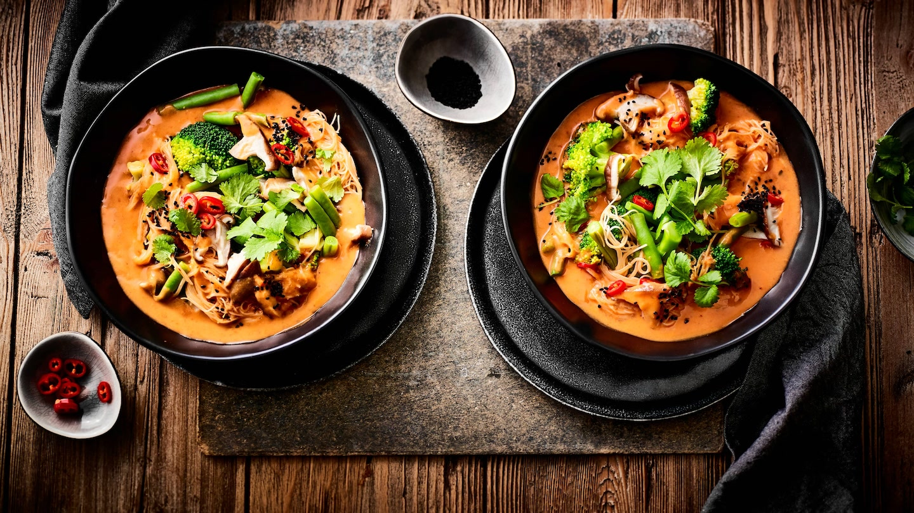

# Thai-Curry mit Nudeln

- **Rezept:** Thai-Curry mit Nudeln
- **Quelle:** [EDEKA](https://www.edeka.de/rezeptwelt/rezepte/thai-curry-mit-nudeln/)
- **Bewertung:** —
- **Arbeitszeit:** 25 Min. · **Gesamtzeit:** 40 Min. · **Schwierigkeit:** Mittel
- **Für:** 4 Portionen · **Erstellt:** 19.11.2025 · **Original:** 4 Portionen
- **Allergene:** Soja · Gluten
 #gut 

## Zutaten

- 200 g Shiitake-Pilze
- 200 g Bohnen, grün
- 250 g Brokkoli
- Salz
- 20 g Ingwer
- 2 TL Currypaste, rot
- 400 ml Kokosmilch
- 600 ml Gemüsebrühe
- 200 g Reisnudeln
- 1 Limette
- 1,5 TL Palmzucker
- 3,5 EL Sojasauce, hell
- 2 Thai-Chilischoten, rot
- 4 TL Koriandergrün
- Schwarzkümmel

## Zubereitung

1. **Gemüse garen:** Die Pilze putzen und in dünne Scheiben schneiden. Die Bohnen waschen, putzen und in kleine Stücke schneiden. Die Bohnen in kochendem Salzwasser ca. 8 Minuten blanchieren. Nach ca. 5 Minuten den Brokkoli dazu geben und zusammen fertig garen. Abgießen, eiskalt abschrecken und abtropfen lassen.
2. **Curry braten:** Den Ingwer schälen und fein hacken. Die Currypaste, die Kokosmilch, die Gemüsebrühe und den Ingwer in einen Topf geben und zum Kochen bringen. 5–10 Minuten leise köcheln lassen.
3. **Nudeln & würzen:** Die Nudeln nach Packungsanweisung garen und nach Belieben mit einer Schere in kürzere Stücke schneiden. Die Nudeln zum Curry geben und mit Limettensaft, Zucker und Sojasauce würzen sowie abschmecken. Nochmals aufkochen lassen.
4. **Servieren:** Die Chilis waschen, putzen und in feine Ringe schneiden. Das Koriandergrün abbrausen und trocken schütteln. Den Brokkoli, die Bohnen und Pilze in vier Schalen verteilen. Das heiße Curry darüber geben. Mit Koriandergrün, Chiliringen und Schwarzkümmel bestreut servieren.

## Kommentare

(noch keine)

## Eigene Bemerkungen

(noch keine)

---

*Eine thailändische Curry-Suppe mit Reisnudeln, Brokkoli, Bohnen und Shiitake in Kokosmilch-Ingwer-Koriander-Soße — perfekt für ein leichtes, würziges Essen.*
