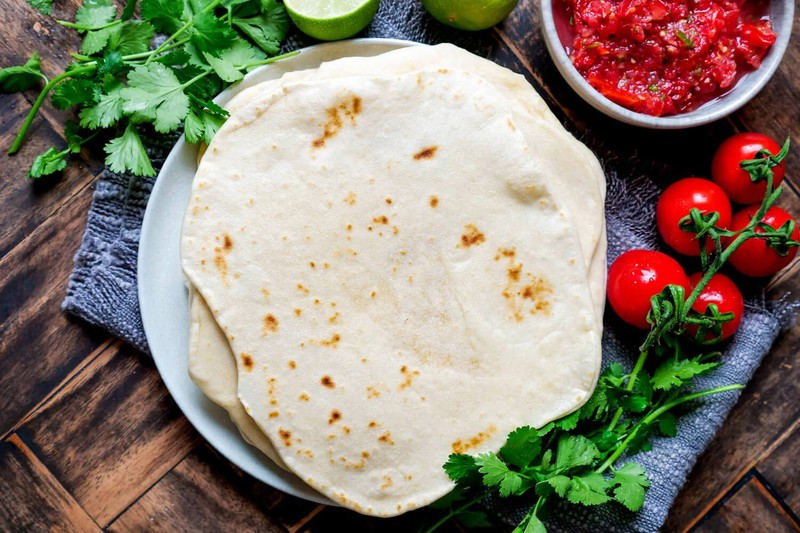

# Tortilla-Wraps selber machen

- **Rezept:** Tortilla-Wraps selber machen
- **Autor:** Steffi (Gaumenfreundin)
- **Quelle:** [Gaumenfreundin](https://www.gaumenfreundin.de/tortilla-wraps-selber-machen/)
- **Bewertung:** —
- **Arbeitszeit:** 5 Min. · **Gesamtzeit:** 25 Min. · **Schwierigkeit:** Leicht
- **Für:** 8 Portionen · **Erstellt:** 09.07.2022
- **Allergene:** —

## Zutaten

- 375 g Mehl Weizenmehl Type 405
- 1 TL Backpulver
- 1 TL Salz
- 50 ml Olivenöl
- 240 ml warmes Wasser

## Zubereitung

1. Mehl, Salz und Backpulver in eine Schüssel geben und mischen.
2. Eine Kuhle in der Mitte bilden und Olivenöl und Wasser zugeben. Dann mit einer Gabel verrühren, bis der Teig zusammen klumpt.
3. Den Teig auf eine bemehlte Arbeitsfläche geben und mit den Händen verkneten bis er glatt und elastisch ist. Mit einem Küchentuch abdecken und 15 Minuten ruhen lassen.
4. Aus dem Teig 8 Kugeln formen (bei mir waren es 78 g pro Kugel) und mit den Händen plattdrücken. Die plattgedrückten Teiglinge mit einem Nudelholz möglichst dünn ausrollen. Die Teiglinge mit einem Küchentuch abdecken, damit sie nicht austrocknen.
5. Eine Pfanne bei mittlerer Hitze erwärmen und die Wraps nacheinander für ca. 45 - 60 Sekunden pro Seite ausbacken. Die Tortillas sollten noch weich sein, aber ein paar braune Flecken bekommen.
6. Herausnehmen und in ein feuchtes Küchentuch wickeln oder in einen luftdichten Behälter geben. So bleiben sie schön weich.

## Kommentare

(noch keine)

## Eigene Bemerkungen
(noch keine)

---

*Nährwerte (pro Portion): 221 kcal · 5 g · 6 g · 36 g.*
