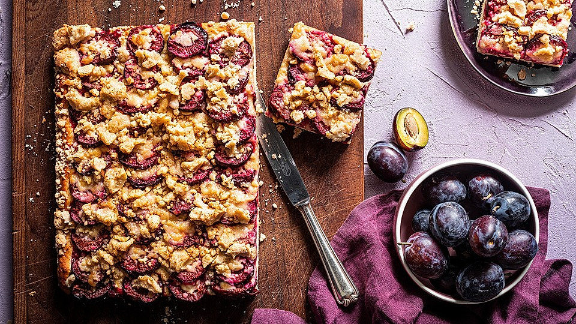

# Zwetschgendatschi mit Butterstreuseln

- **Rezept:** Zwetschgendatschi mit Butterstreuseln
- **Quelle:** [Chefkoch](https://www.chefkoch.de/rezepte/1476331252838756/Zwetschgendatschi-mit-Butterstreuseln.html)
- **Bewertung:** 4.85 (929 Bewertungen)
- **Arbeitszeit:** 30 Min. · **Gesamtzeit:** 65 Min. · **Schwierigkeit:** Mittel
- **Für:** ca. 20 Stücke · **Erstellt:** 13.09.2009 · **Original:** 1 Portion
- **Allergene:** Gluten · Milch · Eier
 #gut 

## Zutaten

**Hefeteig:**

- 350 g Weizenmehl Type 550
- 60 g Zucker
- 30 g Frischhefe
- 180 ml Milch, lauwarme (knapp)
- 1 Msp. Vanillemark (getrocknet, oder Vanillezucker)
- 1 Ei, Größe M
- 1 Prise Salz
- 60 g Butter, flüssige
- etwas Zitronenabrieb (oder Finesse)
- Fett für das Blech

**Belag:**

- 1500 g Zwetschge(n), entsteint
- 0,5 TL Zimt (zum Bestäuben)

**Butterstreuseln:**

- 300 g Mehl
- 200 g Butter, kalte (in Stücken)
- 280 g Zucker
- 1 EL Vanillezucker
- 1 TL Zimt

## Zubereitung

1. **Vorteig:** Aus 3 EL Mehl, 1 TL Zucker, Hefe und der Hälfte der lauwarmen Milch in einer kleinen Schüssel einen Vorteig herstellen und zugedeckt an einem warmen Ort ca. 30 Minuten gehen lassen.
2. **Zwetschgen vorbereiten:** In der Zwischenzeit die Zwetschgen waschen, abtropfen lassen und von den Stielen befreien. Mit einem Obstentsteiner in Viertelspalten teilen bzw. mit einem Messer halbieren, den Stein entfernen und beiseitestellen.
3. **Teig kneten:** Wenn der Vorteig Bläschen wirft, die restlichen Zutaten für den Hefeteig in eine Rührschüssel geben und den Vorteig dazugeben. Den Teig mit dem Knethaken so lange aufschlagen, bis er leichte Blasen wirft. Ebenfalls an einem warmen Ort zugedeckt so lange gehen lassen, bis sich das Volumen verdoppelt hat. Das dauert je nach Raumtemperatur ca. 60 Minuten.
4. **Ofen vorheizen:** Den Backofen auf 190 °C Ober-/Unterhitze vorheizen.
5. **Streuseln:** Für die Streusel Mehl mit den kalten Butterstücken, dem Zucker, Vanillezucker und Zimt rasch verkneten und zu Streuseln zerbröseln.
6. **Anrichten:** Das Blech einfetten und den Hefeteig darauf ausrollen. Die Zwetschgen fächerförmig darauf verteilen, mit etwas Zimt bestäuben und die Streusel gleichmäßig darauf verteilen.
7. **Backen:** Den Zwetschgendatschi im heißen Backofen ca. 35–40 Min. backen.

## Kommentare

(noch keine)

## Eigene Bemerkungen

Streusel: Nur **120-130g** Zucker

---

*Klassischer Zwetschgendatschi auf Hefeteig mit saftigen Zwetschgen und einer knusprigen Butterstreusel — ein herbstlicher Backklassiker.*
